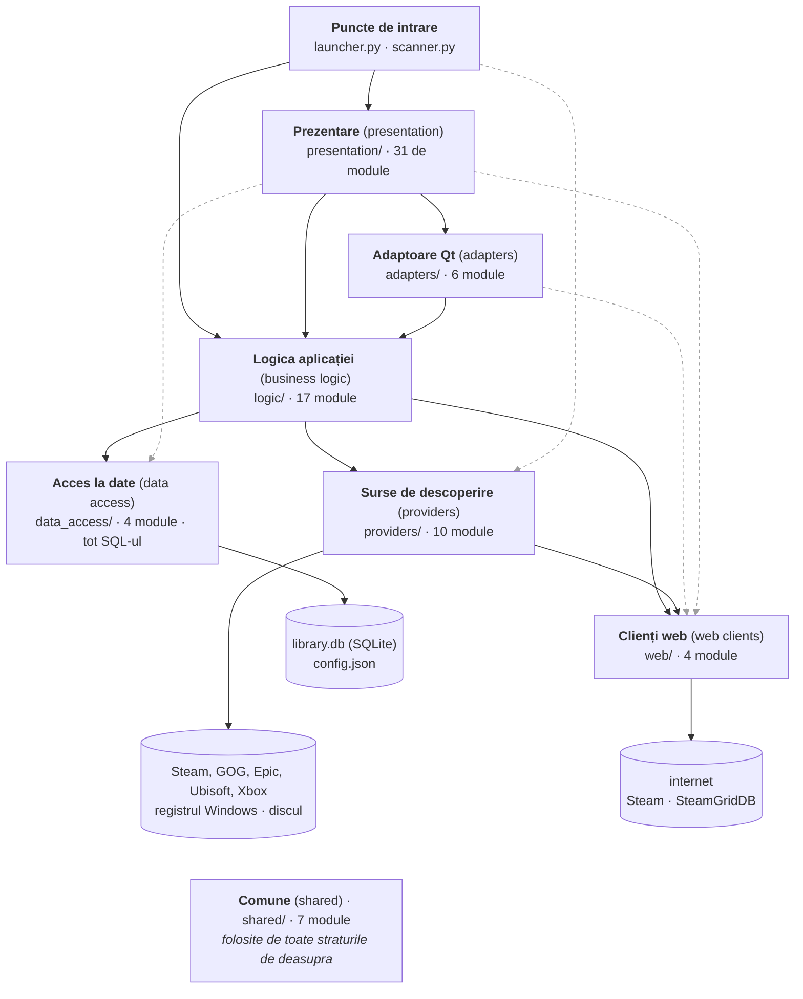

# Arhitectura lansatorului de jocuri

**Stare:** Faza 71 — **încheiat.** Restructurarea pe straturi (pașii 1–9, fazele 39–47), datele
tale în folderul lor `data/` (faza 48), aspectul „Nocturne" și bara laterală (fazele 54–62) și
**baza de date** (fazele 63–71: biblioteca în `data/library.db`, descrisă în
[`docs/BAZA_DE_DATE.md`](BAZA_DE_DATE.md)). Pe drum: fazele 49–53 au reparat controlerul în meniuri
și în Settings, au desenat butoanele reale ale padului și au făcut ca timpul total al unui joc să
se potrivească cu sesiunile lui; faza 51 a făcut din această copie lansatorul tău de zi cu zi.
Fiecare strat stă în folderul lui, niciun import nu arată spre un strat de deasupra și niciun
SQL nu stă în afara lui `data_access/`. Sunt 1.428 de verificări în 35 de suite, plus șase plase
de siguranță; în ultima rulare completă au trecut toate.

## Cuprins

1. [Pe scurt](#1-pe-scurt)
2. [Straturile](#2-straturile)
3. [Diagrama dependențelor](#3-diagrama-dependențelor)
4. [Harta modulelor](#4-harta-modulelor)
5. [Două drumuri prin cod](#5-două-drumuri-prin-cod)
6. [Ce s-a măsurat înainte de orice mutare](#6-ce-s-a-măsurat-înainte-de-orice-mutare)
7. [Planul: arborele propus](#7-planul-arborele-propus)
8. [Ce se strică atunci când fișierele se mută](#8-ce-se-strică-atunci-când-fișierele-se-mută)
9. [Pașii](#9-pașii)
10. [Granița datelor și viitoarea bază de date](#10-granița-datelor-și-viitoarea-bază-de-date)
11. [Decizii care îți aparțin](#11-decizii-care-îți-aparțin)
12. [Observate, dar nereparate](#12-observate-dar-nereparate)
13. [Verificarea finală, făcută de tine](#13-verificarea-finală-făcută-de-tine)
14. [Glosar](#14-glosar)

---

## 1. Pe scurt

Programul este un lansator de jocuri pentru Windows. Găsește jocurile de pe disc și pe cele
instalate de alte lansatoare (Steam, GOG, Epic, Ubisoft, Xbox), le arată într-o singură fereastră
și le pornește. Este scris în Python, iar interfața folosește biblioteca PySide6 (Qt).

Codul este organizat ca o **arhitectură stratificată (layered architecture)**: fiecare strat
(layer) are o singură responsabilitate și folosește doar straturile de sub el. Principiul din spate
se numește **separarea responsabilităților (separation of concerns)**: codul care desenează
ecranul nu știe cum se citește registrul Windows, iar codul care găsește jocurile nu știe că
există o fereastră.

Drumul datelor, într-o propoziție: **sursele (providers) găsesc jocurile → descoperirea
(discovery) le unește într-un singur catalog → interfața citește doar catalogul.** Modificările
făcute de utilizator (nume, coperți, timp jucat, notițe) sunt ținute separat, iar scanarea nu le
scrie niciodată. Fiecare parte are o singură direcție de scriere, iar la citire modificările
utilizatorului câștigă. Până în Faza 69 erau două fișiere, `catalog.json` și `overrides.json`;
acum sunt tabele ale aceleiași baze de date SQLite (`data/library.db`, `docs/BAZA_DE_DATE.md`),
cu aceeași regulă: scanarea rescrie `install` și `scan`, niciodată coloanele utilizatorului.

Structura aceasta există deja în cod, dar nu se vede: rădăcina proiectului are **103 intrări**,
dintre care **81 de fișiere Python într-o singură listă**. Planul de mai jos o face vizibilă:
un folder pentru fiecare strat, iar rădăcina coboară la 31 de intrări (la 21 dacă iei ambele
decizii din secțiunea 11).

În cifre, la pasul 0: 75 de module ale aplicației, aproximativ 21.400 de rânduri, plus 16 suite
de teste cu 850 de verificări. La faza 71: 81 de module (plus `schema.sql`), aproximativ 25.600 de
rânduri, plus 35 de suite cu 1.428 de verificări.

---

## 2. Straturile

Ordinea este de sus în jos. Un strat poate folosi straturile de sub el, niciodată pe cele de
deasupra. Unele module sar peste un strat (de exemplu interfața citește direct fișierele prin
stratul de acces la date, fără să treacă prin logică). Asta se numește **stratificare relaxată
(relaxed layering)**, este permisă și este marcată în diagramă. Ce nu este permis este o
dependență în sus. În pasul 0 existau trei, toate spre același fișier; pasul 8b le-a eliminat
(secțiunea 12, punctul 1).

Două precizări despre formă. Adaptoarele nu sunt o barieră prin care trebuie să treacă totul:
prezentarea le folosește doar pentru ce rulează în fundal, iar restul îl cere direct logicii. Iar
sub logică stau, unul lângă altul, trei straturi care ascund lumea din afara programului: sursele
de descoperire (alte programe de pe disc), clienții web (internetul) și accesul la date
(fișierele proprii).

| Strat | Folder | Module | Rânduri | Răspunde de |
|---|---|---|---|---|
| Puncte de intrare (entry points) | rădăcina | 2 | 383 | pornirea programului: fereastra sau linia de comandă |
| Prezentare (presentation layer) | `presentation/` | 31 | 13.699 | tot ce se vede și tot ce primește clicuri sau taste |
| Adaptoare Qt (adapters) | `adapters/` | 6 | 1.063 | lucru în fundal, controlerul, folderele urmărite, iconițe → semnale Qt |
| Logica aplicației (business logic) | `logic/` | 17 | 3.966 | regulile programului, fără Qt |
| Surse de descoperire (providers) | `providers/` | 10 | 1.722 | citirea jocurilor din Steam, GOG, Epic, Ubisoft, Xbox și de pe disc |
| Clienți web (web clients) | `web/` | 4 | 1.252 | singurele cereri pe internet |
| Acces la date (data access layer) | `data_access/` | 4 (+ `schema.sql`) | 1.858 | datele proprii ale aplicației: baza de date SQLite și `config.json` |
| Comune (shared) | `shared/` | 7 | 1.668 | forma datelor, reglajele, căile, unelte de bază |

Termenii standard ai modelului în trei niveluri (three-tier architecture), adică prezentare,
logică și acces la date, se potrivesc pentru trei dintre straturi. Pentru celelalte, numele vine
din tipare de proiectare (design patterns) cunoscute, Adapter și Gateway, iar mai jos este spus
explicit unde termenul standard nu se potrivește.

### 2.1 Puncte de intrare — rămân în rădăcină

`launcher.py` pornește interfața grafică. `scanner.py` rulează aceeași descoperire din linia de
comandă (command line interface, CLI) și scrie rezultatul ca JSON sau ca tabel. Sunt singurele
fișiere pe care le pornește un om, de aceea rămân la vedere. Faptul că același back end are două
fețe, o fereastră și o comandă, este dovada practică a separării: descoperirea nu depinde de
interfață.

### 2.2 Prezentarea — `presentation/`

Tot ce se vede și tot ce primește intrarea utilizatorului: fereastra, paginile (Bibliotecă,
pagina unui joc, Statistici, Stocare), dialogurile, meniurile, animațiile, culorile. Granița: un
modul de aici poate desena și poate reacționa la un clic, dar nu decide nimic despre jocuri. Când
trebuie decis ceva (pornește jocul, cât s-a jucat), întreabă logica. Tot aici stă al doilea
fișier de reglaje, `ui_rules.py`, cu tot ce ține de aspect.

O abatere cunoscută: `ui_window.py` face și o parte din logica aplicației. Adună timpul jucat,
scrie sesiunile și salvează catalogul după o scanare. Nu se mută acum, pentru că regula acestei
faze este că fișierele mari nu se despart. Este în lista pentru mai târziu.

### 2.3 Adaptoarele Qt — `adapters/`

Șase module care nu desenează nimic, dar vorbesc limba lui Qt. Fiecare transformă ceva din afara
buclei de evenimente (event loop) a ferestrei în semnale (signals) Qt:

- un fir de execuție (thread) care scanează devine semnalul „am terminat";
- controlerul, citit prin biblioteca SDL, devine „sus", „jos", „A";
- un folder nou pe disc devine „scanează acum";
- un fișier exe devine o iconiță.

Numele vine de la tiparul **Adapter**, care convertește interfața unui lucru în interfața pe care
o așteaptă altul. Granița: un modul care folosește Qt dar nu este un element vizual (widget) stă
aici, iar unul care nu folosește Qt deloc stă în logică. Nu este un strat din modelul clasic în
trei niveluri. Există pentru că o aplicație cu interfață grafică trebuie să lucreze în fundal fără
să înghețe fereastra.

### 2.4 Logica aplicației — `logic/`

Regulile programului, fără Qt și fără ferestre:

- cum pornești un joc și cum îi măsori timpul;
- ce înseamnă o sesiune și ce cifre arată statisticile;
- unde își ține un joc salvările și cum se dezinstalează în siguranță;
- ce înseamnă „o versiune nouă a unui joc pe care l-ai avut".

Tot aici stă descoperirea propriu-zisă (`discovery.py`), care rulează sursele și le unește.
Granița: nimic de aici nu importă Qt. De aceea codul acesta se poate rula fără fereastră, iar
`scanner.py` chiar o face.

Trei module de aici vorbesc direct cu Windows: `focus`, `taskbar`, `uninstall`. Un folder separat
`windows/` a fost luat în calcul și respins. Ar fi adăugat un folder pentru trei module, iar
`launch`, `removal` și `saves` folosesc și ele Windows, deci granița nu ar fi fost curată.

### 2.5 Sursele de descoperire — `providers/`

Câte un modul pentru fiecare loc unde pot fi jocuri: Steam, GOG, Epic, Ubisoft, Xbox și folderele
de pe disc. Alături stau regulile care aleg exe-ul unui joc (`detect.py`). Fiecare sursă respectă
același contract (`provider.py`): un nume, `is_available()` și `discover()`, care întoarce o
listă de `GameEntry`. O sursă nu aruncă niciodată o eroare: dacă lansatorul ei lipsește, întoarce
o listă goală.

Termenul standard cel mai apropiat este **Gateway** (Martin Fowler, *Patterns of Enterprise
Application Architecture*): un obiect care ascunde accesul la un sistem extern. În modelul în trei
niveluri ar intra la „acces la date". Aici însă sunt datele altor programe, doar citite, și
conțin reguli de interpretare (care exe este jocul), așa că au stratul lor. Granița față de
logică: o sursă știe să citească un singur loc, iar doar `discovery` știe să le combine.

### 2.6 Clienții web — `web/`

Cele patru module care vorbesc cu internetul: magazinul Steam (`store.steampowered.com`),
căutarea Steam, știrile Steam (`api.steampowered.com`) și SteamGridDB. Toate fac cereri anonime de
citire (GET), iar rezultatul se păstrează pe disc (cache). Până la pasul 2 au stat în
`providers/`, dar sunt alt fel de lucru: nu găsesc jocuri instalate, ci aduc informații despre
ele. Și ele sunt Gateway-uri, de data aceasta către servicii de pe internet. Granița: orice cerere
de rețea pleacă dintr-un modul din `web/` și de nicăieri altundeva. Am verificat după mutare:
niciun alt modul nu folosește o bibliotecă de rețea. `epic.py` folosește `urllib` doar ca să
codifice o adresă de pornire.

### 2.7 Accesul la date — `data_access/`

Citirea și scrierea datelor proprii ale aplicației. **Din Faza 69, biblioteca stă într-o bază de
date SQLite, `data/library.db`** (`library_db.py`, schema în `schema.sql`; totul în
`docs/BAZA_DE_DATE.md`): modificările utilizatorului, ce a găsit ultima scanare și proiecția
înregistrărilor Steam. `config.json` rămâne fișier (`config_io.py`, de la pasul 8a). Tot aici stau
copiile de siguranță (backups), care copiază și baza, și scrierea atomică (atomic write) a
fișierelor. Granița: este singurul strat care știe cum sunt ținute datele. Toate instrucțiunile
SQL ale programului sunt aici, iar `check_layers` refuză `sqlite3` în afara lui. Restul programului
vede aceeași fațadă de dicționare (`get`, `update`, ...) ca pe vremea JSON-ului; de aceea mutarea
în bază (Fazele 64–69) a schimbat interiorul acestui folder, nu codul care îl folosește.

Codul stă în `data_access/`, iar datele în `data/` (de la pasul 10): `config.json`,
`library.db`, jurnalul, `cache/`, `backups/`, `save_backups/` și `migrated/` (unde migrarea a pus
`overrides.json` și `catalog.json`, mutate, nu șterse). Unde e acest folder decide un singur loc,
`paths.data_dir()`. Rulat din sursă, este `<proiect>\data`; instalat ca exe, este folderul
exe-ului.

### 2.8 Comune — `shared/`

Lucrurile de bază pe care le folosesc toate straturile:

- forma datelor (`GameEntry`);
- primul fișier de reglaje (`rules.py`);
- unde stau fișierele (`paths.py`);
- curățarea numelor și parcurgerea sigură a folderelor;
- formatarea cifrelor pentru oameni și accesul la registrul Windows.

Granița: un modul de aici nu importă nimic din straturile de deasupra. Nu este un strat de logică
în sine, ci cutia de unelte comună. În literatura de specialitate se găsesc termenii *shared
kernel* și *cross-cutting utilities*.

### 2.9 În afara aplicației — `tests/`, `packaging/`, `docs/`

- `tests/`: cele 35 de suite (fazele 22–37, 49–60, 62 și 64–70), cutia de nisip (sandbox) care le
  ține departe de datele reale și plasele de siguranță: cele șase din `run_all` (importuri,
  straturi, căi, scaner, migrare, folderul original) și diferența unei mutări.
- `packaging/`: construirea installerului (`GameLauncher-Setup.exe`) și, din Faza 78,
  `sandbox/make_sandbox.py`, care scrie fișierul pentru testul în Windows Sandbox.
- `compare_exports.py` (Faza 81): al treilea punct de intrare, al meu, nu al prietenilor: compară exporturile anonime din `data\exports\` și scrie raportul.
- `docs/`: acest document, baza de date (`BAZA_DE_DATE.md`), distribuția (`DISTRIBUTIE.md`, Faza
  78), nota pentru prieteni (`CITESTE-MA.md`) și notele despre portarea pe Linux.

---

## 3. Diagrama dependențelor

O săgeată de la A la B înseamnă „A folosește B". Săgețile pline sunt dependențe în jos, adică
normale. Cele punctate gri sar peste un strat, ceea ce este permis. Nu mai există nicio
săgeată în sus: cele trei din pasul 0 (spre `ui_rules`) au dispărut la pasul 8b. Stratul `shared/` este folosit de toate celelalte și
nu are săgeți desenate, ca diagrama să rămână lizibilă.



Săgețile care nu sunt evidente din desen:

- **gri, prezentare → clienți web**: `ui_cover_actions` (căutarea copertei) și `ui_settings`
  (testul cheii SteamGridDB);
- **gri, prezentare → acces la date**: `ui_window` (încarcă și salvează), `ui_backups`
  (restaurarea), `ui_earlier` (copia de siguranță dinaintea preluării istoricului);
- **gri, adaptoare → clienți web**: `screenshot_worker` descarcă imaginile;
- **gri, puncte de intrare → surse**: `scanner.py` citește diagnosticul sursei de foldere;
- **plin, surse → clienți web**: sursa Steam cere tipul aplicației și imaginile de la
  `steam_web` în timpul scanării.

Pe lângă cele trei săgeți roșii, mai există un ciclu (cycle) în interiorul prezentării:
`ui_window` → `ui_actions` → `ui_earlier` → `ui_window`. Este rupt printr-un import făcut în
interiorul unei funcții (secțiunea 12, punctul 5).

Toate cifrele de mai sus sunt măsurate, nu estimate. Graful real al importurilor (430 de rânduri
de import) a fost verificat de un program contra acestei împărțiri în straturi. Rezultatul: zero
module neîncadrate și exact trei dependențe în sus, toate spre `ui_rules`.

---

## 4. Harta modulelor

Un rând pe modul: ce face, de ce stă în stratul acela, ce module ale proiectului importă azi.
Numele modulelor nu se schimbă la mutare, doar folderul în care stau (motivul este în
secțiunea 7). Un import marcat cu *(f)* este făcut în interiorul unei funcții. **Regenerată la
pasul 9 din codul final, și din nou la fazele 71, 73 și 74:** numărul de rânduri și importurile sunt citite din fișiere, iar
importurile sunt grupate pe straturi, de sus în jos. Așa se vede direct că niciun modul nu
importă dintr-un strat de deasupra lui.

### 4.1 Puncte de intrare (rămân în rădăcină)

| Modul | Rânduri | Ce face | Importă, pe straturi |
|---|---|---|---|
| `launcher.py` | 186 | Pornește fereastra: argumentele `--tv`, `-v`, `--make-shortcuts`, `--uninstall`, jurnalul (log) în `launcher.log` (din Faza 77 începe cu versiunea), identitatea în bara de activități, apoi `MainWindow` | presentation: ui_window · logic: taskbar, uninstall *(f)* · shared: paths, rules, version |
| `scanner.py` | 202 | Descoperirea din linia de comandă (Faza 1): JSON, `--summary` ca tabel, `--out` într-un fișier | logic: discovery · providers: folders · data_access: config_io · shared: paths, rules |

### 4.2 Prezentare → `presentation/`

De ce aici, pentru toate: desenează sau primesc intrarea utilizatorului (`ui_rules` este reglajul
aspectului, deci tot aici).

| Modul | Rânduri | Ce face | Importă, pe straturi |
|---|---|---|---|
| `ui_window.py` | 1789 | Fereastra: stiva de pagini, tranzițiile, scanarea, cronometrarea, controlerul, salvările după joc; din Faza 76 ține orele Steam pe conturile tale, citite o dată pentru toată biblioteca; din Faza 77 întreabă unde sunt jocurile la prima pornire și spune de ce e goală biblioteca | presentation: ui_actions, ui_backdrop, ui_backups, ui_continue, ui_covers, ui_detail, ui_earlier, ui_jump, ui_library, ui_motion, ui_pageshell, ui_rail, ui_removal, ui_rules, ui_screenshots, ui_settings, ui_stats, ui_storage, ui_theme, ui_toast, ui_topbar, ui_tv · adapters: controller, folder_watch, icons, save_worker, scan_worker · logic: focus, gamedetails, launch, lineage, migration, pick, prices, removal, save_backup, saves, sessions, stats, steam_projection, steam_time, storage, taskbar · data_access: backups, catalog_io, config_io · shared: naming, rules |
| `ui_library.py` | 1780 | Pagina Bibliotecă: cardul Continue playing, filtrele (chips, desenate în două culori de `Chip`), sortarea (`SortBox`), grila; din Faza 99 filtrul de gen (`GenrePill`) lângă sortare și rândul acestor controale, la care urcă și controlerul; `CoverDelegate` desenează fiecare dală (din Faza 76, sub un joc Steam, orele lui de pe Steam); cele două aranjări, cu bara de sus sau cu bara laterală (Faza 60) | presentation: ui_continue, ui_jump, ui_rail, ui_rules, ui_theme, ui_topbar · shared: humanize, rules |
| `ui_detail.py` | 1302 | Pagina unui joc: rândul Play, faptele, cardurile, navigarea între jocuri | presentation: ui_cards, ui_continue, ui_hero, ui_icons, ui_rules, ui_screenshots, ui_theme · adapters: screenshot_worker · logic: gamedetails, lineage, sessions · shared: humanize, paths, rules |
| `ui_storage.py` | 891 | Pagina Stocare: unități, bare clasate, jocuri vechi, harta (treemap) | presentation: ui_icons, ui_pageshell, ui_rules, ui_theme · logic: storage · shared: humanize, rules *(f)* |
| `ui_rules.py` | 995 | **Al doilea fișier de reglaje**: dimensiuni, culori, durate și curbe de animație, scara interfeței | — |
| `ui_stats.py` | 665 | Pagina Statistici: patru cifre, graficul pe luni, două liste, ce nu poate vedea | presentation: ui_cards, ui_icons, ui_pageshell, ui_rules, ui_theme · logic: stats · shared: humanize |
| `ui_settings.py` | 877 | Dialogul de setări, pe secțiuni, folosibil și cu controlerul; din Faza 75 și conturile Steam, fiecare cu marcajul în trei (al meu / nu / nehotărât); din Faza 77 folderele cu jocuri, „Save diagnostics...” și versiunea | presentation: ui_backups, ui_cards, ui_folders, ui_icons, ui_rules, ui_transfer · logic: diagnostics *(f)*, save_backup *(f)* · web: steamgriddb *(f)* · shared: humanize, rules, version |
| `ui_continue.py` | 485 | Cardul Continue playing: ce joc, imaginea, Play/Details, plierea la derulare | presentation: ui_covers, ui_icons, ui_rules, ui_theme · shared: humanize, rules |
| `ui_hero.py` | 445 | Partea de sus a paginii unui joc: imaginea pe toată lățimea, ciclul de imagini, coperta | presentation: ui_icons, ui_rules, ui_theme |
| `ui_actions.py` | 393 | Meniul de clic dreapta și acțiunile lui; `play()` -- din Faza 99 cu „Starting…” cât pornește jocul, iar un exe pornit pe un fir separat | presentation: ui_cover_actions, ui_earlier *(f)*, ui_purchases *(f)*, ui_removal, ui_rules, ui_save_restore *(f)* · logic: launch, lineage *(f)*, removal, save_backup *(f)* · shared: models, rules |
| `ui_analysis.py` *(Faza 80)* | 109 | Fereastra exportului anonim: ce conține fișierul, cu numerele bibliotecii, ce nu conține niciodată, comutatorul pentru ce s-a plătit | presentation: ui_cards, ui_rules, ui_settings |
| `ui_theme.py` | 459 | Culori, dimensiuni la scara curentă, foaia de stil (stylesheet); din Faza 99 schimbarea culorii de accent (`use_accent`) și pastilele desenate rotund (`paint_capsule`) | presentation: ui_icons, ui_rules |
| `ui_covers.py` | 298 | Produce coperțile și bannerele: decupare, așezare pe panou, înlocuitori | presentation: ui_rules, ui_theme · shared: rules |
| `ui_cards.py` | 432 | Piesele paginilor: carduri, bare de sesiuni, aranjament pe rânduri, comutatorul, inelul de focalizare pus peste o pagină | presentation: ui_icons, ui_rules, ui_theme |
| `ui_tv.py` | 286 | Bara de indicii a modului TV (câte un set pe pagină) și bateria controlerului | presentation: ui_buttons, ui_rules · shared: rules |
| `ui_motion.py` | 247 | Mișcarea: pagini care alunecă, coperta care zboară, desenate din imagini | presentation: ui_rules, ui_theme |
| `ui_backdrop.py` | 224 | Fundalul ferestrei: arta jocului curent, estompată | presentation: ui_rules, ui_theme |
| `ui_screenshots.py` | 207 | Banda de capturi de ecran și vizualizatorul mare | presentation: ui_cards, ui_rules |
| `ui_cover_actions.py` | 180 | Caută, setează sau șterge coperta ori bannerul; marchează ca unealtă sau joc; din Faza 105 scrie o copertă găsită de lot ca Find online (`fill_cover`), niciodată peste una aleasă de mână | presentation: ui_cover_dialog · web: steam_search, steam_web, steamgriddb · shared: models, paths, rules |
| `ui_fill_covers.py` *(Faza 105)* | 205 | Coperțile lipsă, dintr-o dată: dialogul deschis din Settings -- jocurile fără copertă după nume, „Look them up” și Cancel; ia întâi o copie de siguranță, pornește lotul pe un fir separat, marchează fiecare rând când vine răspunsul și spune la sfârșit ce a găsit și cum se anulează | adapters: cover_fill_worker · presentation: ui_cards, ui_rules · logic: fill_covers · shared: paths |
| `ui_earlier.py` | 160 | Lista instalărilor anterioare și preluarea istoricului lor | presentation: ui_window *(f)* · logic: lineage · data_access: backups · shared: humanize |
| `ui_removal.py` | 159 | Confirmarea dezinstalării, comună celor trei locuri de unde se poate cere | adapters: save_worker · logic: removal · shared: humanize, rules |
| `ui_save_restore.py` | 158 | Alegerea și restaurarea unei copii a salvărilor | logic: save_backup, saves · shared: humanize, rules |
| `ui_topbar.py` | 219 | Bara de sus: Library/For you/Stats/Storage/Reports/Wishlist, căutarea, trei butoane | presentation: ui_icons, ui_rules, ui_theme |
| `ui_toast.py` | 153 | Mesajele, ca un card în colțul din dreapta-jos | presentation: ui_icons, ui_rules |
| `ui_transfer.py` | 154 | Exportul și importul, din setări | logic: transfer · shared: humanize, rules |
| `ui_buttons.py` *(Faza 50)* | 241 | Butoanele controlerului, desenate pentru bara din modul TV: ale unui pad Xbox sau ale unui DualSense | presentation: ui_icons, ui_rules · shared: rules |
| `ui_recap.py` *(Faza 96)* | 590 | Cardul Recap: o lună sau un an desenat ca o singură imagine, aceiași pixeli la orice scară a ecranului; dialogul Share as image (perioada, Copy image, Save image...) | presentation: ui_covers, ui_icons, ui_rules, ui_theme · logic: recap, saves · data_access: catalog_io · web: steam_web · shared: paths, rules, version |
| `ui_foryou.py` *(Faza 98)* | 505 | Locul For you, sub Library: jocurile instalate și neîncepute, cele mai asemănătoare cu ce joci, fiecare cu motivul în cuvintele listei de dorințe; cele fără genuri numite deoparte, cele jucate în ultimele 7 zile numite și lăsate afară; apoi Tonight -- alegerea timpului și jocurile a căror sesiune obișnuită încape; inelul controlerului își păstrează locul | presentation: ui_cards, ui_icons, ui_library, ui_pageshell, ui_rules, ui_stats · logic: recommend · shared: rules |
| `ui_rail.py` *(Faza 60)* | 447 | Bara laterală: Library/For you/Stats/Storage/Reports/Wishlist, cele cinci filtre cu numărul lor, de unde vin jocurile, iar jos Play something, rescanarea și setările; nu ține nicio stare, doar oglindește filtrele paginii | presentation: ui_icons, ui_rules, ui_theme, ui_topbar |
| `ui_jump.py` *(Faza 60)* | 411 | „Jump back in”: ultimele trei jocuri jucate, ca trei carduri late deasupra grilei, lângă bara laterală; răspund paginii exact ca cardul Continue playing | presentation: ui_continue, ui_covers, ui_icons, ui_rules, ui_theme · shared: humanize |
| `ui_backups.py` | 142 | Lista copiilor de siguranță și restaurarea uneia | data_access: backups · shared: humanize |
| `ui_icons.py` | 216 | Iconițe desenate din fontul Phosphor (Faza 59; fontul Windows în spate); încarcă fonturile livrate (Inter și Phosphor) și alege fontul | presentation: ui_rules · shared: paths |
| `ui_pageshell.py` | 142 | Coloana (așezată ca în machetă) și antetul comune paginilor Stats și Storage | presentation: ui_rules |
| `ui_cover_dialog.py` | 98 | Fereastra de alegere a copertei din rezultatele căutării | shared: models |
| `ui_purchases.py` *(Faza 74)* | 189 | „What I paid...”: cumpărările unui joc, arătate, adăugate și scoase, cu mouse-ul sau cu controlerul | shared: humanize, rules |
| `ui_folders.py` *(Faza 77)* | 165 | Lista folderelor cu jocuri, aceeași în întrebarea de la prima pornire și în Settings: adaugă, scoate, bifează; avertismentul pentru o unitate întreagă | presentation: ui_rules · logic: first_run |
| `ui_first_run.py` *(Faza 77)* | 258 | Întrebările de la prima pornire: „Where do you keep your games?”, cu folderele găsite, Xbox și „I only use Steam, GOG, Epic or Xbox”; apoi „Want more cover art?”, o cheie SteamGridDB sau Skip (Faza 79) | presentation: ui_cards, ui_folders, ui_rules, ui_settings · shared: rules · web: steamgriddb *(f)* |
| `ui_offer.py` *(Faza 99)* | 81 | Singura întrebare: să rămână launcher-ul lângă ceas când închizi fereastra? Pusă o dată, la o secundă după ce apare fereastra, numai cu comutatorul oprit și niciodată la pornirea cu întrebările primei rulări; „Not now” e alegerea implicită | presentation: ui_cards, ui_rules |
| `ui_alert.py` *(Faza 101)* | 83 | „Alert me under...”: ținta de preț a unui joc dorit, în moneda prețului lui, pornind de la cel mai mic preț văzut; lucrată și cu controlerul | presentation: ui_rules · shared: humanize, rules |
| `ui_rate.py` *(Faza 102)* | 209 | „How was it?”: cardul de după o sesiune -- jocul, cât a durat, cinci stele și Skip --, în colțul în care plutesc mesajele, dar primind clicuri; lucrat și cu controlerul | presentation: ui_icons, ui_rules |
| `ui_splash.py` *(Faza 99)* | 211 | „Starting…”: de la Play până apare jocul, peste toată fereastra -- arta jocului, coperta, numele, trei puncte și „Press Esc to go back”; o singură imagine făcută la început, ca mișcarea din Faza 34 | presentation: ui_icons, ui_rules |

### 4.3 Adaptoare Qt → `adapters/`

De ce aici, pentru toate: folosesc Qt, dar nu sunt elemente vizuale; transformă ceva din afară în
semnale.

| Modul | Rânduri | Ce face | Importă, pe straturi |
|---|---|---|---|
| `controller.py` | 384 | Citește controlerele prin SDL (pygame) și le transformă în acțiuni cu nume; nivelul bateriei | shared: rules |
| `folder_watch.py` | 270 | Urmărește rădăcinile de scanare cât fereastra e deschisă; cere o scanare când a sosit un joc | shared: rules, walk |
| `screenshot_worker.py` | 140 | Fire de execuție care aduc capturi, imagini hero și știri | web: steam_news *(f)*, steam_web, steamgriddb *(f)* · shared: rules |
| `cover_fill_worker.py` *(Faza 105)* | 48 | Lotul coperților lipsă pe un fir separat: fiecare pas trimis ferestrei ca semnal, care scrie; Cancel lasă jocul în curs să termine, iar o așteptare se oprește pe loc | logic: fill_covers · shared: rules |
| `update_worker.py` *(Faza 79)* | 30 | Verificarea actualizărilor pe un fir de execuție separat | web: updates *(f)* |
| `launch_worker.py` *(Faza 99)* | 35 | Pornirea unui joc dintr-un fișier exe pe un fir separat: fereastra îl așteaptă într-o buclă locală, deci desenează și răspunde între timp | — |
| `icons.py` | 125 | Iconița unui exe prin shell-ul Windows (`QFileIconProvider`), judecată după ce primește | — |
| `save_worker.py` | 96 | Caută salvările și le copiază, pe un fir separat | logic: save_backup, saves |
| `scan_worker.py` | 64 | Rulează descoperirea pe un fir separat; cu ea, prețurile datorate (Faza 73) și citirea fișierelor Steam (Faza 75) | logic: discovery, prices, steam_time |

### 4.4 Logica aplicației → `logic/`

De ce aici, pentru toate: reguli ale programului, fără Qt.

| Modul | Rânduri | Ce face | Importă, pe straturi |
|---|---|---|---|
| `transfer.py` | 427 | Export și import al bibliotecii într-un singur zip; unește, nu șterge | logic: sessions · data_access: backups, catalog_io, config_io, library_db · shared: models, paths, rules |
| `launch.py` | 360 | Pornește un joc (exe sau URI), îl urmărește printr-un Job Object, numără timpul (`PlaytimeTracker`), îl oprește | shared: rules |
| `save_backup.py` | 349 | Copii zip ale salvărilor: manifest, sărit dacă nimic nu s-a schimbat, rotație, restaurare | logic: removal *(f)*, saves · shared: naming, paths, rules, walk |
| `removal.py` | 348 | Dezinstalarea pe niveluri, cele patru reguli de siguranță, Coșul de gunoi (Recycle Bin) | shared: registry, rules |
| `saves.py` | 331 | Unde își ține un joc salvările, după ce a scris cât timp rula | shared: rules |
| `lineage.py` | 302 | O versiune nouă a unui joc vechi: instalările anterioare, care se potrivesc, preluarea | logic: save_backup, saves, sessions · shared: humanize, naming, rules |
| `storage.py` | 283 | Spațiul pe disc pe unități, jocurile vechi, calculele pentru treemap | data_access: catalog_io · shared: rules |
| `taskbar.py` | 264 | Identitatea aplicației în bara de activități și cele patru scurtături | shared: paths |
| `discovery.py` | 167 | Rulează sursele, le unește, elimină dublurile (până la pasul 8a citea și scria și `config.json`) | providers: epic, folders, gog, steam, ubisoft, xbox · web: steam_search · shared: models, paths, rules, walk |
| `stats.py` | 215 | Toate cifrele paginii de statistici; fără Qt, fără fișiere | logic: sessions · shared: rules |
| `gamedetails.py` | 283 | Citește înregistrarea Steam salvată: descriere, fapte, capturi; faptele de bani (Faza 74) și „On Steam” (Faza 76) | logic: save_backup *(f)* · web: steam_web · shared: humanize *(f)*, paths, rules |
| `uninstall.py` | 171 | `GameLauncher.exe --uninstall`, pentru copia instalată (lista de păstrat ține și jurnalul, Faza 78) | logic: taskbar · shared: paths |
| `sessions.py` | 142 | Sesiunile unui joc: înregistrare, ștergere după vechime, adunare | shared: rules |
| `focus.py` | 133 | Aduce fereastra în față după un joc, peste blocajul de focus al Windows | — |
| `pick.py` | 120 | Alegerea ponderată pentru „joacă ceva" | shared: rules |
| `migration.py` *(Faza 67)* | 185 | Din JSON în baza de date: adună din ce se face baza, o construiește și o verifică (`build`); deschide biblioteca programului, migrând-o la nevoie (`open_library`, Faza 69) | logic: steam_projection · web: steam_search, steam_web · data_access: backups, catalog_io, library_db · shared: paths, rules |
| `steam_projection.py` *(Faza 70)* | 85 | După fiecare scanare: tabelele Steam din bază aduse la ce ține cache-ul, citind doar ce s-a schimbat | web: steam_web · shared: paths |
| `recap.py` *(Faza 96)* | 437 | Recapitularea: perioada (o lună sau un an, semi-deschisă, în ora de pe ceas), rândurile cardului din interogările ei, numai cele care au ceva de spus, și oferta o dată pe lună | shared: humanize, rules, version |
| `fill_covers.py` *(Faza 105)* | 168 | Coperțile lipsă: care jocuri (din grilă, fără copertă, nu ascunse, nu unelte, fără una aleasă de mână), lotul pe SteamGridDB -- pragul de 0,85, pauza dintre cereri, un 429 așteptat și cerut încă o dată, oprirea la al doilea -- și cuvintele lui | web: steamgriddb · shared: rules |
| `fit.py` *(Faza 98)* | 103 | Cât de asemănător e un joc cu ce joci: ponderea fiecărui gen după cât de rar e (TF-IDF), un joc ca vector al genurilor lui, gustul ca suma jocurilor jucate înmulțite cu minutele lor, potrivirea ca similaritate cosinus; un singur loc pentru matematica pe care o citesc și lista de dorințe, și For you | shared: rules |
| `recommend.py` *(Faza 98)* | 231 | For you: jocurile care așteaptă, ordonate după potrivire (egalitățile după nume), cele fără genuri numite deoparte -- niciodată un zero; mediana sesiunilor fiecărui joc, judecată numai de la 3 sesiuni; Tonight; pastila și faptul de pe pagina unui joc | logic: fit · shared: humanize, rules |
| `alerts.py` *(Faza 101)* | 201 | Alertele de preț ale listei de dorințe: se judecă doar prețurile abia sosite -- „lowest” (strict sub toate cele de dinainte, din trei prețuri) și „target” (la țintă sau sub ea, după un preț peste) --, câte o dată pe scădere prin jurnalul `price_alert`; mesajul, cuvintele rândului, lista Alerts | shared: humanize, rules |
| `rate.py` *(Faza 102)* | 81 | Când e întrebată o sesiune (de la 10 minute, niciun joc pornit, o dată pe zi pe joc, comutatorul pornit, niciodată o unealtă), cuvintele cardului și ale notificării, ce sesiuni mai pot fi notate de pe pagina jocului (ultimele 14 zile) | shared: humanize, rules |
| `prices.py` *(Faza 73)* | 86 | Observația săptămânală a prețurilor: ce aplicații sunt datorate, întrebarea pe firul scanării, rândurile puse în bază pe firul ferestrei | web: steam_web · shared: paths, rules |
| `steam_time.py` *(Faza 75)* | 149 | Timpul de joc al Steam: ce înregistrări lipsesc conturilor tale, citirea fișierelor pe firul scanării, citirea pusă în bază pe firul ferestrei | providers: steam, steam_userdata · web: steam_web · data_access: backups · shared: paths, rules |
| `first_run.py` *(Faza 77)* | 90 | Unde ar putea fi jocurile unui utilizator nou: folderele cu un cuvânt de joc în nume, pe discurile fixe, fără bibliotecile magazinelor și folderele Windows; o unitate întreagă; ce foldere se pot atinge acum | shared: drives, rules |
| `diagnostics.py` *(Faza 77)* | 162 | Arhiva de diagnostic: jurnalul, versiunea, setările fără cheie, ce a găsit ultima scanare; fără istoric de joc, fără conturi Steam | logic: first_run · data_access: config_io · shared: humanize, paths, rules, version |
| `analysis.py` *(Faza 80)* | 298 | Exportul anonim pentru lucrare: jocurile și timpul lor, sesiunile doar ca totaluri, conturile Steam marcate „Mine” ca A, B, ...; codul participantului; ultima verificare că nu e nimic personal în el | shared: humanize, rules, version |
| `comparison.py` *(Faza 81)* | 251 | Comparația exporturilor anonime: le citește, le verifică, le numește P1, P2, ...; măsurile fiecăruia, indicele Jaccard, jocurile comune | shared: rules |
| `comparison_report.py` *(Faza 81)* | 463 | Comparația ca o pagină HTML în română, cu grafice SVG și tabelul fiecăruia, și fișierele CSV pentru Excel | logic: comparison · shared: rules, version |

### 4.5 Surse de descoperire → `providers/`

| Modul | Rânduri | Ce face | De ce aici | Importă, pe straturi |
|---|---|---|---|---|
| `__init__.py` | 1 | Marchează folderul ca pachet (package) | — | — |
| `detect.py` | 331 | Alege exe-ul care pornește jocul: Unity, Unreal, Godot, apoi scor; bootstrap și loader | regulile surselor de foldere | providers: peinfo · shared: models, naming, rules, walk |
| `steam.py` | 286 | Jocurile Steam, din manifestele locale `.acf` | sursă | providers: steam_art · web: steam_web · shared: models, naming, rules |
| `xbox.py` | 252 | Xbox / Game Pass, din `<unitate>:\XboxGames` | sursă | shared: models, rules, walk |
| `folders.py` | 211 | Jocuri găsite în foldere, fără manifest | sursă | providers: detect, peinfo · shared: models, naming, rules, walk |
| `epic.py` | 155 | Epic, din manifestele `.item` | sursă | shared: models, naming, rules |
| `peinfo.py` (din pasul 2; înainte în rădăcină) | 124 | Citește numele din resursa de versiune a unui exe | doar `detect` și `folders` îl folosesc | — |
| `gog.py` | 114 | GOG, din registru | sursă | shared: models, naming, registry, rules, walk |
| `ubisoft.py` | 113 | Ubisoft Connect, din registru (neverificat pe un joc instalat) | sursă | shared: models, naming, registry, rules, walk |
| `steam_art.py` | 110 | Coperta din cache-ul local de imagini al clientului Steam | citește fișiere Steam de pe disc, nu internetul | shared: rules |
| `steam_userdata.py` *(Faza 75)* | 172 | Conturile Steam (`loginusers.vdf`) și timpul de joc al fiecăruia (`localconfig.vdf`), cu cheile citite fără să conteze litera | citește fișiere Steam de pe disc, nu internetul | shared: rules |
| `provider.py` (din pasul 2; înainte în rădăcină) | 26 | Contractul (Protocol) respectat de fiecare sursă | este contractul surselor | shared: models |

### 4.6 Clienți web → `web/` (din pasul 2; înainte în `providers/`)

De ce aici, pentru toate: vorbesc cu internetul, nu găsesc jocuri instalate.

| Modul | Rânduri | Ce face | Importă, pe straturi |
|---|---|---|---|
| `steam_web.py` | 607 | `store.steampowered.com`: `appdetails`, coperți, bannere; cache pe disc; prețurile în grup (Faza 73); înregistrările istoriei Steam, câteva pe scanare (Faza 75) | shared: models, rules |
| `steamgriddb.py` | 416 | SteamGridDB, opțional, cu cheia utilizatorului; din Faza 105 deosebește o potrivire, o ratare (ținută minte) și niciun răspuns -- cheie refuzată, de neatins, „mai încet” (429, cu Retry-After) --, care nu se ține minte niciodată ca ratare | web: steam_web · shared: models, naming, rules |
| `steam_search.py` | 255 | Găsește un appid după nume, cu pragul 0,85 | web: steam_web · shared: models, naming, rules |
| `steam_news.py` | 251 | Știrile editorului, de pe `api.steampowered.com` | shared: rules |
| `updates.py` *(Faza 79)* | 207 | E o versiune mai nouă? Întreabă `api.github.com` (release-urile depozitului public cu installere), o dată pe zi, doar dintr-o copie instalată; doar spune, nu descarcă nimic | shared: paths, rules, version |

### 4.7 Acces la date → `data_access/`

De ce aici: citesc și scriu fișierele proprii ale aplicației.

| Modul | Rânduri | Ce face | Importă, pe straturi |
|---|---|---|---|
| `catalog_io.py` | 571 | Îmbinarea înregistrărilor cu catalogul în `GameView`, vederea pe care o arată interfața; relocarea imaginilor după o mutare; depozitul JSON (`Overrides`), cu aceleași operații ca `LibraryStore` — din Faza 69 folosit doar dacă migrarea a fost refuzată | data_access: backups · shared: models, paths, rules |
| `config_io.py` *(pasul 8a)* | 95 | `config.json`: citit cu valori implicite, scris prin îmbinare; mutat din `discovery.py`, neschimbat; din Faza 77 spune dacă există (lipsa lui e o instalare nouă) | data_access: backups · shared: paths, rules |
| `backups.py` | 318 | Instantanee (snapshots) ale `config.json`, ale `overrides.json` și (din Faza 68) ale bazei, prin `backup()` al SQLite; rotație pe două niveluri, care trece și de folderele ReadOnly; restaurare; scriere atomică | data_access: catalog_io *(f)*, library_db *(f)* · shared: paths, rules |
| `recap.py` *(Faza 96)* | 170 | Interogările unei perioade pentru cardul Recap, fiecare pornind din CTE-ul `sessions` al rapoartelor; doar citire | data_access: reports |
| `recommend.py` *(Faza 98)* | 69 | Interogările For you: genurile aplicațiilor, fiecare sesiune numărată cu jocul ei și, pentru privirea înapoi a raportului 9, când a sosit și când a fost jucat prima dată fiecare joc; se alătură interogărilor rapoartelor când se încarcă, ca orice rulare a rapoartelor să le aibă; doar citire, prin `Reports.rows`. Jocurile care așteaptă sunt chiar rândurile raportului 4 | data_access: reports |
| `library_db.py` *(Faza 67)* | 1298 | **Baza de date** (din Faza 69 biblioteca programului): deschiderea și crearea ei, legătura dintre o înregistrare și rândurile ei, `LibraryStore` (depozitul pe SQLite), proiecția Steam, încărcătorul și verificarea; toate instrucțiunile SQL ale programului | data_access: catalog_io *(f)* · shared: models, naming, paths, rules |

Alături de cod stau fișierele SQL ale stratului: `schema.sql`, schema întreagă de azi, rulată când se creează o bază, și scripturile care aduc o bază mai veche la zi (`docs/BAZA_DE_DATE.md`, secțiunea 18): `upgrades/002_prices.sql` (Faza 73), de la versiunea 1 la 2, `upgrades/003_steam_time.sql` (Faza 75), de la 2 la 3, și `upgrades/004_steam_time_mine.sql` (Faza 76), de la 3 la 4 -- o vedere rescrisă.

### 4.8 Comune → `shared/`

De ce aici, pentru toate: sunt folosite de cel puțin două straturi și nu importă nimic de deasupra.

| Modul | Rânduri | Ce face | Importă, pe straturi |
|---|---|---|---|
| `rules.py` | 983 | **Primul fișier de reglaje**: excluderi, scoruri, rețea, tot ce ține de găsit și pornit jocuri | — |
| `walk.py` | 225 | Parcurgerea sigură a folderelor (fără joncțiuni, adâncime limitată); amprenta unui folder | shared: rules |
| `naming.py` | 160 | Curățarea numelor de folder; decizia numelui afișat; „același titlu" | shared: rules |
| `models.py` | 115 | `GameEntry`, `Alternative`, `normalize_path`: forma comună a datelor | — |
| `registry.py` | 86 | Acces la registrul Windows care nu aruncă erori | — |
| `version.py` *(Faza 77)* | 72 | Numele și versiunea programului, într-un singur loc (`APP_VERSION`, versionare semantică); ziua construirii unei copii instalate; compararea a două versiuni ca numere (Faza 79) | shared: paths |
| `drives.py` *(Faza 77)* | 40 | Unitățile PC-ului și care sunt discuri fixe (Windows, `GetDriveTypeW`); fără să arunce erori, ca `registry.py` | — |
| `humanize.py` | 98 | Timp, date, mărimi, scrise pentru oameni | shared: rules |
| `paths.py` | 54 | Unde trăiește programul și unde își ține datele; din sursă sau ca exe | shared: rules |

`registry` este aici, nu la surse, pentru că îl folosește și `removal` (logică). `humanize` este
aici, nu la prezentare, pentru că îl folosesc și `gamedetails` și `lineage` (logică).

### 4.9 Teste → `tests/`

| Fișier | Rânduri | Ce verifică | Importă, pe straturi |
|---|---|---|---|
| `test_sandbox.py` | 378 | O copie de unică folosință a datelor, migrată în bază ca lansatorul (sau scrisă înapoi ca JSON, `as_json`); compară la final fișierele reale octet cu octet și baza după conținut; ajutoarele care citesc biblioteca prin depozit | logic: migration *(f)* · data_access: catalog_io *(f)*, library_db *(f)* · shared: paths *(f)* |
| `run_sandboxed.py` | 34 | Rulează o suită mai veche (22–25) peste o astfel de copie | tests: test_sandbox |
| `run_all.py` *(pasul 1)* | 97 | Totul într-o singură comandă: cele 16 suite pe rând, apoi plasele de siguranță | tests: sources |
| `sources.py` *(pasul 1)* | 25 | Folderul proiectului și toate fișierele `.py` din el, oriunde ar sta | — |
| `check_imports.py` *(pasul 1)* | 190 | Plasa 1: fiecare import se rezolvă; fiecare modul se încarcă o singură dată | tests: sources, test_sandbox *(f)* |
| `check_paths.py` *(pasul 1)* | 180 | Plasa 4: căile tăcute — unde se găsește programul, ce păzește cutia de nisip | logic: taskbar · shared: paths · tests: sources, test_sandbox |
| `check_scanner.py` *(pasul 1)* | 113 | Plasa 2: scannerul pe biblioteca reală, comparat cu rularea salvată | tests: sources |
| `check_original.py` *(pasul 1)* | 68 | Plasa 3, doar pentru copia aceasta: originalul nu a fost atins | tests: sources |
| `check_move_diff.py` *(pasul 1)* | 78 | Plasa 5: o mutare a schimbat în aplicație doar rânduri de import | tests: sources |
| `phase22_tests.py` | 231 | Bateria controlerului în bara TV | presentation: ui_rules, ui_theme, ui_tv, ui_window · adapters: controller · shared: rules · tests: test_sandbox |
| `phase23_tests.py` | 362 | Pagina Statistici | presentation: ui_rules, ui_stats, ui_theme, ui_tv, ui_window · adapters: controller · logic: sessions, stats · data_access: catalog_io · shared: humanize, rules · tests: test_sandbox |
| `phase24_tests.py` | 356 | Pagina Stocare | presentation: ui_rules, ui_storage, ui_window · adapters: controller · logic: storage · data_access: catalog_io · shared: rules · tests: test_sandbox |
| `phase25_tests.py` | 524 | Dezinstalarea pe niveluri | presentation: ui_actions, ui_removal, ui_window · logic: launch, removal · data_access: catalog_io, config_io · shared: rules · tests: test_sandbox |
| `phase26_tests.py` | 663 | Sortarea și fereastra ținute minte, NEW, urmărirea folderelor, jurnalul | intrare: launcher · presentation: ui_actions, ui_rules, ui_settings, ui_window · adapters: folder_watch · logic: launch, storage, transfer · data_access: catalog_io, config_io · shared: models, paths, rules, walk · tests: test_sandbox |
| `phase27_tests.py` | 378 | Playing/Finished/Dropped, notița, meniul cu controlerul | presentation: ui_actions, ui_library, ui_rules, ui_window · adapters: controller · logic: pick · data_access: catalog_io, config_io · shared: rules · tests: test_sandbox |
| `phase28_tests.py` | 262 | Revenirea în față după un joc | presentation: ui_actions, ui_window · logic: focus · data_access: catalog_io · shared: models · tests: test_sandbox |
| `phase29_tests.py` | 333 | Găsirea salvărilor și copiile lor | presentation: ui_actions, ui_removal, ui_window · adapters: save_worker · logic: save_backup, saves · data_access: catalog_io · shared: models, rules · tests: test_sandbox |
| `phase30_tests.py` | 260 | Restaurarea unei copii a salvărilor | presentation: ui_actions, ui_save_restore, ui_window · adapters: controller · logic: removal, save_backup · shared: models · tests: test_sandbox |
| `phase31_tests.py` | 324 | Reproiectare 1: fonturi, iconițe, bara de sus, filtre, mesaje | presentation: ui_icons, ui_rules, ui_theme, ui_toast, ui_topbar, ui_window · logic: focus · shared: rules · tests: test_sandbox |
| `phase32_tests.py` | 430 | Reproiectare 2: Continue playing, fundalul, dalele | presentation: ui_actions, ui_continue, ui_library, ui_rules, ui_theme, ui_window · adapters: controller · shared: rules · tests: sources, test_sandbox |
| `phase33_tests.py` | 421 | Reproiectare 3: pagina unui joc | presentation: ui_actions, ui_rules, ui_window · adapters: controller · logic: gamedetails, removal, sessions · shared: rules · tests: test_sandbox |
| `phase34_tests.py` | 431 | Reproiectare 4: mișcarea | presentation: ui_actions, ui_motion, ui_rules, ui_window · adapters: controller · logic: gamedetails · tests: test_sandbox |
| `phase35_tests.py` | 509 | Reproiectare 5: Stats, Storage, Settings, modul TV | presentation: ui_actions, ui_cards, ui_rules, ui_settings, ui_stats, ui_theme, ui_tv, ui_window · adapters: controller · shared: rules · tests: sources, test_sandbox |
| `phase36_tests.py` | 540 | O versiune nouă a unui joc vechi | presentation: ui_actions, ui_earlier, ui_save_restore, ui_tv, ui_window · adapters: controller, save_worker · logic: lineage, removal, save_backup, saves, stats · data_access: backups, catalog_io · shared: models, naming, rules · tests: test_sandbox |
| `phase37_tests.py` | 231 | Folderul proiectului poate fi redenumit sau mutat | presentation: ui_actions, ui_window · logic: taskbar · data_access: catalog_io, config_io · shared: models, paths, rules · tests: sources, test_sandbox |
| `phase49_tests.py` *(Faza 49)* | 234 | Controlerul lucrează un meniu și setările deschise de el însuși, apăsând ca un controler real | presentation: ui_actions, ui_window · adapters: controller · logic: focus · shared: rules · tests: test_sandbox |
| `phase50_tests.py` *(Faza 50)* | 206 | Bara din modul TV desenează butoanele reale ale padului folosit, de aceeași înălțime și lățime la orice mărime | presentation: ui_buttons, ui_rules, ui_theme, ui_tv, ui_window · adapters: controller · shared: rules · tests: test_sandbox |
| `phase52_tests.py` *(Faza 52)* | 325 | Un controler simulat, citit prin bucla reală: lucrează Settings, o confirmare și un meniu, dar nimic nu trece cât alt program e în față | presentation: ui_actions, ui_window · adapters: controller · logic: focus · tests: test_sandbox |
| `phase53_tests.py` *(Faza 53)* | 203 | Sesiuni de o oră pe un ceas fals, cu citiri la intervale neregulate: totalul și sesiunea se potrivesc la o secundă | presentation: ui_window · logic: launch, sessions · tests: test_sandbox |
| `playtime_report.py` *(Faza 53)* | 108 | Probă fără scriere: pentru fiecare joc, totalul păstrat, suma sesiunilor și diferența | logic: sessions · shared: paths, rules |
| `phase62_tests.py` *(Faza 62)* | 229 | Grosimea literelor (fețe reale Medium, SemiBold, Bold, Inter Display), cele două fișiere după amprentă, butonul „Play something” întreg, pagina Storage deschisă sus cu numele discului și harta care cedează locul | presentation: ui_icons, ui_rules, ui_storage, ui_window · logic: focus · tests: test_sandbox |
| `phase60_tests.py` *(Faza 60)* | 284 | Bara laterală măsurată pe fereastra vie (lățimea, locurile, filtrele, de unde vin jocurile), antetul bibliotecii, „Jump back in” (jocurile, mărimile, drumul controlerului), paginile Stats și Storage lângă ea, modul TV cu bara de sus, comutatorul din Settings | presentation: ui_continue, ui_rules, ui_settings, ui_window · adapters: controller · logic: focus · tests: test_sandbox |
| `phase59_tests.py` *(Faza 59)* | 193 | Aspectul Nocturne, pasul 6: fișierele Phosphor identice cu cele publicate, fiecare cod prezent în font și desenat, stilul cerut de machetă, revenirea la fonturile Windows, iconițele pe fereastra vie | presentation: ui_detail, ui_icons, ui_rules, ui_window · logic: focus · tests: test_sandbox |
| `phase58_tests.py` *(Faza 58)* | 432 | Aspectul Nocturne, pasul 5: Stats și Storage măsurate pe fereastra vie (coloana, cifrele, graficul, listele cu coperte, cardul unității, rândurile), meniul, mesajul, butoanele, inelul din Settings | presentation: ui_actions, ui_rules, ui_settings, ui_window · logic: focus · tests: test_sandbox |
| `phase57_tests.py` *(Faza 57)* | 373 | Aspectul Nocturne, pasul 4: pagina unui joc măsurată pe fereastra vie (imaginea, coperta și marginile comune, pastilele, rândul Play, comutatorul cu trei semne, inelul din afara fiecărui buton, cardurile, sesiunile) | presentation: ui_detail, ui_rules, ui_window · logic: focus, gamedetails, sessions · shared: rules · tests: test_sandbox |
| `phase56_tests.py` *(Faza 56)* | 255 | Aspectul Nocturne, pasul 3: cardul Continue playing măsurat pe fereastra vie (înălțimea, butoanele conturate, cuvintele de jos în sus, inelul din afara butonului, Stop) | presentation: ui_rules, ui_window · adapters: controller · logic: focus · tests: test_sandbox |
| `phase55_tests.py` *(Faza 55)* | 259 | Aspectul Nocturne, pasul 2: biblioteca măsurată pe fereastra vie (marginea comună, distanțele, filtrele, inelul și strălucirea, fundalul) | presentation: ui_rules, ui_window · tests: test_sandbox |
| `phase54_tests.py` *(Faza 54)* | 219 | Aspectul Nocturne, pasul 1: tabelul de culori, colțurile, fontul Inter încărcat (și revenirea la Segoe), grosimea 500 | presentation: ui_continue, ui_detail, ui_icons, ui_pageshell, ui_rules, ui_settings, ui_stats, ui_theme, ui_topbar, ui_window · tests: test_sandbox |
| `check_layers.py` *(pasul 9; Faza 67)* | 114 | Plasa straturilor: niciun import nu urcă un strat; `sqlite3` numai în `data_access/` | tests: sources |
| `check_migration.py` *(Faza 67)* | 87 | A patra plasă: baza construită dintr-o copie a datelor se citește înapoi exact | logic: migration · data_access: catalog_io, library_db · tests: test_sandbox |
| `phase64_tests.py` *(Faza 64)* | 339 | Operațiile cu nume ale depozitului, codul vechi (din git) rulat lângă cel nou pe copii identice | presentation: ui_window · logic: lineage, saves, storage · data_access: catalog_io · tests: sources, test_sandbox |
| `phase65_tests.py` *(Faza 65)* | 347 | Exportul și importul prin depozit: același pachet, octet cu octet | presentation: ui_settings, ui_transfer, ui_window · logic: transfer · data_access: backups, catalog_io, config_io · shared: rules · tests: test_sandbox |
| `phase66_tests.py` *(Faza 66)* | 156 | Testele citesc biblioteca prin depozit, nu prin fișierul ei | data_access: backups, catalog_io · tests: test_sandbox |
| `phase67_tests.py` *(Faza 67)* | 365 | Schema, constrângerile, proiecția Steam; `LibraryStore` face exact ce face `Overrides` | logic: lineage, migration, transfer · web: steam_web · data_access: catalog_io, library_db · shared: models, paths, rules · tests: check_layers, sources, test_sandbox |
| `phase68_tests.py` *(Faza 68)* | 220 | Copiile de siguranță ale bazei, restaurarea, lista de păstrare a installerului; folderele ReadOnly | presentation: ui_window · logic: migration · data_access: backups, catalog_io, library_db · shared: rules · tests: test_sandbox |
| `phase69_tests.py` *(Faza 69)* | 264 | Migrarea și comutarea: mutată, refuzată, restaurată, scrisă de un singur fir | presentation: ui_actions, ui_window · logic: migration, storage · data_access: backups, catalog_io, library_db · shared: rules · tests: test_sandbox |
| `phase70_tests.py` *(Faza 70)* | 344 | Proiecția Steam după scanare, momentul preluării, adresa care cere România | presentation: ui_window · logic: migration, steam_projection · web: steam_web · data_access: catalog_io, library_db · shared: paths, rules · tests: test_sandbox |
| `phase72_tests.py` *(Faza 72)* | 227 | O copertă aleasă nu devine banner; OK din Settings nu mai scoate fereastra din maximizat | presentation: ui_rules, ui_settings, ui_window · adapters: screenshot_worker · logic: focus, gamedetails · shared: paths · tests: test_sandbox |
| `phase73_tests.py` *(Faza 73)* | 615 | Actualizarea schemei la versiunea 2, seria de prețuri pornită din cache, observația săptămânală | presentation: ui_window · logic: migration, prices, steam_projection · web: steam_web · data_access: backups, catalog_io, library_db · shared: paths, rules · tests: test_sandbox |
| `phase74_tests.py` *(Faza 74)* | 415 | Formatul banilor, cumpărările prin depozit, fereastră și controler, cele patru fapte la toate jocurile, cumpărările în pachet | presentation: ui_actions, ui_purchases, ui_window · adapters: controller · logic: gamedetails, transfer · data_access: catalog_io, library_db · shared: humanize, rules · tests: test_sandbox |
| `phase75_tests.py` *(Faza 75)* | 814 | Versiunea 3: actualizarea, ce refuză tabelele, cititorul pe fișierele Steam reale și pe unele inventate, scrierea doar la schimbare, vederile, înregistrările istoriei, marcajul din Settings cu mouse-ul și controlerul, scanarea ferestrei | presentation: ui_rules, ui_settings, ui_window · adapters: controller · logic: migration, steam_projection, steam_time · providers: steam, steam_userdata · web: steam_web · data_access: backups, library_db · shared: paths, rules · tests: test_sandbox |
| `phase76_tests.py` *(Faza 76)* | 550 | Versiunea 4 (o vedere rescrisă, același răspuns, mai repede), „On Steam” și rândul de pe dală la fiecare joc sub fiecare set de marcaje, un răspuns nou fără grila refăcută | presentation: ui_continue, ui_library, ui_settings, ui_window · logic: gamedetails, migration, steam_time · data_access: backups, library_db · shared: humanize, paths, rules · tests: test_sandbox |
| `phase77_tests.py` *(Faza 77)* | 654 | Prima pornire: căutătorul de foldere pe unități inventate, întrebarea (închisă, răspunsă, cu controlerul, la mărimea TV), folderele din Settings, biblioteca goală, versiunea în patru locuri, arhiva de diagnostic | presentation: ui_first_run, ui_folders, ui_settings, ui_window · adapters: controller · logic: first_run · data_access: config_io · shared: drives, paths, rules, version · tests: test_sandbox |
| `phase78_tests.py` *(Faza 78)* | 201 | Fișierul pentru Windows Sandbox, lista de păstrat a installerului (jurnalul inclus), o actualizare care păstrează datele, cele două documente | logic: uninstall · shared: rules · tests: test_sandbox |
| `check_installer.py` *(Faza 78)* | 312 | Installerul construit, rulat de două ori într-un profil fals: prima pornire (cele două întrebări, verificarea actualizărilor), datele păstrate, programul identic, dezinstalarea; rulat de mână după o construire, nu în `run_all` | logic: first_run · shared: rules, version |
| `phase79_tests.py` *(Faza 79)* | 539 | Versiunile comparate, răspunsurile GitHub (păstrate), o dată pe zi, doar copiile instalate, rândul Updates din Settings, a doua întrebare de la prima pornire (cheia SteamGridDB) | adapters: controller · logic: diagnostics, first_run · presentation: ui_first_run, ui_settings, ui_window · shared: paths, rules, version · web: steamgriddb, updates · tests: test_sandbox |
| `phase80_tests.py` *(Faza 80)* | 455 | Exportul anonim pe o copie a bibliotecii reale, cu lucruri personale puse înadins: nimic personal în el, jocurile bibliotecii, totaluri care se potrivesc, conturile pseudonimizate, ultima verificare, rândul din Settings cu mausul și cu controlerul | adapters: controller · data_access: catalog_io · logic: analysis, diagnostics · presentation: ui_analysis, ui_settings, ui_window · shared: rules · tests: test_sandbox |
| `phase81_tests.py` *(Faza 81)* | 288 | Comparația pe exporturi făcute de mână (cifrele calculate independent), pagina, fișierele CSV, comanda, un export al bibliotecii reale | logic: analysis, comparison, comparison_report · shared: rules · tests: test_sandbox |

### 4.10 Restul

| Fișier | Unde | Ce face |
|---|---|---|
| `packaging/build.py`, `installer.py`, `app.spec`, `setup.spec`, `hooks/` | rămân în `packaging/` | Construirea installerului cu PyInstaller (unealtă folosită doar la construire) |
| `LINUX-PORT.md`, `probe_linux.py` | → `docs/linux/` | Evaluarea portării pe Linux și scriptul de sondare; nu fac parte din programul care rulează |

---

## 5. Două drumuri prin cod

### 5.1 De la un folder de joc pe disc la o dală pe ecran

Drumul trece prin toate straturile, de jos în sus.

1. **Pornirea** (puncte de intrare → prezentare → logică → acces la date). `launcher.py`
   creează `MainWindow` (`ui_window`). Fereastra face întâi un instantaneu (`backups.snapshot`),
   apoi își deschide biblioteca prin `migration.open_library()`: `data/library.db`, adică un
   `LibraryStore` (`library_db.py`), sau, o singură dată, migrarea din JSON. Ultimul catalog vine
   din tabela `install` (`load_catalog`), modificările utilizatorului din `game` și listele ei.
   Scoate jocurile șterse între timp de pe disc (`prune_missing`) și arată grila imediat, fără să
   aștepte o scanare.
2. **Scanarea în fundal** (adaptoare). La 1,2 secunde după ce apare fereastra (`showEvent` →
   `_startup_scan`; `rules.STARTUP_SCAN_DELAY_MS`) pornește o scanare discretă. `start_scan`
   creează un `ScanWorker` (`scan_worker.py`), un fir de execuție separat, ca fereastra să nu
   înghețe.
3. **Descoperirea** (logică). Firul cheamă `discovery.run_discovery(config)`. Întâi rulează
   sursele cu manifest: Steam, GOG, Epic, Ubisoft, Xbox. Folderele lor de bibliotecă devin
   excluderi pentru scanarea de foldere, ca niciun joc să nu fie numărat de două ori.
4. **Folderele de pe disc** (surse → comune). `FolderProvider` (`providers/folders.py`) parcurge
   fiecare rădăcină (`C:\games`, `C:\voices38`) cu `walk.py`: doar `os.scandir`, fără să urmeze
   joncțiuni (junctions), cel mult 6 niveluri. Fiecare subfolder de prim nivel este un joc.
5. **Care exe e jocul** (surse). `detect.select_target` alege exe-ul: Unity (un exe cu folder
   `_Data` alături), Unreal (`*-Win64-Shipping.exe`), Godot (un `.pck` alături), altfel un scor.
   Urmează două corecții: lansatorul mic al lui Unreal (`unreal_bootstrap`) și programul care
   trebuie pornit înainte (`loader`). `peinfo` citește numele din resursa de versiune a
   exe-ului, iar `naming` decide numele afișat. Rezultatul este un `GameEntry` (`models.py`), iar
   exe-urile respinse rămân în `alternatives`.
6. **Unirea** (logică → clienți web). `discovery.deduplicate` scoate intrările de foldere aflate
   într-un folder revendicat de un manifest, pentru că manifestele câștigă. Pentru jocurile fără
   appid, `steam_search` caută unul după nume, din cache dacă se poate. `steam_web` aduce tipul
   aplicației (joc sau unealtă) și imaginile.
7. **Înapoi în fereastră** (adaptoare → prezentare → acces la date). Firul emite
   `scanned(entries)`. `MainWindow._on_scanned`, pe firul ferestrei, singurul care scrie, salvează
   ce a găsit scanarea (`save_catalog`: un rând nou în `scan`, tabela `install` rescrisă), apoi
   aduce tabelele Steam la ce ține cache-ul (`steam_projection.refresh`, Faza 70), pune în bază
   prețurile observate (`prices.land`, Faza 73) și timpul Steam citit de firul scanării
   (`steam_time.land`, Faza 75), apoi cheamă `reload_views`.
8. **Îmbinarea** (acces la date). `catalog_io.merge(entries, overrides)` produce câte un
   `GameView` pentru fiecare joc: ce a găsit scanarea plus ce a schimbat utilizatorul (numele,
   coperta aleasă, timpul jucat). Ce a schimbat utilizatorul câștigă. Tot aici se pun data primei
   apariții (`first_seen`) și eticheta NEW.
9. **Dala** (prezentare). `LibraryPage.set_views` (`ui_library.py`) umple grila. Pentru fiecare
   dală, `CoverDelegate.paint` cere imaginea de la `CoverFactory.cover` (`ui_covers.py`). Aceasta
   decupează o imagine portret sau o așază pe un panou colorat, dacă imaginea e lată. Sub copertă
   se scriu numele și un rând mai mic (timpul jucat, prin `humanize`).

### 5.2 De la „Apăs Play" la o sesiune înregistrată

1. **Clicul** (prezentare). Butonul Play al paginii unui joc (`ui_detail`, semnalul
   `playRequested`) ajunge la `MainWindow._play_key`, care cheamă `ui_actions.play(window, view)`.
   La fel ajung Enter pe o dală, A pe controler și Play de pe cardul Continue.
2. **Pornirea** (logică). `launch.launch_game(view)`:
   - pentru un joc de tip exe, creează procesul suspendat (`CreateProcess` cu `CREATE_SUSPENDED`),
     îl pune într-un Job Object, apoi îl pornește (`ResumeThread`), cu folderul exe-ului ca folder
     de lucru. Ordinea contează: un joc care pornește un alt proces nu poate scăpa din Job Object
     dacă acesta există înainte să ruleze ceva.
   - pentru Steam, Epic și Xbox, deschide un URI (`steam://rungameid/...`). Jocul devine al
     clientului lor, așa că nu primim înapoi niciun proces.

   Din Faza 99, înainte de pornire fereastra arată „Starting…” (`MainWindow.begin_starting`, secțiunea
   5.7), iar pornirea unui exe rulează pe un fir separat (`adapters/launch_worker.py`): Windows poate
   sta secunde întregi în acest apel, și fereastra nu mai pare înghețată.
3. **Urmărirea** (logică → prezentare). Dacă există un proces, `window.tracker.add(...)` îl
   predă lui `PlaytimeTracker`, iar butonul Play devine Stop (`refresh_running_state`). Un joc
   pornit prin URI nu este cronometrat.
4. **Numărarea**. La fiecare 3 secunde (`rules.PLAYTIME_POLL_MS`), `_poll_playtime`
   cheamă `tracker.poll()`. Află câte secunde au trecut și dacă Job Object-ul s-a golit, adică
   dacă jocul s-a închis cu toate procesele lui. Un interval dintre două citiri contează cel mult
   `rules.PLAYTIME_GAP_MAX_S`, adică trei citiri (9 secunde): cât timp PC-ul doarme nu se citește
   nimic, iar somnul nu se adună la timpul jucat (Faza 94).
5. **Salvarea timpului** (prezentare → logică). O dată pe minut
   (`rules.PLAYTIME_WRITE_INTERVAL_S`) și imediat la final, `_bank_playtime` adună timpul la
   `playtime_seconds`, pune `last_played` și rescrie sesiunea curentă: `_session_update` →
   `sessions.upsert`, `sessions.prune`, `sessions.dump`. O sesiune mai scurtă de un minut nu se
   scrie. *Pașii 4 și 5 sunt logică a aplicației care stă azi în prezentare (secțiunea 12).*
6. **Pe disc** (acces la date). `overrides.update(key, ...)` scrie înregistrarea jocului în
   bază (`LibraryStore`, `library_db.write_record`): rândul din `game` și sesiunile lui, într-o
   singură tranzacție (`BEGIN IMMEDIATE ... COMMIT`). Ori intră toate, ori niciuna: o cădere nu
   poate lăsa timpul scris fără sesiune. Până în Faza 69, același apel rescria `overrides.json`
   prin `backups.atomic_write`.
7. **După joc** (logică → adaptoare). Când jocul s-a închis:
   - fereastra revine în față (`_come_back_to_front` → `focus.bring_to_front`);
   - pornește scanarea amânată cât rula jocul;
   - `_run_saves` pornește `SaveWorker` (`save_worker.py`), care găsește folderele de salvări
     (`saves.find`) și le copiază (`save_backup.back_up`). `record_saves` le notează apoi în
     bază (tabela `save_folder`).

### 5.3 Viața în fundal (faza 92)

Cu „Keep running when the window is closed” pornit, lansatorul trăiește în zona de notificări
(*system tray*), după ciclul de viață al unei aplicații de tray (*tray application life cycle*).
**Pornirea** trece întâi prin încuietoarea unei singure instanțe (`adapters/single_instance.py`,
*single-instance application*): dacă un alt lansator rulează pe aceleași date, noul start îi cere doar
să se arate și se oprește. Apoi pornirea e **cu fereastră** (scurtăturile) sau **ascunsă**
(`--background`, ce rulează Windows la conectare prin valoarea din cheia Run, `logic/autostart.py`);
amândouă cheamă o singură dată aceeași rutină de început, `MainWindow.begin()`: scanarea de la pornire,
prima căutare de salvări, verificarea actualizărilor și **bătaia ceasului** (*the tick*). O dată la 30 de
minute (`rules.BACKGROUND_TICK_MINUTES`), oricum ar fi fereastra, bătaia întreabă regulile de scadență
ale citirilor — prețurile (`prices.due`), listele de dorințe (`wishlist.due`), fișierele de timp ale
Steam scrise de la ultima scanare — și, dacă una e scadentă, nu rulează niciun joc pornit de aici și
nicio scanare, pornește o scanare tăcută, aterizată exact ca cea de la pornire. Cadența o hotărăsc
regulile, nu bătaia: o zi în tray face aceleași cereri ca o zi în care lansatorul a fost deschis o dată.
**Închiderea ferestrei** o ascunde: timpul jocului care rulează se salvează în acel moment, iar
cronometrarea, urmărirea folderelor și bătaia continuă. **Quit**, din meniul iconiței, face exact ce
făcea închiderea până acum (`MainWindow.shutdown()`: oprește firele, salvează timpul, eliberează baza),
apoi închide programul.

**Observatorul** (faza 93). Tot din rutina de început pornește, dacă e lăsat pornit, un fir care se uită
la lista proceselor o dată la 5 secunde (`adapters/process_worker.py`, `logic/observe.py`): un proces
din folderul unui joc cunoscut înseamnă că jocul rulează, oricine l-ar fi pornit. Fereastra deschide o
sesiune observată la prima privire care îl vede, o închide după două priviri fără el și o scrie, ca pe
una cronometrată, o dată pe minut și la sfârșit — cu `origin 'observed'` și, după regula fără numărare
dublă, fără să adauge ore unui joc Steam. Un joc pe care lansatorul îl cronometrează el însuși nu e
niciodată observat; observatorul doar citește numele și căile proceselor și nu atinge niciunul.

### 5.4 Recapitularea (faza 96)

Cardul Recap trece prin toate straturile: `data_access/recap.py` ține interogările unei perioade,
`logic/recap.py` face din rânduri propozițiile cardului (numai pe cele care au ceva de spus), iar
`presentation/ui_recap.py` desenează imaginea și dialogul. **Cardul, pagina Stats și raportul 5 numără
aceleași sesiuni, după aceeași regulă** — jocul nu e marcat ca unealtă, instalat sau nu — pentru că
toate trei pornesc din același CTE `sessions` din `data_access/reports.py`. Imaginea se desenează direct
pe o imagine de 1080 × 1350 la 96 dpi, cu fonturile măsurate pe ea și fără *hinting*, deci are aceiași
pixeli la orice scară a ecranului (*device-independent rendering*).

### 5.5 For you (faza 98)

For you este un loc al lui, sub Library în bara laterală și după Library în bara de sus. Trece și el prin
toate straturile: `data_access/recommend.py` ține interogările lui, `logic/recommend.py` face din ele pagina,
iar `presentation/ui_foryou.py` o desenează. **Nicio regulă nu are o a doua copie**: jocurile care așteaptă
sunt **chiar rândurile raportului 4** (interogarea `backlog`, starea lor „never” sau „under”), din care
`logic/recommend.waiting` le păstrează pe cele care se văd -- neascunse, nemarcate Finished sau Dropped;
sesiunile sunt cele ale CTE-ului `sessions`, ca la Recap și la Stats; iar
potrivirea este funcția listei de dorințe, mutată în faza 98 în `logic/fit.py`, ca amândouă să o citească
din același loc. De aceea un joc citește aici aceleași cuvinte ca pe pagina Wishlist: „72% like what you
play · Action, RPG”. Este o filtrare bazată pe conținut (*content-based filtering*): asemănarea amestecului
de genuri, ponderată de ore, **nu o prezicere că jocul îți va plăcea**, iar pagina o spune o dată. Un joc
fără genuri cunoscute nu primește niciodată 0: e numit deoparte (problema pornirii la rece, *cold start*).
Tonight folosește mediana sesiunilor unui joc -- mijlocul pe care o singură sesiune foarte lungă nu îl mută --
și judecă numai jocurile cu cel puțin 3 sesiuni. Nimic nu se scrie în afară de alegerea pentru Tonight, o
singură cheie din config.json.

**Raportul 9, Recomandarea**, folosește aceleași funcții (`recommend.page_of`), plus o privire înapoi
(`recommend.retrospective`): pentru fiecare primă sesiune a unui joc, unde l-ar fi pus ordinea în seara
dinainte -- o evaluare offline. Cele nouă rapoarte trebuie să rămână sub 50 ms împreună, iar fiecare
interogare care citește orele din `v_hours` costă cam 1,5 ms; de aceea raportul 9 nu le citește din nou:
gustul îl face din rândurile raportului 1 (`fit.profile_from`, egal cu profilul listei de dorințe, iar un
test le ține egale), jocurile care așteaptă sunt rândurile raportului 4. Tot atunci `money_lowest` a trecut
pe lista jocurilor instalate fără ore, iar editorii și dezvoltatorii raportului 3 vin dintr-o singură
rulare: aceleași răspunsuri, cu 4 ms mai repede. Cele opt luau 41 ms, cele nouă iau 45.

### 5.6 Culoarea de accent (faza 99)

În Settings, la Look and feel, rândul **Accent** are cinci culori: Violet (cea de azi și cea implicită), Teal,
Amber, Rose și Slate. Fiecare e o familie de nouă trepte, de la cea mai deschisă (100) la cea mai închisă (900),
construită cum a construit foaia de stil a designului familia Violet: în OKLCH, fiecare treaptă la luminozitatea
treptei Violet, cu altă nuanță. Așa, fiecare pereche de culori pe care o folosește interfața trece pragul de
contrast AA pe fundalurile întunecate, la toate cinci; un test o calculează.

Drumul unei schimbări: `ui_rules` numește fiecare culoare care e o treaptă a accentului (`ACCENT_STEPS`,
`ACCENT_FORMS`); `ui_theme.use_accent` le pune treptele familiei alese; fereastra (`MainWindow.apply_accent`)
reface foaia de stil, pune din nou dimensiunile fiecărei pagini -- așa se redesenează iconițele pictate o
singură dată în accent -- și redesenează tot. Ce se citește când se desenează urmează singur. Culoarea unui
joc fără copertă și strălucirea din arta lui sunt ale jocului, nu ale temei, și nu se schimbă. Un clic pe o
culoare se vede imediat, chiar și în dialog; OK o păstrează, Cancel o pune înapoi pe cea de dinainte. Baza
Nocturne rămâne singura: umbrele peste artă presupun un fundal întunecat.

### 5.7 „Starting…” și filtrul de gen (faza 99)

**„Starting…”.** Între Play și momentul în care jocul își deschide fereastra trec de obicei între 0 și 4,4
secunde, o dată 13,1 (Hellraiser la prima pornire, când Windows verifica un program nou) -- măsurate în
`launcher.log`. Până acum fereastra stătea nemișcată în tot acest timp. Acum `ui_actions.play` cheamă întâi
`MainWindow.begin_starting`: dala, butonul Play al paginii, cardurile Continue și For you și iconița de lângă
ceas spun „Starting…”, iar Play nu se poate apăsa a doua oară. Peste fereastră apare `LaunchSplash`
(`ui_splash.py`), o singură imagine făcută la început, ca mișcarea din Faza 34, cu trei puncte animate de un
cronometru. Pornirea unui exe rulează pe un fir separat (`LaunchWorker`), iar fereastra o așteaptă într-o
buclă de evenimente locală (*local event loop*, `MainWindow.run_launch`): desenează și răspunde la Escape și
la controler între timp, iar cine a cerut pornirea își primește rezultatul exact ca înainte. Adresa unui
magazin (Steam, Epic, Xbox) se predă imediat, fără fir.

Ecranul se încheie (`end_starting`) la prima dintre: fereastra launcher-ului nu mai e activă (jocul a luat
ecranul), cronometrul vede jocul închis imediat, observatorul vede jocul rulând (un joc Steam), trec
`rules.LAUNCH_SPLASH_MAX_S` (30 de secunde), sau Escape, B ori un clic. O pornire care nu reușește îl încheie
înainte de dialogul de eroare de azi. Pentru un exe, faptul că cronometrul a primit procesul nu îl încheie:
jocul abia a început să se încarce. Cu „Reduce animations” imaginea apare fără tranziție și fără puncte.

**Filtrul de gen.** Lângă sortare, `GenrePill` arată genurile jocurilor din bibliotecă (din înregistrările
Steam, prin `LibraryStore.genres()`), fiecare cu câte jocuri are, plus „No genre known”. Se combină (ȘI) cu
filtrele de sus și cu căutarea, iar rândul cu numărul jocurilor spune ce se vede („13 of 34 games ·
Adventure”). Alegerea se păstrează în cheia ei (`library_genre`); un gen care nu mai există înseamnă toate.
Alegerea dorită e ținută separat de lista din pill, pentru că la pornire alegerea se citește înaintea
genurilor. Valul de dale se joacă numai la o alegere (semnalul `activated`), niciodată la o reîmprospătare.
Controlerul urcă la rândul acestor controale deasupra cardului Continue (sau deasupra primului rând al
grilei, când cardul lipsește), merge stânga-dreapta pe ele, iar A deschide lista.

### 5.8 „How was it?” — de la sfârșitul unei sesiuni la o notă (faza 102)

O sesiune se termină în două locuri, și amândouă duc la aceeași întrebare. Pentru un joc pornit din launcher,
cronometrul ferestrei (`MainWindow._poll_playtime`) vede procesul închis și scrie sesiunea; înainte să o
uite, ia începutul și lungimea ei. Pentru un joc văzut rulând, observatorul (faza 93) o încheie în
`_bank_observed`. Amândouă cheamă `MainWindow._ask_rating`, care întreabă regula din `logic/rate.py` (`due`):
comutatorul pornit, nu o unealtă, cel puțin 10 minute, niciun joc încă pornit, jocul neîntrebat azi (în
memorie) și nenotat azi (în bază — o repornire nu întreabă de două ori).

Dacă regula spune da: cu fereastra ascunsă lângă ceas, `Tray.say` arată o notificare, iar clicul ei aduce
fereastra și cardul; cu fereastra arătată, `_show_rating` așteaptă cât e deschis un dialog, un meniu sau ecranul
„Starting…” (încearcă din nou la două secunde, cel mult un minut), apoi arată `RateCard` (`ui_rate.py`). Cardul
e un widget al lui, nu mesajul obișnuit: mesajul lasă clicurile să treacă prin el, intenționat. Mesajele care
vin cât cardul e sus se așază deasupra lui. Cât întreabă, stânga, dreapta, A și B ale controlerului sunt ale
cardului, iar bara de indicii de pe televizor spune asta. Play și ascunderea la ceas îl iau de pe ecran.

O stea apăsată cheamă `LibraryStore.rate_session` — **singura scriere nouă a fazei**, prin `data_access`: un
rând în `rating`, pe cheia sesiunii (jocul și începutul ei); o notă dată din nou înlocuiește stelele. Pagina
jocului se reîmprospătează: la Recent sessions, `SessionBars` desenează după lungimea fiecărei sesiuni stelele
ei, și cinci stele goale, pe care se poate da clic, pentru o sesiune nenotată din ultimele 14 zile; un clic
ajunge la aceeași scriere (`MainWindow.rate_late`). Pe controler, pagina unui joc nu merge pe butoane, așa că
meniul jocului are „Rate your last session...”, care deschide același card.

Depozitul ține nota lângă sesiunea ei: o salvare care șterge o sesiune veche (după 400 de zile) îi șterge și
nota, în aceeași tranzacție, iar trecerea istoricului la o instalare nouă (faza 36) mută și notele. Notele
pleacă în arhiva din Settings (`ratings.json`, ca `purchases.json`) și în exportul anonim (formatul 3: stelele
și ziua sesiunii, nimic mai mult). Raportul 10 le pune lângă ore (`docs/ANALIZA.md`).

### 5.9 Coperțile lipsă, dintr-o dată (faza 105)

În Settings, la Artwork and the internet, un rând nou: Missing covers. Numărul îl dă fereastra
(`MainWindow.missing_covers`, adică `logic/fill_covers.missing`: jocurile din grilă fără copertă -- nu ascunse, nu
unelte, fără una aleasă de mână). Butonul „Fill missing covers...” merge doar cu o cheie în câmp și cu „Allow network
lookups” pornit, așa cum stau în fereastra deschisă, deci o cheie abia lipită și încercată merge pe loc.

Butonul deschide `FillCoversDialog` (`ui_fill_covers.py`) peste Settings. „Look them up” așteaptă întâi o scanare
în curs, apoi cere ferestrei o copie de siguranță (`MainWindow.fill_backup` → `backups.snapshot_or_newest`: una
nouă, sau cea mai nouă, dacă biblioteca nu s-a schimbat de atunci -- o ține deja); fără ea nu se caută nimic. Apoi
pornește `CoverFillWorker` (`adapters/`), care rulează `fill_covers.run` pe firul lui.

Pentru fiecare joc, în ordine: numele se caută întâi în memoria de nume (`steamgriddb.known_game_id`), deci o ratare
știută nu costă nicio cerere; altfel o căutare, cu pragul de 0,85 (`resolve_game_id`); apoi prima copertă înaltă
(`cover_url`, 600x900, statică) și descărcarea ei (`download_cover`), amândouă sărite dacă imaginea e deja pe disc.
Între două cereri, 0,6 secunde. Un 429 de la SteamGridDB se așteaptă (cât cere Retry-After, sau 30 de secunde) și
cererea se mai pune o dată; al doilea 429, un Retry-After de peste 60 de secunde, o cheie refuzată sau un
SteamGridDB de neatins opresc lotul -- și niciunul nu se ține minte ca ratare, cum se întâmpla înainte cu un 429.

Firul nu scrie nimic în bibliotecă: fiecare copertă găsită ajunge ca semnal la fereastră (`MainWindow.cover_found`),
care o scrie ca Find online (`ui_cover_actions.fill_cover`: doar locul copertei, niciodată peste una aleasă de mână)
și redesenează grila cel mult o dată pe secundă. Cât rulează, o scanare cerută așteaptă (o ține `start_scan`) și
pornește la închiderea dialogului. Cancel lasă jocul în curs să se termine, iar Escape face la fel. La sfârșit,
dialogul spune câte coperți a găsit, ce n-a potrivit și cum se anulează: Restore..., din Settings, cu copia de
siguranță numită.

---

## 6. Ce s-a măsurat înainte de orice mutare

**Puncte de restaurare.** Ramura `licenta` pornește din `master` (`4dab512`), iar `master` nu s-a
mișcat. `bb3a802` „Play data before phase 38" ține `config.json` și `overrides.json` așa cum au
venit din original. Tag-ul `before-phase-38` stă pe acel commit, iar `licenta-baseline`
(`6e1a0f6`) a rămas neatins. Nimic nu a fost trimis (push). Depozitul de pe GitHub este privat.

**Mediul virtual copiat funcționează.** `.venv` rulează Python 3.14.5 din propriul folder
(`sys.prefix` = `C:\Users\andre\Licenta\.venv`), cu PySide6 6.11.1 și pygame-ce 2.5.8.

**Testele, una câte una, după regulile din CLAUDE.md** (22–25 prin `run_sandboxed.py`):

| Suita | 22 | 23 | 24 | 25 | 26 | 27 | 28 | 29 | 30 | 31 | 32 | 33 | 34 | 35 | 36 | 37 | **Total** |
|---|---|---|---|---|---|---|---|---|---|---|---|---|---|---|---|---|---|
| Prima rulare | 46 | 73 | 71 | 75 | 78 | 44 | 19 | 50 | 21 | 40 | 65 + **4 roșii** | 60 | 58 | 78 | 46 | 21 + **1 roșie** | 845 / 850 |
| După corectura testelor (`30fe735`) | 46 | 73 | 71 | 75 | 78 | 44 | 19 | 50 | 21 | 40 | 69 | 60 | 58 | 78 | 46 | 22 | **850 / 850** |

Fără controler conectat, suita 22 are 46 de verificări. Cu controler are 47.

Cele cinci verificări roșii nu țineau de cod. Ambele cauze au fost dovedite înainte de corectură,
cu variante rulate în afara proiectului:

- **Faza 32 (4 verificări).** `config.json` ține minte fereastra maximizată, așa cum a fost
  închisă ultima dată. Cutia de nisip copia și această setare. O fereastră maximizată ignoră
  mărimea cerută de test, iar grila nu mai avea destule rânduri ca să se deruleze. Cu mărimea de
  dinainte, suita trecea 69 din 69. Corectura: `test_sandbox.py` nu mai copiază `window_geometry`,
  exact ce făcea deja suita 26 pentru cutia ei.
- **Faza 37 (1 verificare).** Testul simulează o redenumire a folderului înlocuind căile care încep
  cu numele acestui folder. În copia aceasta, cele 34 de coperți și bannere alese arată spre
  `C:\Users\andre\Game Launcher`, deci nu era nimic de înlocuit, iar secțiunea 2 trecea fără să
  testeze ceva. Corectura: folderul se citește și din căile imaginilor alese. Acum relocarea este
  verificată pe toate cele 34.

**Plasele de siguranță.** Sunt trei, pentru că suitele testează funcții, iar faza aceasta mută
fișiere.

1. **Importurile.** Partea statică citește fiecare instrucțiune `import` din cele 97 de fișiere,
   inclusiv cele din interiorul funcțiilor: 430 de rânduri, 19 dintre ele în 11 fișiere. Verifică
   faptul că fiecare numește un modul existent și un nume definit în el. Rezultat: 0 probleme.
   Partea vie importă efectiv toate cele 75 de module ale aplicației într-o cutie de nisip și
   verifică faptul că niciun fișier nu este încărcat sub două nume. Rezultat: 0 eșecuri,
   0 dubluri. Importurile scrise în interiorul unor șiruri de caractere (procesele copil din
   suitele 28, 34 și 35) nu sunt văzute de această plasă. Le prind suitele.
   *Completată la pasul 6:* partea statică cere acum ca orice nume importat care nu e al
   proiectului să existe măcar în afara lui (în biblioteca standard sau în `.venv`). Înainte, un
   nume rămas în urma unei mutări nu mai era recunoscut ca al proiectului și era sărit
   (secțiunea 9, rezultatul pasului 6).
2. **Scannerul pe biblioteca reală.** `scanner.py --out` a fost salvat acum și se compară după
   fiecare pas, câmp cu câmp. Trebuie să rămână aceleași jocuri, aceleași ținte de pornire,
   aceeași detectare, aceleași alternative și aceleași căi de imagini. Câmpurile care se schimbă
   firesc (mărimea pe disc, ultima jucare în Steam) sunt raportate, dar nu fac verificarea să
   pice. Azi sunt 33 de jocuri: 22 din foldere, 8 Steam, 2 Xbox, 1 GOG. Două rulări consecutive
   au dat 0 diferențe, iar o schimbare plantată a fost prinsă.
3. **Originalul nu se atinge.** Toate cele 11.500 de fișiere din `C:\Users\andre\Game Launcher`
   au fost înregistrate (mărime și dată) înainte și după fiecare rulare de teste. Nimic adăugat,
   șters sau schimbat.

De la pasul 1, toate plasele stau în `tests/`, alături de încă două:

4. **Căile tăcute** (`check_paths.py`). Arată că programul își găsește folderul, iconița și
   `overrides.json`-ul real, și că scurtăturile ar porni acest `launcher.py`. Arată și că
   cutia de nisip păzește exact acel folder, că prinde o schimbare plantată într-o copie, că
   modifică singurul modul `paths` pe care îl folosesc modulele de date și că refuză să
   pornească dacă un modul de date a fost importat înainte.
5. **Diferențele** (`check_move_diff.py`). Pică dacă un commit de mutare schimbă în aplicație
   altceva decât rânduri de import, cu excepția fișierelor pe care planul pasului le numește.
6. **Straturile** (`check_layers.py`, de la pasul 9). Citește fiecare import al aplicației,
   inclusiv pe cele din funcții, și pică dacă vreunul arată spre un strat de deasupra. Pe codul de
   dinaintea pasului 8b găsește exact cele trei importuri în sus; pe codul de acum, zero.

O singură comandă le rulează pe toate, după cele 16 suite:

```powershell
& ".\.venv\Scripts\python.exe" tests\run_all.py
```

Rezultatul salvat al scannerului (`tests/baseline/scanner.json`) este cel din pasul 0, adus
neschimbat. Compararea cu el arată că descoperirea nu s-a schimbat de dinaintea restructurării.
Folderul `tests/baseline/` nu intră în git, pentru că descrie biblioteca de pe această mașină.

---

## 7. Planul: arborele propus

### 7.1 Rădăcina la început: 103 intrări

- **81 de fișiere `.py`**: 62 de module ale aplicației, 16 suite de teste, `test_sandbox.py`,
  `run_sandboxed.py`, `probe_linux.py`.
- **2 foldere de cod**: `providers/` (13 fișiere), `packaging/`.
- **6 alte fișiere ale proiectului**: `CLAUDE.md`, `LINUX-PORT.md`, `.gitignore`,
  `requirements.txt`, `requirements-build.txt`, `launcher.ico`.
- **8 intrări cu datele tale**: `config.json`, `overrides.json`, `catalog.json`, `launcher.log`,
  `launcher.log.1`, `cache/`, `backups/`, `save_backups/`.
- **6 unelte și fișiere generate**: `.venv/`, `.git/`, `.claude/`, `build/`, `dist/`,
  `__pycache__/`.

### 7.2 Rădăcina acum: 21 de intrări

```
Licenta/
├── launcher.py             punctul de intrare: fereastra
├── scanner.py              punctul de intrare: linia de comandă
├── presentation/           29  ui_*.py, inclusiv ui_rules.py
├── adapters/                6  controller, folder_watch, icons, scan_worker, save_worker, screenshot_worker
├── logic/                  15  discovery, launch, sessions, stats, storage, saves, save_backup, removal,
│                               lineage, pick, transfer, gamedetails, focus, taskbar, uninstall
├── providers/              10  provider, detect, peinfo, folders, steam, steam_art, gog, epic, ubisoft, xbox
├── web/                     4  steam_web, steam_search, steam_news, steamgriddb
├── data_access/             3  catalog_io, config_io, backups
├── shared/                  7  models, rules, paths, naming, walk, humanize, registry
├── tests/                      phase22–37, test_sandbox, run_sandboxed, run_all, plasele check_*
├── packaging/                  build.py, installer.py, app.spec, setup.spec
├── docs/                       ARHITECTURA.md, linux/LINUX-PORT.md, linux/probe_linux.py
├── data/                       datele tale: config.json, overrides.json, catalog.json, jurnalul,
│                               cache/, backups/, save_backups/   (decizia 1, pasul 10)
├── CLAUDE.md  .gitignore  requirements.txt  requirements-build.txt  launcher.ico
└── .venv/  .git/  .claude/                                         uneltele
```

Rezultatul: 11 foldere (cele 10 de cod și documente, plus `data/`), 7 fișiere ale proiectului
și 3 foldere de unelte, adică **21 de intrări** în loc de 103. Pe drum: 31 după mutări (pasul 7),
28 după ce `build/`, `dist/` și `__pycache__/` au plecat (decizia 2, pasul 9), 21 după ce datele
au primit folderul lor (decizia 1, pasul 10).

Fiecare pachet nou primește un `__init__.py` cu o singură frază care spune de ce răspunde
stratul. Acestea sunt singurele fișiere noi ale mutărilor.

### 7.3 Deciziile de formă, cu motivul lor

- **Numele modulelor nu se schimbă, doar folderul.** `ui_window.py` rămâne `ui_window.py`, în
  `presentation/`. Prefixul `ui_` devine redundant, dar fără el s-ar ciocni șapte nume
  (`ui_stats`/`stats`, `ui_storage`/`storage`, `ui_backups`/`backups`, `ui_removal`/`removal`,
  `ui_transfer`/`transfer`, `ui_icons`/`icons`, `ui_rules`/`rules`). Pe deasupra, CLAUDE.md și
  istoria git vorbesc despre module după nume de sute de ori.
- **Importurile devin absolute**: `from shared import rules`, niciodată `from . import rules`.
  Fiecare modul are astfel o singură scriere, ușor de căutat. Rândurile care folosesc modulul
  (`rules.MAX_DEPTH`) nu se schimbă deloc, se schimbă doar rândul de import.
- **Pe calea de căutare a lui Python (`sys.path`) stă doar rădăcina proiectului.** Niciun folder
  de pachet nu se adaugă acolo, pentru că atunci același fișier s-ar putea importa sub două nume
  (`paths` și `shared.paths`), iar cutia de nisip ar modifica o copie în timp ce aplicația o
  folosește pe cealaltă. Plasa vie de importuri pică dacă se întâmplă asta.
- **`scanner.py` rămâne în rădăcină**, pentru că este al doilea punct de intrare și comanda pe
  care o folosește plasa de siguranță.
- **`launcher.ico` rămâne în rădăcină.** Scurtăturile, fereastra și installerul îl iau de acolo,
  iar o iconiță negăsită doar scrie un avertisment în jurnal. Este o eroare tăcută care nu merită
  riscată pentru o singură intrare.
- **`rules.py` și `ui_rules.py` rămân două fișiere, cu aceleași două roluri**:
  `shared/rules.py` și `presentation/ui_rules.py`.
- **Nicio contopire (merge).** Au fost luate în calcul și respinse:
  - `provider.py` în `providers/__init__.py`: contractul se arată mai ușor ca fișier separat;
  - `ui_cover_dialog` în `ui_cover_actions`: unul este o fereastră, celălalt sunt acțiuni;
  - cele trei module `*_worker` într-unul singur: sunt trei lucrări diferite, cu proprietari
    diferiți;
  - cititorul propriu de configurație din `scanner.py` în `discovery.load_config`: aici ar fi o
    contopire reală, dar valorile lor implicite diferă puțin, deci schimbă comportamentul. Este
    în lista pentru mai târziu.

---

## 8. Ce se strică atunci când fișierele se mută

*Starea la sfârșit:* toate punctele de mai jos au fost rezolvate în pașii 1–9, fiecare cu dovada
lui (secțiunea 9, rezultatele pe pași). Pe lângă ele s-au găsit pe drum două lucruri pe care
planul nu le prevăzuse. Primul: rânduri de forma `import X as Y`, pe care rescrierea nu le
cunoștea, la pasul 6. Al doilea: o gaură în plasa de importuri, care a fost închisă, tot la pasul
6.

Aproximativ **430 de rânduri de import** trebuie schimbate. Acestea nu sunt periculoase: un nume
greșit oprește programul imediat, cu o eroare clară, sau, dacă importul este într-o funcție, îl
prinde plasa de importuri. Periculoase sunt erorile **tăcute**, unde totul pare să meargă. Toate
cele de mai jos au fost găsite prin căutare, cu fișierul și rândul lor.

### 8.1 Căi calculate din locul fișierului

| # | Unde | Ce se întâmplă dacă e uitat | Pasul | Dovada |
|---|---|---|---|---|
| 1 | `paths.py:22` `_SOURCE_DIR = Path(__file__).resolve().parent` | Mutat în `shared/` fără schimbare, lansatorul pornește ca la prima rulare: fără timp jucat, fără coperți, și își creează date noi în `shared/`. Pare că a pierdut tot | 7 | `check_paths`: `program_dir()` conține `launcher.py`, iar `data_dir()` conține `overrides.json` cu jocurile tale |
| 2 | `test_sandbox.py:27` `REAL = …parent` | Cutia de nisip ar păzi alt folder, iar un test ar putea scrie din nou fișierele reale | 1 | `check_paths`: `REAL` este folderul cu `launcher.py` și `overrides.json`-ul real. O schimbare plantată într-o copie este raportată de verificarea octet cu octet |
| 3 | `run_sandboxed.py:21` caută suita lângă `REAL` | Nu găsește suita (eroare clară) | 1 | rulează |
| 4 | suitele 22–26: `sys.path.insert`, `os.chdir`, `REAL` din locul testului | Ar citi și compara fișiere din `tests/` | 1 | totalul rămâne 850 |
| 5 | suitele 33–36: `REAL_SHOTS = …/cache/screenshots` | **Tăcut**: cele 40 de capturi nu se mai copiază, iar verificările cardurilor trec pe pagini fără capturi | 1 | testul afișează câte fișiere a copiat: trebuie 40 |
| 6 | suita 36: `HERE / "save_backups"` | **Tăcut**: copiile salvărilor (15 foldere) nu se mai copiază, iar secțiunea respectivă trece pe gol | 1 | testul afișează câte a copiat |
| 7 | suitele 34 și 35: un proces copil cu `sys.path.insert(HERE)` și `cwd=HERE` | Procesul copil nu pornește (verificare roșie) | 1 | rulează |
| 8 | suita 37: `.venv` și folderul proiectului din locul testului | Verificare roșie | 1 | rulează |
| 9 | `taskbar.py`: `launcher.py`, `pythonw.exe` și iconița, din `paths` | Corect cât timp `paths` e corect. Altfel, comanda de repornire pusă pe fereastra vie ar arăta greșit, iar fixarea în bara de activități ar fi stricată | 7 | `check_paths`: cele trei fișiere există |
| 10 | iconița, prin `paths.resource_dir()` | **Tăcut**: doar un avertisment în jurnal | 7 | `check_paths` |

### 8.2 Verificări care se uită la fișierele sursă

| # | Unde | Ce se întâmplă | Pasul | Dovada |
|---|---|---|---|---|
| 11 | `phase35_tests.py:158` `HERE.glob("*.py")`: fiecare `QColor(ui_rules.X)` trebuie să fie o culoare citibilă | **Tăcut**: din `tests/` ar vedea doar testele și ar trece fără să verifice niciun modul | 1 | Va căuta în toate sursele și va afișa câte fișiere a citit. Azi sunt **81 de fișiere și 51 de folosiri în 14 fișiere**. După fiecare pas: aceleași 81 de nume și aceleași 51 de folosiri |
| 12 | `phase37_tests.py:167,171` (147 și 151 înainte de corectura din `30fe735`): nimic nu mai numește folderul vechi | **Tăcut**, la fel | 1 | azi **81 + 2 fișiere**; după, aceleași nume |
| 13 | `phase25_tests.py:250` `open("removal.py")`, relativ la folderul curent | Eroare clară după pasul 6 | 6 | va citi `removal.__file__`, adică exact fișierul importat |
| 14 | `phase32_tests.py:103` `find_spec("ui_shelf") is None` (rafturile au dispărut) | **Tăcut**: după pasul 3 nu mai există niciun `ui_*` în rădăcină, deci trece orice ar fi | 3 | va căuta un fișier `ui_shelf.py` oriunde în proiect |

### 8.3 Nume scrise ca text (plasa de importuri nu le vede)

| # | Unde | Ce se întâmplă | Pasul | Dovada |
|---|---|---|---|---|
| 15 | `test_sandbox.py:86` refuză să pornească dacă `"catalog_io"` sau `"discovery"` sunt deja în `sys.modules` | **Tăcut și periculos**: după mutare numele devin `data_access.catalog_io` și `logic.discovery`, garda nu mai pornește niciodată, iar protecția dispare fără niciun semn | 5 și 6 | `check_paths` importă întâi `catalog_io` într-un proces separat și cere ca `start()` să refuze |
| 16 | `phase28_tests.py:78`: proces copil cu `import focus` într-un șir | Verificare roșie | 6 | rulează |
| 17 | `phase34/35`: scripturi copil care fac `import ui_window`, `import test_sandbox` | Verificări roșii | 1 și 3 | rulează |
| 18 | `packaging/app.spec`: `hiddenimports` conține `"uninstall"` | **Tăcut**: PyInstaller doar avertizează „hidden import not found" | 6 | devine `"logic.uninstall"`; installerul se reconstruiește și se rulează la pasul 9 |
| 19 | `packaging/app.spec`: `collect_submodules("providers")` | Rămâne valid, dar nu mai acoperă `web/` | 2 | se adaugă `collect_submodules("web")` |
| 20 | `packaging/hooks/hook-humanize.py`: anulează conflictul cu pachetul PyPI „humanize" | După pasul 7 modulul se numește `shared.humanize`, conflictul dispare, iar fișierul nu mai face nimic | 7 / 9 | se șterge abia după ce reconstruirea de la pasul 9 arată că nu mai trebuie |
| 21 | numele jurnalelor (loggers): 61 de module folosesc `getLogger(__name__)` | Numele din `launcher.log` se schimbă (`discovery` devine `logic.discovery`). **Am verificat**: nimic nu filtrează și niciun test nu verifică după numele unui jurnal. `launcher.py` și `scanner.py` au nume fixe | — | notat în CLAUDE.md |

### 8.4 Documente și configurație

| # | Unde | Ce se schimbă | Pasul |
|---|---|---|---|
| 22 | CLAUDE.md, „File layout as built" | La fiecare pas, în același commit | toți |
| 23 | CLAUDE.md, „Commands": `run_sandboxed.py phase24_tests.py` | `tests\run_sandboxed.py phase24_tests.py` | 1 |
| 24 | CLAUDE.md, rețeaua: `providers/steam_web.py`, `providers/steam_news.py` | `web/…` | 2 |
| 25 | `.gitignore` | Nu numește surse. Se adaugă doar `tests/baseline/` (rezultatul salvat al scannerului descrie biblioteca ta, deci nu intră în git) | 1 |

### 8.5 Verificate și sigure

- Toate căile spre date (`config.json`, `catalog.json`, `overrides.json`, `cache/`, `backups/`,
  `save_backups/`, `launcher.log`) se calculează din `paths.data_dir()`. Sunt corecte dacă
  `paths` este corect (punctul 1).
- `packaging/build.py` și `installer.py` nu se mută. `PROJECT = HERE.parent` rămâne adevărat.
- `uninstall.py` folosește `paths.program_dir()` (doar ca exe).
- Numele fișierelor din `cache/` vin din `rules.py`, nu din numele modulelor.
- Niciun nume nou de pachet nu se ciocnește cu un modul Python standard sau instalat (verificat
  pentru toate cele zece).

---

## 9. Pașii

Fiecare pas este o fază separată, cu tag-ul ei, la fel ca reproiectarea (fazele 31–35). Fiecare
se poate anula singur cu `git reset --hard before-phase-N`. Fiecare lasă lansatorul pornit și
toate plasele verzi. Între pași, lucrul se oprește până spui „mai departe".

| Pas | Faza | Ce se mută | Rânduri de import schimbate | Riscuri tăcute (secțiunea 8) |
|---|---|---|---|---|
| 1 ✓ | 39 | `tests/` (18 fișiere), `docs/linux/` (2), plasele de siguranță în `tests/` — **făcut** | 0 în aplicație; doar căile din teste | 2–8, 11, 12, 17, 23, 25 |
| 2 ✓ | 40 | `web/` (4 module scoase din `providers/`); `provider.py` și `peinfo.py` intră în `providers/` — **făcut** | 12, în 10 fișiere (3 în funcții) | 19, 24 |
| 3 ✓ | 41 | `presentation/` (28) — **făcut** | 152, în 42 de fișiere (4 în funcții) | 14, 17 |
| 4 ✓ | 42 | `adapters/` (6) — **făcut** | 21, în 15 fișiere | — |
| 5 ✓ | 43 | `data_access/` (2) — **făcut** | 18, în 16 fișiere | 15 |
| 6 ✓ | 44 | `logic/` (15) — **făcut** | 72, în 33 de fișiere (7 în funcții) | 13, 15, 16, 18; verificarea `taskbar` din suita 37 se rescrie după proprietatea ei: scurtătura pornește `launcher.py` din rădăcină |
| 7 ✓ | 45 | `shared/` (7) — **făcut** | 134, în 68 de fișiere (5 în funcții) | 1, 9, 10, 20 |
| 8 ✓ | 46 | **Granițele**: 8a `config.json` primește proprietar; 8b patru valori trec din `ui_rules` în `rules` — **făcut**, câte un commit | ~15 locuri de apel | secțiunea 11, decizia 4 |
| 9 ✓ | 47 | Încheierea: verificarea automată a straturilor, installerul reconstruit și rulat, documentele finale, lista ta de verificat; apoi `build/`, `dist/` și `__pycache__/` în Coșul de gunoi (decizia 2) — **făcut** | — | 18, 20 |
| 10 ✓ | 48 | Datele tale în `data/` (decizia 1): mutate cu `git mv`, cu lansatorul închis — **făcut** | căile din `paths.py` și din teste | secțiunea 11, decizia 1 |

**Rădăcina pe parcurs:** 103 intrări la început, 85 după pasul 1, 84 după pasul 2, 57 după
pasul 3, 52 după pasul 4, 51 după pasul 5, 37 după pasul 6, **31 după pasul 7**, cât prevedea
planul. **28 după pasul 9**, după ce `build/`, `dist/` și `__pycache__/` au plecat în
Coșul de gunoi. **21 după pasul 10**, cu datele în `data/`.

**Rezultatul pasului 1** (`tests\run_all.py`, toate verzi):

- **Suitele.** 850 din 850 de verificări trec, iar fiecare suită are exact numărul dinainte.
- **Plasele de siguranță.**
  - Importurile: 0 probleme, 75 de module încărcate, niciunul de două ori.
  - Căile: 17 din 17.
  - Scannerul: 0 diferențe față de rularea din pasul 0.
  - Originalul: 11.500 de fișiere, nimic schimbat.
  - Diferențele: 0 rânduri ale aplicației schimbate.
- **Riscurile tăcute ale pasului** (secțiunea 8), închise cu dovezi:
  - suitele 33–36 copiază tot cele 40 de capturi, iar suita 36 tot cele 15 foldere cu copii ale
    salvărilor (punctele 5 și 6);
  - suita 35 citește acum 104 fișiere, toate ale proiectului, și găsește tot 51 de culori din
    `ui_rules` în 14 fișiere, ca înainte (punctul 11);
  - suita 37 citește 104 fișiere, printre ele cele 83 de dinainte (punctul 12);
  - `check_paths` arată că cutia de nisip păzește folderul corect și prinde o schimbare plantată
    (punctul 2).

**Rezultatul pasului 2** (toate verzi):

- **Ce s-a schimbat.** 12 rânduri de import în 10 fișiere și nimic altceva: plasa de diferențe
  găsește 0 alte rânduri. Trei dintre importuri erau în funcții, iar plasa de importuri le
  verifică și pe acelea.
- **Suitele.** 850 din 850.
- **Scannerul.** 0 diferențe. Aceasta era plasa care conta aici: sursa Steam cere tipurile și
  imaginile de la `web.steam_web`, iar descoperirea cere appid-urile de la `web.steam_search`.
  Toate cele 33 de jocuri au aceleași imagini, aceleași appid-uri și aceleași tipuri.
- **Installerul.** `app.spec` adună acum și pachetul `web`. Installerul nu a fost reconstruit;
  asta se face la pasul 9.

**Rezultatul pasului 3** (toate verzi):

- **Ce s-a schimbat.** 154 de rânduri de import în 42 de fișiere. 152 dintre ele le vede plasa
  de importuri, iar 2 sunt în scripturile copil ale suitelor 34 și 35, scrise pe disc și rulate la
  225%. Ambele scripturi au rulat. În aplicație: 0 rânduri schimbate în afară de importuri.
- **Suitele.** 850 din 850.
- **Suita 35.** Citește 106 fișiere și găsește tot 51 de culori din `ui_rules` în 14 fișiere,
  deși cele 9 module ale interfeței care le folosesc stau acum în `presentation/`.
- **Riscul tăcut al pasului** (punctul 14): verificarea „rafturile au dispărut" din suita 32
  întreba dacă există un modul `ui_shelf` importabil din rădăcină. După mutare, răspunsul ar fi
  fost „nu" orice ar fi existat. Acum caută un fișier `ui_shelf.py` oriunde în proiect.
- **Cele trei importuri în sus se văd acum și în numele folderelor**: `stats`, `gamedetails` și
  `screenshot_worker` scriu `from presentation import ui_rules`. Pasul 8 le elimină.

**Rezultatul pasului 4:**

- **Ce s-a schimbat.** 21 de rânduri de import în 15 fișiere și nimic altceva. Niciun modul mutat
  nu își calcula vreo cale din propriul loc.
- **Plasele de siguranță.** Importurile, căile, scannerul (0 diferențe) și originalul: toate verzi.
- **Suitele: 850 din 850, cu o precizare.** În rularea completă, suita 28 a picat la 2 verificări.
  Jocul fals pe care îl pornește nu a primit ecranul, iar fără asta nici lansatorul nu avea în
  fața cui să revină. Windows nu dă ecranul unei ferestre noi cât timp cineva lucrează în alt
  program, iar Firefox, Chrome și Word erau deschise. CLAUDE.md descrie exact această situație
  la Faza 35. Rulată singură, pe același cod, suita a trecut 19 din 19, cu jocul pe ecran și
  lansatorul revenit în față. Pasul nu a atins nimic din ce folosește suita 28.

**Rezultatul pasului 5** (toate verzi într-o singură rulare, 850 din 850):

- **Ce s-a schimbat.** 18 rânduri de import în 16 fișiere, plus exemplul de folosire din
  documentația cutiei de nisip. În aplicație: 0 rânduri schimbate în afară de importuri.
- **Riscul tăcut al pasului** (punctul 15), dovedit în ambele sensuri. Garda cutiei de nisip
  refuză să pornească dacă un modul de date e deja încărcat, pentru că un astfel de modul și-a
  reținut deja căile reale. Garda caută modulul după nume, ca text. Întâi am schimbat numele doar
  în `check_paths` și am rulat-o cu garda veche: a picat. Cutia de nisip a pornit („STARTED")
  deși `data_access.catalog_io` era deja încărcat, adică exact situația în care un test ar putea
  scrie `overrides.json`-ul tău real. Cu garda actualizată: 17 din 17. Pasul 6 face la fel pentru
  `discovery`.

**Rezultatul pasului 6** (toate verzi într-o singură rulare, 850 din 850):

- **Ce s-a schimbat.** 73 de rânduri de import în 33 de fișiere, plus unul scris ca text, în
  procesul ajutător al suitei 28. În aplicație: 0 rânduri schimbate în afară de importuri.
- **O gaură în plasa de importuri, găsită chiar de plasă.** Șase rânduri aveau forma
  `import stats as stats_module`, pe care rescrierea nu o cunoștea. Partea statică le-a lăsat să
  treacă, pentru că verifica doar numele pe care le recunoștea ca fiind ale proiectului. După
  mutare, `stats` nu mai era un nume al proiectului și a fost luat drept bibliotecă. Partea vie
  le-a prins, pentru că acele rânduri rulează la încărcare. Un nume vechi într-un import din
  interiorul unei funcții ar fi trecut însă de ambele. Acum partea statică cere ca orice nume care
  nu e al proiectului să existe în afara lui. Rulată pe codul dinaintea corecturii, a raportat
  exact cele șase rânduri și nimic altceva, deci pașii 1–5 nu lăsaseră niciunul.
- **Riscurile tăcute ale pasului** (secțiunea 8, punctele 13, 15, 16, 18):
  - garda cutiei de nisip spune acum `logic.discovery`, dovedit la fel ca la pasul 5 (întâi
    eșec cu garda veche, apoi 17 din 17);
  - suita 25 citește fișierul `removal.py` care a fost efectiv importat, oriunde ar sta;
  - procesul ajutător al suitei 28 importă `logic.focus`;
  - `app.spec` cere `logic.uninstall`;
  - verificarea scurtăturilor din suita 37 compară acum ținta cu folderul proiectului, nu cu
    folderul în care stă `taskbar.py`.

**Rezultatul pasului 7** (toate verzi într-o singură rulare, 850 din 850):

- **Ce s-a schimbat.** 135 de rânduri de import în 69 de fișiere și un singur rând de cale: în
  `paths.py`, folderul proiectului este acum „cu un nivel mai sus de `shared/`". Plasa de
  diferențe găsește doar importuri și acel rând.
- **Înainte de mutare:** niciunul dintre cele șapte nume (`models`, `rules`, `paths` și
  celelalte) nu există ca bibliotecă instalată. Așa, un import vechi uitat nu poate încărca altceva
  pe tăcute, ci doar poate pica.
- **Capcana, arătată înainte de reparare.** Lansatorul nu a fost pornit, totul doar s-a citit.
  Mutat, dar nereparat, `paths.py` răspundea `...\shared` pentru program, pentru date, pentru
  iconiță și pentru țintele scurtăturilor. Acolo nu există `overrides.json`, deci lansatorul s-ar
  fi deschis ca la prima rulare, fără timp jucat și fără coperți. `check_paths` a picat 8
  verificări, fiecare cu folderul greșit afișat. După reparare: 17 din 17, cu cele 65 de
  înregistrări reale găsite.
- **Un singur modul `paths`.** Cutia de nisip modifică acum `shared.paths`, exact același obiect
  pe care îl folosesc modulele de date. Plasa de importuri nu găsește niciun fișier încărcat de
  două ori.
- **Scannerul: 0 diferențe.** Parcurgerea folderelor (`walk`), alegerea numelor (`naming`) și
  forma datelor (`models`) s-au mutat toate în acest pas, iar cele 33 de jocuri ies identice.

**Rezultatul pasului 8** (două commit-uri; aici s-a mutat cod între module, nu fișiere întregi):

- **8a — `config.json` are un proprietar.** `CONFIG_PATH`, `load_config` și `save_config` au
  trecut din `logic/discovery.py` în noul `data_access/config_io.py`. Un script le-a decupat și a
  verificat că cele 49 de rânduri au ajuns identice. Apelanții au trecut de la `discovery.X` la
  `config_io.X`: `ui_window` (9), `transfer`, `scanner` și testele 25–27. Acum citirea și
  scrierea tuturor celor trei fișiere JSON stau în `data_access/`. Garda cutiei de nisip numește
  cele două module care își rețin căile reale la încărcare (`catalog_io`, `config_io`); a treia
  oară, dovedit la fel: întâi eșec cu garda veche, apoi 17 din 17. Rezultat: 850 din 850 într-o
  singură rulare.
- **8b — logica nu mai citește fișierul de aspect.** `SOURCE_LABELS`, `STATS_CHART_MONTHS`,
  `STATS_TOP_GAMES` și `SCREENSHOT_MIN_BYTES` au trecut, cu comentariile lor, din `ui_rules.py`
  în `rules.py`. Valorile sunt identice: am încărcat din git `ui_rules.py` de dinaintea pasului
  și le-am comparat. Niciuna nu a mai rămas în `ui_rules.py`, deci fiecare valoare are o singură
  sursă.
- **Niciun modul nu mai importă dintr-un strat de deasupra lui.** Verificat pachet cu pachet.
  Cele trei săgeți roșii au dispărut și din diagramă.
- **Suitele după 8b: 850 din 850, cu o precizare.** În rularea completă, suita 34 a picat la 2
  verificări care măsoară o pagină în mișcare la jumătatea drumului: pagina a fost prinsă încă la
  poziția 0. În același minut randam diagrama în browser. Rulată singură, suita a trecut 58 din
  58. Pasul nu a atins nimic legat de mișcare.

**Rezultatul pasului 9** (încheierea):

- **Verificarea straturilor** (`tests/check_layers.py`) face acum parte din `run_all`. Pe codul
  final arată 0 importuri în sus. Pe codul de dinaintea pasului 8b, rulată dintr-o copie
  temporară, găsește exact cele trei, deci verificarea poate să pice atunci când trebuie.
- **Installerul, reconstruit din codul nou și chiar rulat.**
  - **Construirea:** 31 de secunde, aplicația de 137 MB, installerul de 66 MB.
  - **Fără fișierul `hook-humanize.py`:** a existat doar ca să evite o ciocnire de nume cu un
    pachet de pe PyPI. De când modulul se numește `shared.humanize`, ciocnirea nu mai există.
    Construirea a mers fără el, așa că a fost șters, împreună cu setarea care îl folosea.
  - **Conținutul pachetului:** toate cele 80 de module de care are nevoie aplicația instalată
    sunt în el (inclusiv `logic.uninstall`, importul ascuns). Lipsește doar `scanner.py`, care e
    unealta separată de linie de comandă, nu parte din aplicație. PyInstaller nu a dat niciun
    avertisment despre modulele noastre.
- **Testul installerului: 16 din 16.** A rulat într-un profil fals, cu folderul de instalare,
  Desktop-ul și Start Menu redirecționate.
  - Instalarea a durat 7 secunde și a pus cele patru scurtături în profilul fals.
  - Copia instalată a pornit cu un jurnal curat („installed copy", fără erori) și a găsit 31 de
    jocuri. Sunt 31, nu 33, pentru că o instalare nouă are Xbox oprit implicit.
  - S-a închis la cerere. Dezinstalarea a șters programul, scurtăturile și intrarea din
    Add/Remove Programs.
  - Cele patru scurtături reale ale tale au rămas identice, octet cu octet.
- **Documentele.** Harta modulelor a fost regenerată din cod, cu importurile grupate pe straturi.
  CLAUDE.md are lista de fișiere grupată pe straturi. Lista ta de verificat (secțiunea 13) este
  definitivă.
- **Suitele.** O primă rulare completă a dat 844 din 850. Suita 27 a picat la 5 verificări (meniul
  condus de controler și fotografiile dalelor), iar suita 34 la una, un cadru prea lent. În timpul
  ei editam documentele. Rulate singure, au trecut 44 din 44 și 58 din 58. **O a doua rulare
  completă, cu mașina liniștită: ALL GREEN, 850 din 850**, toate plasele verzi. Pasul nu a
  schimbat niciun rând din codul aplicației.
- **Decizia 2.** `build/`, `dist/` și cele trei foldere `__pycache__` (5 foldere, 342 MB) sunt în
  Coșul de gunoi. Coșul a crescut cu exact 5 elemente și 342 MB, deci totul se poate recupera de
  acolo.

**Rezultatul pasului 10** (datele tale în `data/`, toate verzi într-o singură rulare, 850 din 850):

- **Codul.** O singură funcție și-a schimbat logica: `paths.data_dir()`. Rulat din sursă, răspunde
  acum `<proiect>\data`; ca exe instalat, folderul exe-ului, ca înainte. Numele folderului stă în
  `rules.py` (`DATA_DIRNAME`). Restul aplicației nu a trebuit atins, pentru că fiecare cale spre
  date trecea deja prin `data_dir()`.
- **Capcana, arătată întâi, fără să scrie nimic.** Cu codul nou și datele încă în rădăcină,
  `check_paths` a picat cu mesajul „folderul de date nu are `overrides.json`" și a arătat
  `data\`, gol. Exact asta ar fi fost lansatorul care pornește ca la prima rulare.
- **Mutarea.** S-a făcut cu nimic pornit: `git mv` pentru cele două fișiere urmărite de git,
  redenumire pe același disc pentru restul. Am numărat fișierele și octeții înainte și după:
  identic, inclusiv cele 721 de fișiere din `cache/`. Regulile din `.gitignore` se potrivesc și
  în `data/`, așa că git ignoră în continuare ce ignora înainte.
- **Testele** caută datele reale în `data/`, iar `check_paths` verifică faptul că locul în care
  caută ele este exact `paths.data_dir()`.
- **Lansatorul real, pe datele reale.**
  - Construit fără să fie arătat, a văzut 33 de jocuri (27 pe grilă), toate cele 65 de
    înregistrări, 48 h 8 min de joc (exact cât scrie în fișier) și toate cele 13 coperți alese.
  - Pornit normal aproximativ 30 de secunde, a scris jurnalul în `data\launcher.log`, a scanat
    33 de jocuri fără nicio cerere pe internet și s-a închis cu codul 0.
  - În rădăcină nu a apărut nimic nou.

**După restructurare — Faza 49: controlerul blocat într-un meniu** (eroare găsită de tine, în
modul TV):

- **Simptomul.** Pe pagina unui joc, X deschidea meniul, iar apoi controlerul nu mai făcea
  nimic. Mouse-ul și tastatura mergeau.
- **Cauza.** Controlerul este citit de un temporizator (timer) care pornește la fiecare 16 ms, și
  fiecare apăsare era trimisă direct ferestrei. Când apăsarea deschidea un meniu sau un dialog,
  acesta își rula propria buclă de evenimente în interiorul funcției acelui temporizator. Qt pe
  Windows nu mai pornește un temporizator cât timp funcția lui încă rulează. Măsurat: cât
  meniul a stat deschis 1,5 secunde, temporizatorul a pornit o singură dată, adică exact
  apăsarea care l-a deschis.
- **Nu era o urmare a restructurării.** Aceeași probă, rulată pe codul de dinainte (`before-phase-38`)
  într-o copie temporară, arată exact la fel. Deci și lansatorul tău de atunci, din folderul
  vechi, are eroarea.
  Originalul nu a fost atins.
- **Reparația este un singur rând.** Apăsările ajung acum la fereastră printr-o coadă de
  evenimente (`QueuedConnection`), nu printr-un apel direct. Funcția temporizatorului se termină
  imediat, controlerul este citit în continuare cât meniul e deschis, iar codul din Faza 27, care
  știa deja să conducă meniul, își primește apăsările.
- **De ce n-au văzut-o cele 850 de verificări.** Toate apăsau butoanele apelând direct funcția
  ferestrei, din afara temporizatorului, adică pe o scurtătură pe care controlerul real nu o ia.
  Suita nouă, `phase49_tests.py`, apasă butoanele exact cum o face controlerul. A fost dovedită
  în ambele sensuri: 20 din 20 cu reparația; fără ea, 16 eșecuri, fiecare cu „temporizatorul a
  pornit o dată". Lecția, pentru capitolul despre testare: un test trebuie să intre în program
  pe același drum ca utilizatorul, altfel testează altceva decât ce folosește omul.
- **Rezultat: ALL GREEN, 871 de verificări** (850, plus cele 20 noi, plus una în suita 22, care
  citește bateria controlerului acum conectat).

**Faza 50: butoanele reale în bara din modul TV** (cerută de tine):

- **Ce s-a schimbat.** Bara scria butoanele cu text, ambele familii deodată („A / ✕",
  „LB·RB / L1·R1"). Acum fiecare buton este desenat așa cum arată pe padul din mână. Pentru un
  pad Xbox, cum e 8BitDo Ultimate 2C-ul conectat aici: A B X Y colorate. Pentru un DualSense:
  ✕ ○ □ △ în culorile PlayStation. Bumperele, cele două butoane mici din mijloc și D-pad-ul au
  și ele formele lor.
- **Butoanele sunt desenate, nu descărcate.** Le desenează noul modul `presentation/ui_buttons.py`.
  Așa rămân clare la orice mărime, inclusiv pe televizorul 4K la 225%. Nu adaugă nicio sursă nouă
  de pe internet, nu ridică probleme de licență, iar culorile stau în `ui_rules.py`, ca toate
  celelalte.
- **Bara urmărește padul folosit.** Modulul care citește controlerul recunoaște familia după numele
  padului și anunță când ea se schimbă: ai luat DualSense-ul în mână, ori ai conectat alt pad.
  Bara schimbă imediat desenele.
- **Prezentarea și datele rămân separate.** Datele barei, adică ce buton face ce pe fiecare
  pagină, au rămas neschimbate, așa că testele vechi nu au avut nimic de schimbat. S-a schimbat
  doar felul în care e desenat fiecare buton: ce se arată s-a separat de cum se arată.
- **O capcană veche, prinsă din nou.** Regula care colorează fundalul fiecărui element punea câte
  un dreptunghi întunecat în spatele fiecărui buton. Verificarea pentru asta trecea la început
  chiar și fără reparație, pentru că toleranța era prea largă. Am măsurat-o, am strâns-o și am
  dovedit-o în ambele sensuri.
- **Rezultat: ALL GREEN, 900 de verificări** (cele 871, plus 29 noi).

**Faza 51: copia aceasta devine lansatorul tău de zi cu zi** (decizia ta):

- **Ce s-a schimbat.** Cele patru scurtături (Desktop și meniul Start, normal și TV) pornesc acum
  lansatorul din `C:\Users\andre\Licenta`. Au fost refăcute cu `launcher.py --make-shortcuts`,
  rulat din acest folder, ca să poarte identitatea aplicației. Fără ea, o fixare în bara de
  activități ar deveni „Python" (vezi notele Windows din CLAUDE.md).
- **Nimic pierdut la mutare.** Întâi a fost adus aici ce se schimbase în lansatorul vechi de la
  copiere: două marcaje (The Witcher 3 „Playing", Khazan „Dropped"), coperțile alese pentru
  WARDOGS și Minecraft Dungeons II și patru setări. Timpul jucat și sesiunile erau deja identice
  (75 h 38 min, 109 sesiuni).
- **Folderul vechi a rămas neatins**, ca rezervă: a fost doar citit. Scurtăturile făcute de mână
  pentru copie, „Game Launcher (Licenta)", au mers în Coșul de reciclare, pentru că nu mai erau
  necesare.

**Faza 52: controlerul lucrează și în Settings** (raportată de tine după Faza 49):

- **Ce se întâmpla.** În modul TV, Start deschidea Settings, dar apoi controlerul nu mai făcea
  nimic: nici sus-jos, nici A, nici B. Meniul de pe pagina unui joc mergea.
- **Cauza.** Lansatorul citește controlerul doar cât timp e el în față, ca apăsările dintr-un joc
  să nu ajungă și la el (Faza 7). Dar întrebarea pusă era „este fereastra principală cea activă?".
  Un meniu lasă fereastra principală activă. Settings însă este o fereastră separată, iar Windows
  o face pe ea cea activă. Așa că, din clipa în care Settings se deschidea, fiecare apăsare era
  aruncată înainte să ajungă la codul care știa să conducă dialogul. La fel pățea orice întrebare
  de confirmare.
- **Reparația.** Întrebarea devine „este una dintre ferestrele lansatorului cea activă?"
  (`QApplication.activeWindow()`, într-o funcție nouă de câteva rânduri din `ui_window.py`). Cu un
  joc în față, răspunsul rămâne „nu", deci apărarea din Faza 7 rămâne întreagă.
- **De ce n-a văzut-o suita din Faza 49.** Ea trimitea apăsările după acest filtru, ocolind exact
  locul unde stătea eroarea. Suita nouă, `phase52_tests.py`, ține apăsate butoane pe un controler
  simulat, iar programul le citește prin bucla lui reală, cu filtru cu tot. Verifică Settings, o
  întrebare de confirmare și meniul. Verifică și invers: cât alt program e în față, nicio apăsare
  nu trece. A fost dovedită în ambele sensuri: 17 din 17 cu reparația. Cu filtrul vechi pus
  temporar la loc au apărut 7 eșecuri, exact ce ai văzut tu: Settings se deschide, apoi
  controlerul nu mai răspunde, iar meniul merge.
- **Aceeași lecție, a doua oară.** Un test trebuie să intre în program pe drumul utilizatorului.
  De data asta drumul începe și mai jos, chiar la citirea butoanelor.
- **Rezultat: ALL GREEN, 916 de verificări** (cele 900, plus 17 noi, minus una din suita 22, care
  citește bateria controlerului doar când e unul conectat; acum nu era).

**Faza 53: totalul unui joc și sesiunile lui se potrivesc** (raportată de tine):

- **Ce se întâmpla.** Timpul total al unui joc era cu 15–20% mai mic decât suma sesiunilor lui.
- **Cauza, confirmată înainte de orice schimbare.** Fereastra citește jocurile pornite la fiecare
  3 secunde. Fiecare citire număra doar secundele întregi scurse de la citirea precedentă
  (`int(acum - ultima_citire)`) și apoi muta reperul la „acum", așa că fracțiunea de secundă se
  pierdea de fiecare dată. Fereastra aduna apoi aceste bucăți. Temporizatorul nu bate exact la
  3 secunde: măsurat, între 2,993 și 3,012 s. Aproape jumătate din bătăi vin puțin sub 3 secunde,
  iar `int()` le numără drept 2, deci se pierde aproape o secundă întreagă. Pe 90 de secunde
  s-au numărat 77, adică o pierdere de 14,5%. Jurnalul programului arată același lucru pe
  sesiunile tale reale: Slow Roads, 937 s măsurate și 789 s adunate (15,8%). Lungimea sesiunii
  era măsurată de la începutul ei, de aceea ea era corectă, iar totalul nu.
- **Unde stătea greșeala.** Adunarea se face în `ui_window.py`, dar trunchierea avea loc cu un
  pas mai jos, în `logic/launch.py` (`PlaytimeTracker.poll`).
- **Reparația.** La fiecare citire, fereastra ia acum lungimea sesiunii măsurată de la începutul
  ei și scade ce a adăugat deja la total. Astfel totalul devine „totalul de la începutul
  sesiunii plus timpul scurs", rotunjit o singură dată, iar eroarea rămâne sub o secundă oricât
  ar dura sesiunea. Diferența se *adaugă*, nu se suprascrie, ca timpul adus din altă parte cât
  rulează jocul (preluarea unei instalări mai vechi, Faza 36) să nu se piardă. Logica a rămas
  în `ui_window.py`, cum ai cerut. În `launch.py`, ceasul sesiunii este acum `time.monotonic()`.
- **Testul.** `phase53_tests.py` joacă sesiuni de câte o oră pe un ceas fals, cu citiri la
  3,4 secunde, puțin sub și peste 3 secunde ca temporizatorul real, și la intervale neregulate.
  Totalul și sesiunea se potrivesc la o secundă la fiecare scriere și la sfârșit. Dovedit în
  ambele sensuri: 19 din 19 cu reparația; cu codul vechi, 10 eșecuri (3.604 s jucate, 3.180
  numărate).
- **Totalurile deja păstrate nu au fost reparate.** `tests/playtime_report.py` doar citește
  `overrides.json` și arată, pentru fiecare joc, totalul, suma sesiunilor și diferența. În ziua
  aceasta: 75 h 38 min păstrate, față de 88 h 24 min în sesiuni (85,6%). Regula de reparare o
  alegi tu, după ce vezi cifrele. *(Aleasă și aplicată în Faza 61.)*
- **Rezultat: 933 din 935 de verificări** în rularea completă, deci **nu** ALL GREEN. Au picat câte
  o verificare în suitele 35 și 49, amândouă despre meniuri și focalizare cu controlerul, cât
  Firefox era în față. Suita 49 pică la fel și pe codul de dinainte de această fază, iar suita 35
  a trecut singură (78 din 78). Ele au nevoie de o mașină liberă (secțiunea 12, punctul 13).

**Faza 54: aspectul „Nocturne", pasul 1 din 6 — culori, font și colțuri** (cerut de tine, după
macheta din `docs/design/nocturne-handoff`):

- **Ce s-a schimbat.** Tot programul trece la paleta Nocturne. Fundalul devine un gri-albastru
  aproape neutru (`#161826`). Cardurile sunt suprafețe pline cu o margine subțire, nu sticlă
  albă translucidă. Accentul devine un violet-albăstrui (`#9184d9`), folosit pentru linii și
  străluciri. Colțurile coperților și ale cardurilor scad la 8 px, iar cele ale cardului
  Continue playing și ale copertei mari la 14 px. Așezarea nu s-a mișcat: pașii 2–5 o refac
  ecran cu ecran.
- **Toate valorile stau într-un singur loc.** Tabelul din macheta ta a intrat în `ui_rules.py`,
  singurul fișier care are voie să țină o culoare sau o dimensiune. Celelalte module le citesc
  de acolo, așa că o culoare se schimbă într-un singur rând.
- **Fontul Inter.** L-am descărcat, cu acordul tău, de la sursa oficială (github.com/rsms/inter,
  versiunea 4.1). În proiect au intrat doar cinci fișiere (Regular, Medium, SemiBold, Italic și
  Medium Italic) și licența lui liberă (SIL Open Font License), în `presentation/fonts/`.
  Programul le încarcă înainte de a-și construi aspectul. Dacă lipsesc, revine la fontul
  Windows, Segoe UI.
- **Greutatea titlurilor.** Titlurile și etichetele au acum grosimea 500 (Medium), nu 600.
  Valoarea stă într-o singură constantă, `HEADING_WEIGHT`, citită de toate cele șapte foi de
  stil. Doar două etichete mici rămân mai groase, ca în machetă: insigna NEW și literele de pe
  butoanele controlerului. Pentru ele a fost nevoie de al cincilea fișier, SemiBold. Titlurile
  mari au literele puțin mai strânse (−0,02 em de la 40 px, −0,025 em de la 46 px).
- **Ce rămâne vechi deocamdată, intenționat:** butonul Play verde (pașii 3 și 4), filtrul ales
  cu fond deschis (pasul 2) și lunile fără istoric din grafic (pasul 5, vezi secțiunea 12).
- **Verificare.** Cele patru ecrane au fost desenate la 1280×820, înainte și după, și puse
  lângă macheta desenată de Edge.
- **Testele.** Trei verificări mai vechi cereau valorile vechi: o lățime măsurată cu grosimea
  600, un inel de focalizare alb, o „sticlă" albă sub rândurile din Storage. Ele cer acum
  valorile noi, la fel de strict, fără să fie slăbite. Suita nouă, `phase54_tests.py`, are 20
  de verificări: tabelul de culori, colțurile, fontul încărcat, revenirea la Segoe când
  fișierele lipsesc și grosimea 500 în toate cele șapte foi de stil. A fost dovedită în ambele
  sensuri: 20 din 20 pe codul nou; pe codul vechi, 19 eșecuri.
- **Rezultat: ALL GREEN, 956 de verificări** într-o singură rulare (cele 935, plus 20 noi, plus una în
  suita 22, care citește bateria controlerului acum conectat).

**Faza 55: aspectul „Nocturne", pasul 2 din 6 — biblioteca** (aprobat de tine):

- **De unde vin cifrele.** Fiecare valoare a fost citită din codul machetei (ecranul `#1a`),
  nu estimată după o poză.
- **Bara de sus.** Filele au 15 px și ocupă toată înălțimea barei, așa că linia de 2 px de sub
  fila curentă stă la marginea ei de jos. Căutarea a devenit un dreptunghi de 320×36 cu colțuri
  de 8 px. „Ctrl F" e scris discret în dreapta ei și dispare când scrii ceva. Cele trei butoane
  sunt pătrate de 36 px, liniștite până treci cu mouse-ul peste ele.
- **Filtrele (chips)** sunt doar contururi. Cel ales are conturul în culoarea de accent și
  aceeași grosime a literelor, fără fond deschis. Numărul de după cuvânt e mai mic și mai
  șters. Un buton Qt nu poate scrie în două culori, așa că o clasă nouă, `Chip`, desenează
  singură cele două părți. Sortarea are săgeata subțire din machetă, desenată din două linii.
- **O singură margine.** Cardul Continue playing, filtrele și prima copertă încep toate la
  28 px de marginea ferestrei, sub sigla din bară. La fel și în modul TV, unde a fost măsurat.
- **Distanțele din grilă sunt cele din machetă:** 18 px între coperte, 22 px între rânduri,
  14 px de la filtre la primul rând. Distanțele stau acum în interiorul fiecărei dale. Un clic
  între două coperte nimerește deci dala cea mai apropiată, nu golul.
- **Dalele sunt plate**, ca în machetă: copertă cu o margine de 1 px, fără luciu. Sub mouse sau
  sub controler, dala se ridică și primește un inel de 2 px în culoarea de accent, desenat în
  afara copertei, plus o strălucire de 24 px. Ridicarea a scăzut de la 6 la 4 px, ca inelul să
  încapă deasupra primului rând.
- **Semnele de pe dale** (steaua, eticheta NEW) au dimensiunile din machetă, raportate la
  lățimea copertei, ca să crească odată cu ea și în modul TV.
- **Fundalul** își păstrează mecanismul, dar cu cifrele machetei: imaginea la 35%, culorile
  la 70%, topită complet în fundal pe la 62% din înălțime, fără negru la margini.
- **Ce n-am luat din machetă, intenționat:** copertele (vezi secțiunea 12, punctul 20).
- **Testele.** Suita nouă, `phase55_tests.py`, are 37 de verificări făcute pe fereastra vie. A
  fost dovedită în ambele sensuri: 37 din 37 pe codul nou; pe codul vechi, 29 de eșecuri.
  Câteva verificări mai vechi (suitele 31, 32, 35 și 54) cereau aspectul vechi: inele albe,
  litere îngroșate la filtre. Ele cer acum valorile noi, la fel de strict. Suita 33 verifica
  că pagina unui joc e transparentă comparând o culoare dintre carduri. Cu noul fundal acolo
  e doar culoarea de bază, așa că acum întreb pagina însăși: desenată singură pe o imagine
  transparentă, ea trebuie să lase golul gol. Am verificat că testul poate eșua: 0 pe pagina
  reală, 255 cu un fundal opac impus.
- **Rezultat: ALL GREEN, 994 de verificări** într-o singură rulare (cele 956, plus 37 noi, plus una în
  suita 31, pentru cele două comutatoare de lângă filtre).

**Faza 56: aspectul „Nocturne", pasul 3 din 6 — cardul Continue playing** (aprobat de tine):

- **Cardul** are acum cifrele din machetă: 250 px înălțime, 8 px sub bara de sus, colțuri de
  14 px. În loc de umbră are o margine subțire de 1 px. Imaginea e încadrată la 30% din
  înălțime, ca în machetă, iar umbra de culoarea fundalului acoperă partea stângă, unde sunt
  cuvintele.
- **Cuvintele stau pe marginea de jos a cardului**, așezate de jos în sus de la butoane: nota
  (dacă există), rândul cu timpul jucat, titlul de 40 px și eticheta „CONTINUE PLAYING".
  Cerința spunea că eticheta are 12 px. Macheta are 10 px, iar măsurătoarea pe imaginea ei
  confirmă 10 px, așa că am urmat macheta.
- **Nu mai e verde nicăieri.** Butonul Play are doar contur, cuvântul și pictograma în
  culoarea de accent, pe un fundal ușor închis, ca să se citească peste orice imagine. Details
  e butonul discret. Amândouă sunt cât cuvintele lor. Butonul Play de pe pagina unui joc a
  devenit și el conturat, pentru că folosește același stil. Mărimea lui rămâne pentru pasul 4.
- **Stop** e desenat ca Play, dar în roșu. Cerința voia fond roșu sub mouse, dar pictograma
  nu își schimbă culoarea sub mouse și ar dispărea pe roșu plin. De aceea primește doar o
  nuanță de roșu, la fel cum Play primește o nuanță de accent.
- **Inelul de focalizare** al controlerului e desenat acum în afara butonului, la 2 px de el,
  cum cere macheta. Îl desenează cardul, pentru că o foaie de stil poate doar îngroșa marginea
  butonului.
- **Testele.** Suita nouă, `phase56_tests.py`, are 32 de verificări pe fereastra vie: 32 din 32
  pe codul nou și 23 de eșecuri pe codul vechi. O verificare trecea și pe codul vechi, pentru
  că își lua distanța din cod, nu din machetă. Am găsit-o uitându-mă la pixelii de lângă
  buton, iar acum folosește cifrele machetei.
- **Rezultat: 1.020 din 1.026 de verificări** în rularea completă. Au picat șase verificări din suita
  28, cea care mută fereastra din față între programe, cât aplicația Claude era în față. Rulată
  singură, suita 28 a trecut 19 din 19 (secțiunea 12, punctul 13).

**Faza 57: aspectul „Nocturne", pasul 4 din 6 — pagina unui joc** (aprobat de tine):

- **Imaginea de sus** are înălțimea din machetă: 430 px, plus cei 5 px până la primul card.
  Pe o fereastră mai înaltă păstrează însă aceeași parte din înălțime ca în machetă (54%).
  Altfel, pe fereastra mărită și pe televizor ar fi rămas o fâșie subțire: 30% din ecran, față
  de 60% înainte. A dispărut umbrirea peste toată imaginea. Imaginea se topește în fundal de
  la 35% din înălțime și e încadrată la un sfert de sus, ca în machetă.
- **Coperta** are 170 px, o margine subțire gri în afara ei și umbra mare din machetă.
  Titlul are 46 px și stă la 30 px de copertă. Prima randare l-a pus la 70 px, pentru că
  locul lăsat umbrei se aduna la distanță. Primul card începe la 30 px sub copertă.
- **O greșeală mai veche, găsită prin comparația cu macheta:** cardurile stăteau cu 12 px
  mai la dreapta decât coperta, la lățimea de 1280. Spațiul de pe margini primea o parte din
  lățime. Acum cardurile iau toată lățimea până la limita lor, iar coperta și cardurile stau
  pe aceeași margine.
- **Rândul Play:** Play are 170 × 48, butoanele rotunde 44 px și 10 px între ele. Cele trei
  semne (Playing, Finished, Dropped) formează un singur comutator, cu o linie subțire între
  ele. Fiecare e cât cuvântul lui. Cel ales are cuvântul și un contur interior în culoarea de
  accent, fără umplere.
- **Pastilele** au 30 px, cuvinte de 12,5 px și pictograme gri. Doar „Saves copied ..." e în
  culoarea de accent. **Butoanele plutitoare** au 36 px și colțuri de 8 px, nu mai sunt
  rotunjite complet.
- **Inelul controlerului** e desenat acum în afara fiecărui buton al paginii, la 2 px, ca pe
  cardul Continue playing. Un singur desen, pus peste pagină, urmează butonul pe care stă
  controlerul, și când pagina se derulează. Semnele comutatorului au inelul în interior,
  cum cere macheta.
- **Cardurile paginii** au dimensiunile machetei: 18 × 20 px înăuntru, titluri de 15 px și
  cuvinte de 13,5 px. Pagina Statistici folosește aceleași carduri, dar își păstrează aspectul
  până la pasul ei. Rândurile din About au distanța din machetă (1,6). Pentru asta textul e
  dat ca text formatat, cu caracterele speciale neutralizate, ca nimic din el să nu fie citit
  drept comandă. Nota rămâne text simplu, cum cere suita 27, și are în stânga semnul de 2 px
  în accent.
- **Sesiunile** au rânduri de 32 px și o bară de 8 px pe o pistă. Zilele sunt scrise ca în
  machetă: Today, Yesterday, „Mon 5 Oct". Ora nu mai apare, deci două sesiuni din aceeași zi
  au aceeași etichetă.
- **Ce n-am luat din machetă, intenționat:** etichetele de gen de sub About (neaprobate, Faza
  12) și spațiile din „41 h 12 m", care țin de `shared/humanize`, în afara folderului de aspect.
- **Testele.** Suita nouă, `phase57_tests.py`, are 59 de verificări pe fereastra vie: 59 din
  59 pe codul nou și 50 de eșecuri pe codul vechi. Trei verificări mai vechi cereau aspectul
  vechi și cer acum valorile noi, la fel de strict. În suita 33, rândul Play stă la 4 px
  deasupra copertei, iar semnele sunt cât cuvintele lor; aprinderea unuia tot nu schimbă nicio
  lățime. În suita 56, inelul e verificat după pixeli, nu după un rând din foaia de stil.
- **Suita 54** cerea două valori vechi: strângerea literelor pentru un titlu de 48 px și
  grosimea 500 peste tot. Acum cere valorile noi: titlul de 46 px și grosimea normală doar la
  cele trei semne, care e mai subțire, nu mai groasă.
- **Rezultat: 1.082 din 1.085 de verificări** în rularea completă. Au picat trei verificări din
  suita 28, cea care mută fereastra din față între programe. În față era fereastra de consolă a
  programului Apollo (Sunshine, care transmite jocurile pe alt ecran), iar jocul fals al testului
  nu i-a putut lua locul. Suita pică la fel și singură, și pe codul de dinainte de această fază,
  deci cauza este mașina, nu schimbarea (secțiunea 12, punctul 13).

**Faza 58: aspectul „Nocturne", pasul 5 din 6 — Stats, Storage, meniurile, butoanele și Settings** (aprobat de tine):

- **O singură coloană pentru ambele pagini**, așezată ca în machetă: la 64 px de margine și
  18 px sub bara de sus, cel mult 1.022 px lată. La 1.280 px stă exact unde o pune macheta;
  pe o fereastră mai lată, spațiul în plus se împarte egal în ambele părți, ca pagina să nu
  stea lipită de o margine pe ecranul mare sau pe televizor.
- **Statistici.** Cele patru cifre au dimensiunile machetei. Barele graficului merg de la
  culoarea de accent sus la o nuanță mai închisă jos, iar fiecare bară are valoarea scrisă
  deasupra (înainte o avea doar cea mai înaltă). Lunile fără istoric sunt acum o linie scurtă
  de 6 px, nu blocuri gri pe toată înălțimea (secțiunea 12, punctul 19, închis). O lună
  înregistrată, dar fără joc, rămâne diferită: o linie mai subțire în accent. Fraza despre
  lunile estompate a trecut în cardul de la final, lângă o legendă cu cele două culori.
  „Most played" arată coperta fiecărui joc, ca în machetă, în locul numerelor de ordine și al
  barelor.
- **Stocare.** Fiecare unitate de disc este acum un card, cu bara de capacitate în trei
  părți (jocurile, restul, spațiul liber), o legendă și rândurile jocurilor la 38 px. Bara
  unui joc e mai discretă, iar un joc nejucat de mult are eticheta „not played in 6 months".
  Fâșia de sus are culorile machetei când sunt jocuri de eliberat. **N-am construit** butonul
  „Review them" (ar cere o acțiune care nu există) și nici sortarea după Size / Last played /
  Name, pentru că sortarea noastră are alte două variante. Harta cu dreptunghiuri colorate nu
  e în machetă și a rămas cum era.
- **Meniurile** au fundalul cardurilor și o margine subțire. Rândul ales are un violet închis
  cu litere aproape albe, nu culoarea de accent pe tot rândul. **Butoanele** fără stil propriu
  (în dialoguri, în Settings, la întrebări) sunt contururi discrete, iar butonul implicit al
  unui dialog e conturat în accent: OK în Settings, Cancel la întrebarea de dezinstalare.
  **Mesajul** din colț are fundalul cardurilor.
- **Settings.** Inelul controlerului e desenat acum în afara fiecărui buton, câmp de mărime și
  comutator, ca pe pagina unui joc. Prima variantă nu încercuia primul comutator: dialogul îi
  dă focusul la deschidere, înainte să fie marcat ca mutare de controler. Suita 35 a prins
  asta, iar acum comutatorul anunță inelul de fiecare dată când se redesenează.
- **Testele.** Suita nouă, `phase58_tests.py`, are 51 de verificări pe fereastra vie: 51 din
  51 pe codul nou și 45 de eșecuri pe codul vechi. Două verificări treceau la început și pe
  codul vechi, din motive greșite, și le-am strâns. Patru suite mai vechi (23, 35, 54, 57)
  cereau aspectul vechi și cer acum valorile noi, la fel de strict.
- **Rezultat: 1.133 din 1.136 de verificări** în rularea completă. Au picat aceleași trei
  verificări din suita 28 ca în Faza 57, tot cu fereastra programului Apollo în față. Pică la
  fel și pe codul de dinainte de această fază (secțiunea 12, punctul 13). Toate plasele de
  siguranță sunt curate.

**Faza 59: aspectul „Nocturne", pasul 6 din 6 — iconițele Phosphor** (aprobat de tine, iar
descărcarea separat):

- **Fișierele** vin din pachetul `@phosphor-icons/web` 2.1.2 (licență MIT), de pe
  cdn.jsdelivr.net. Fiecare a fost verificat cu mărimea și amprenta (sha256) publicate. În
  proiect au intrat doar cele două fonturi și licența, lângă Inter, în `presentation/fonts`.
- **Codul fiecărei iconițe a fost citit din lista pachetului**, nu ghicit. Tabelul din
  `ui_icons.py` păstrează, pentru fiecare, stilul, numele din Phosphor și codul, ca oricine
  să-l poată verifica. Sunt iconițele din machetă: lupa, rotița, săgețile, dosarul, cele
  trei puncte, ceasul, calendarul, discul, controlerul plin în bara de sus și conturat pe
  pastilă, și o mătură pe fâșia din Storage.
- **Fonturile de iconițe ale Windows rămân în spate.** O copie fără fișierele Phosphor
  desenează iconițele vechi, cu codurile lor. Am verificat asta într-un proces separat.
- **Testele.** Suita nouă, `phase59_tests.py`, are 19 verificări: 19 din 19 pe codul nou și
  17 eșecuri pe codul vechi. Două verificări treceau la început pe codul vechi doar pentru
  că lista pe care o parcurgeau era goală acolo; acum cer lista. Suitele 31 și 54 cer acum
  fontul Phosphor. Punctele de la „..." sunt cea mai mică iconiță (16 pixeli plini la 32
  px), așa că verificarea „desenează ceva" numără acum orice pixel atins.
- **Cu asta, cei șase pași ai noului aspect sunt gata.** Spotlight pentru modul TV și bara
  laterală sunt opționale și așteaptă acordul tău.
- **Rezultat: 1.152 din 1.155 de verificări** în rularea completă. Au picat aceleași trei
  verificări din suita 28, tot cu fereastra programului Apollo în față. Pică la fel și pe
  codul de dinainte de această fază. Toate plasele de siguranță sunt curate.

**Faza 60: bara laterală (ecranul `#1b` din machetă)** (aprobată de tine: „the sidebar is
definetly something that i want"). Spotlight pentru modul TV (`#1c`) nu a fost cerut și nu
este construit.

- **La birou, bara laterală ia locul barei de sus și al filtrelor de deasupra grilei.** Are
  232 px și conține: Library, Stats și Storage; cele cinci filtre, cu numărul de jocuri din
  fiecare; „Found in”, adică de unde vin jocurile (Steam, GOG, dosarele scanate...); iar jos
  Play something, rescanarea și setările. Toate măsurile sunt cele din machetă și stau în
  `ui_rules.py`. Codul nou este în `presentation/ui_rail.py`.
- **Este o alegere, în Settings** („Side rail”, la Look and feel), pornită implicit. Se
  păstrează în config.json, cu celelalte setări. **Modul TV păstrează bara de sus**, pentru
  că macheta pune bara laterală doar la birou, iar drumurile controlerului au fost gândite
  pentru bara de sus.
- **Bara laterală nu ține nicio stare.** Filtrele rămân în pagina bibliotecii, singurul loc
  unde alegerea este păstrată și citită; bara doar le oglindește și cere schimbarea lor. Un
  filtru ales din Stats sau Storage te duce la bibliotecă, unde se vede efectul.
- **„Jump back in”** (`presentation/ui_jump.py`) înlocuiește, lângă bara laterală, cardul
  Continue playing: ultimele trei jocuri jucate, după aceeași regulă ca a cardului. Primul
  este mai lat și are marginea în culoarea de accent. Fiecare are un buton Play rotund, care
  devine Stop cât timp jocul rulează. **Cele trei carduri răspund paginii exact ca un singur
  card Continue playing** (aceleași nume de metode), așa că pagina bibliotecii nu a trebuit
  să afle cum funcționează: controlerul urcă din grilă pe Play-ul primului card, stânga și
  dreapta trec între carduri, A pornește jocul, X deschide meniul, jos te întoarce în grilă.
  Este un exemplu al principiului „programează pe interfață, nu pe implementare”.
- **Stats și Storage își scriu numele** în capul paginii lângă bara laterală. Pagina unui joc
  rămâne fără bară, cum era și fără bara de sus.
- **Neconstruite, intenționat:** comutatorul grilă/listă din machetă (nu există o vedere de
  tip listă) și îndemnul „Review them”. Ar fi fost comportament nou, nu aspect.
- **Testele.** Suitele de dinainte rulează în continuare cu bara de sus, cerută de
  `test_sandbox`, ca să testeze ce au fost scrise să testeze. Suita nouă, `phase60_tests.py`,
  are 46 de verificări: 46 din 46 pe codul nou. Pe codul vechi pică primele șapte și se
  oprește la „there is a rail”, pentru că nu are ce măsura (spune asta, în loc să numere
  restul ca eșecuri). Suita 35 cerea vechea listă de setări; acum o cere cu noul comutator.
- **Rezultat: 1.197 din 1.201 de verificări** în rularea completă: verificarea din suita 35
  de mai sus (78 din 78 după actualizare) și aceleași trei verificări din suita 28, cu
  fereastra programului Apollo în față, care pică la fel și pe codul de dinainte de această
  fază. Toate plasele de siguranță sunt curate.

**Faza 61: totalurile vechi de timp de joc, reparate** (decizia lăsată deschisă în Faza 53;
ai ales „lets correct them", după ce ți-am explicat întrebarea pe înțelesul tău):

- **Regula:** acolo unde totalul păstrat al unui joc era mai mic decât suma sesiunilor lui, a
  devenit suma sesiunilor. Niciun total nu a fost coborât și nimic altceva nu a fost atins.
  Lista sesiunilor a fost măsurată corect de la început; totalul pierduse aproximativ 16%.
- **Cum:** cu lansatorul închis (altfel și-ar fi scris înapoi propria copie), prin codul
  programului însuși: întâi o copie de siguranță, pe care Settings o poate restaura, apoi
  scrierea atomică din `catalog_io`. Înainte de scriere, scriptul a dovedit că scrierea
  programului reproduce fișierul octet cu octet; după, a recitit fișierul și a comparat
  fiecare câmp al celor 65 de înregistrări: 26 de totaluri ridicate, nimic altceva schimbat.
- **Rezultat:** 88 h 29 min, față de 75 h 40 min înainte (+12 h 49 min). De exemplu, Marvel's
  Spider-Man 2: de la 16 h 29 min la 18 h 37 min. Timpul jucat înainte de 14 august, când nu
  se păstrau sesiuni, nu poate fi recuperat; doar trei jocuri au așa ceva.
- **Un efect secundar, fără pierderi:** copia de siguranță a pornit și curățenia obișnuită a
  copiilor vechi. Ea a golit opt dosare vechi, dar nu le-a putut șterge, din cauza
  restricțiilor mediului în care rulează comenzile mele. Toate opt ar fi fost șterse oricum de
  lansator la următoarea pornire, care le va șterge și acum. O copie goală nu poate fi
  restaurată din greșeală: programul refuză.

**Faza 62: literele mai groase, „g”-ul tăiat și pagina Storage** (cerute de tine: „it looks
too thin” și „the g in play something is not showing fully”):

- **Două fonturi aduse de tine au fost încercate și nu au intrat.** *Ubuntu-Title* este
  fontul vechiului logo Ubuntu: 24 din cele 26 de majuscule sunt desenate ca litere mici,
  virgula cade sub litera dinaintea ei și spațiul de după dispare, iar `&`, `%`, `·` și
  literele românești lipsesc cu totul. L-am pus, ți-am arătat ecranele, l-ai respins și l-am
  scos. *San Francisco* (de la Apple) nu a fost folosit deloc: licența scrisă în fișierul
  fontului îl permite doar pentru aplicații pentru Apple Watch, făcute de dezvoltatori
  înregistrați la Apple, iar lansatorul este un program pentru Windows și lucrarea de
  licență.
- **Ce a intrat:** același font Inter, cu o treaptă mai gros. Textul obișnuit este Medium,
  titlurile și butoanele SemiBold, cele două etichete mici (NEW și literele butoanelor de pe
  controler) Bold, iar titlurile mari folosesc *Inter Display*, varianta lui Inter pentru
  text mare și cea mai apropiată de San Francisco. Ai aprobat o previzualizare a întregului
  program. Cele două fișiere noi vin din aceeași descărcare oficială ca în Faza 54, cu
  aceeași licență liberă (OFL), verificate după amprentă.
- **„g”-ul tăiat:** butonul „Play something” primea 124 px, dar cuvintele lui aveau nevoie
  de 134. Bara laterală are acum lățimea din machetă (232 px) sau cât îi trebuie rândurilor
  ei, oricare este mai mare.
- **Pagina Storage** se deschidea, într-o fereastră mai mică la 125%, derulată dincolo de
  numele discului. Acum lista pornește mereu de sus, cu primul joc ales, iar harta cu
  dreptunghiuri se micșorează (sau se ascunde) înaintea listei, ca lista să arate mereu
  numele discului și cel puțin două rânduri. Cauza ascunsă: Qt derula singur la rândul ales
  în momentul în care pagina apărea, după derularea făcută de program.
- **Testele.** Suita nouă, `phase62_tests.py`, are 27 de verificări: 27 din 27 pe codul nou,
  20 de eșecuri pe codul vechi (printre ele exact cele două defecte: 124 față de 134 și lista
  derulată la 46). Copia de test a datelor nu mai preia mărimea interfeței setată de tine
  (125%), pentru că toate suitele măsoară designul la 100%.
- **Rezultat: 1.212 din 1.228 de verificări** în rularea completă. Unsprezece cereau vechile
  grosimi sau bara de 232 px și au fost actualizate la noile valori (suitele 31, 54, 55, 60),
  fără a fi slăbite. Trei verificări cu controlerul și meniuri (suitele 27 și 52) au trecut
  rulate singure. Două verificări din suita 28 au picat cu Firefox în față și pică la fel și
  pe codul de dinainte de această fază. Toate plasele de siguranță sunt curate.
- **Bara laterală** are acum 244 px la 100% și 303 px la 125% (în loc de 232 și 290), ca
  butonul „Play something” să încapă întreg.

Ordinea pornește de la ce nu poate strica nimic. Testele nu fac parte din programul care rulează.
`web/` este o separare mică și izolată. `presentation/` este cel mai mare pas, dar nu are nicio
cale calculată din locul fișierului. `shared/` vine ultimul, pentru că în el stă `paths.py`, cea
mai tăcută eroare posibilă, și are nevoie de un pas doar al lui.

**Rutina fiecărui pas:**

1. Commit-ul „Play data before phase N", apoi tag-ul `before-phase-N`.
2. `git mv` pentru fiecare fișier, ca istoria lui să-l urmeze, plus `__init__.py`-ul pachetului.
3. Rândurile de import se rescriu mecanic. Verificarea diferențelor confirmă că fiecare rând
   schimbat este un import sau o cale din lista pasului. Logica nu se schimbă.
4. CLAUDE.md și acest document, actualizate în același commit. Dacă pasul mută un nume pe care
   îl folosește, și `app.spec`.
5. Se rulează: plasa de importuri (statică și vie), `check_paths`, cele 16 suite pe rând,
   scannerul comparat cu rezultatul salvat, amprenta originalului. Totul trebuie să fie verde
   și 850/850.
6. Un singur commit pentru pas, apoi oprire și raport.

**Installerul.** `app.spec` se actualizează în pasul care mută un nume pe care îl conține.
Installerul se reconstruiește și se rulează o singură dată, la pasul 9: `packaging/build.py`,
apoi `GameLauncher-Setup.exe --silent` într-un profil fals, apoi `GameLauncher.exe` și
`--uninstall`, la fel ca la testul inițial al installerului. Până atunci, raportul fiecărui pas
spune clar: „spec actualizat, installer nereconstruit". *Făcut la pasul 9; rezultatul este mai
sus.*

---

## 10. Granița datelor și viitoarea bază de date

> **Faza bazei de date s-a încheiat (fazele 63–71).** Planul ei, schema, migrarea, harta câmpurilor
> și pașii sunt în [`docs/BAZA_DE_DATE.md`](BAZA_DE_DATE.md). **Din faza 69 lansatorul rulează pe
> baza de date** (`data/library.db`), deschisă prin `logic/migration.open_library()`; migrarea
> datelor tale reale a rulat pe 10 octombrie, fără nimic refuzat. S-a mers pe varianta
> **normalizată** de mai jos. Tabelul care urmează e lista din faza 38, păstrată ca punct de
> plecare, cu fiecare rând închis. Harta de azi, cu linii și câmpuri, e în secțiunea 11 a acelui
> document.

Ținta: după restructurare, citirea și scrierea celor trei fișiere JSON să stea într-un singur
pachet, `data_access/`. Faza cu baza de date ar înlocui atunci interiorul lui, iar restul
programului nu ar trebui să afle. Mai jos este **tot ce atinge azi aceste fișiere sau căile lor
din afara graniței**. Lista arată cât de mare este, de fapt, faza cu baza de date.

**Ce rămâne în interior:** `catalog_io.py` (căile `CATALOG_PATH` și `OVERRIDES_PATH`, clasa
`Overrides`) și `backups.py` (instantanee, scriere atomică).

**În afara graniței, azi:**

| Unde | Ce face | Ce cere o bază de date | Când se repară |
|---|---|---|---|
| ~~`discovery.py:34,41,66`~~ | `CONFIG_PATH`, `load_config`, `save_config` | Să fie în `data_access/` | ✓ pasul 8a: acum în `data_access/config_io.py` |
| ~~`ui_window.py` (9 locuri)~~ | `discovery.load_config` / `save_config` | Să cheme `data_access` | ✓ pasul 8a: `config_io` |
| ~~`transfer.py:78,82,161–163,225–228,270`~~ | citește și scrie `overrides.json` și `config.json` ca fișiere; le pune în zip | Exportul să ceară datele de la `data_access`, nu fișierele | ✓ faza 65: `export_records()`, `import_records()`, `config_io.load_saved()` |
| ~~`transfer.py:344`~~ | `discovery.save_config` | ca mai sus | ✓ pasul 8a: `config_io` |
| `scanner.py:24–47, 104` | propriul cititor de `config.json`; `--write-config` | Același cititor ca restul | ✓ pasul 8a pentru scriere (`config_io.save_config`); cititorul propriu rămâne, contopirea mai târziu |
| ~~`storage.py:222`~~ | data modificării lui `catalog.json` („mărimi de la ultima scanare") | „Când a fost ultima scanare", ca valoare | ✓ faza 64: `catalog_io.last_scan_time()` |
| ~~`lineage.py:105,210,217,285–286`~~ | umblă direct în dicționarul `overrides.games` și cheamă `save()` | Operații numite (mută istoricul de la o cheie la alta) | ✓ faza 64: `uncarried()`, `carry(...)` |
| ~~`ui_window.py:367,381,385,1033,1264`~~ | la fel, `overrides.games` direct și `save()` | ca mai sus | ✓ faza 64: `values_of()`, `update_many()`, `uncarried()`, `get()` |
| ~~`uninstall.py:27`, `packaging/installer.py:28`~~ | lista fișierelor de păstrat la dezinstalare și actualizare | Să includă fișierul bazei de date | ✓ faza 68: `library.db` și `library.db-journal` pe ambele liste |
| ~~`rules.py` `PROTECTED_FILES`, `TRANSFER_LOCAL_KEYS`~~ | numele celor două fișiere protejate | Numele fișierului bazei de date | ✓ faza 68: `LIBRARY_DB_FILE`; numele din pachet despărțite (`TRANSFER_RECORDS_MEMBER`, `TRANSFER_CONFIG_MEMBER`) |
| ~~`tests/test_sandbox.py`~~ | copiază cele trei fișiere și le compară octet cu octet | Să copieze și să compare baza de date | ✓ faza 68: o copiază numai pentru citire și o compară după conținut |
| ~~16 suite, 93 de rânduri~~ | citesc `overrides.json` sau `config.json` direct, ca să verifice ce s-a scris | Să citească prin `data_access` | ✓ faza 66: prin ajutoarele din `test_sandbox` (rândurile cu `config.json` rămân) |

**Ce rămâne bine, dacă interfața pachetului se păstrează:** 28 de apeluri
`overrides.get(key)` / `overrides.update(key, **valori)` în 8 module. O bază de date poate păstra
exact aceste două operații.

**Cât costă faza cu baza de date, în două variante:**

- **Ieftină**: fiecare joc rămâne o înregistrare de tip cheie–valori (un rând per joc, cu
  valorile ca JSON). Se schimbă interiorul lui `data_access`, cele 9 locuri cu acces direct la
  dicționar (`lineage`, `ui_window`), `transfer`, `storage`, lista de fișiere păstrate, cutia de
  nisip și cele 93 de rânduri din teste.
- **Normalizată**: tabele separate pentru jocuri, sesiuni și salvări. Pe lângă cele de mai sus, se
  schimbă și cele 9 module care citesc câmpuri din înregistrare după nume (`rules.*_KEY`), plus
  `sessions.py`, care știe forma listei de sesiuni.

O observație pentru capitolul despre baza de date: `catalog_io.py` amestecă două lucruri. Unul
este citirea și scrierea fișierelor (acces la date). Celălalt este îmbinarea lor în `GameView` (o
vedere de logică). **Nici fazele bazei de date nu le-au despărțit**, cu intenție: regula lor a fost
„se schimbă felul în care se țin datele, nu ce face programul". Citirea și scrierea bazei au
plecat în `library_db.py`; în `catalog_io.py` au rămas îmbinarea și depozitul JSON, folosit doar
dacă o migrare e refuzată. Despărțirea rămâne pe lista din secțiunea 12.

---

## 11. Decizii care îți aparțin

**Toate patru au fost hotărâte pe 6 octombrie 2026, după recomandări** („yes to all four
recommendations”). Nicio decizie nu a fost încă pusă în practică. Fiecare se face la pasul ei:
decizia 4 la pasul 8, decizia 2 la sfârșitul pasului 9, decizia 1 la pasul 10, decizia 3 când
prezinți.

### Decizia 1 — Datele tale într-un singur folder `data/`, când programul rulează din sursă

**Ce ar însemna.** `config.json`, `overrides.json`, `catalog.json`, jurnalele, `cache/`,
`backups/` și `save_backups/` s-ar muta în `data/`. Rădăcina pierde 8 intrări, iar viitorul
fișier al bazei de date are o casă. Tehnic, `paths.data_dir()` ar întoarce `<proiect>\data` în
loc de `<proiect>`. Ca exe instalat, nimic nu se schimbă: datele stau lângă exe.

**Ce poate merge prost:**

- **Mutarea datelor trebuie făcută o dată, corect, cu lansatorul închis.** Dacă programul
  pornește cu noua cale și `data/` e gol, se comportă ca la prima rulare. Arată 0 minute jucate și
  coperți generate, scanează și scrie fișiere noi. Datele vechi rămân neatinse în rădăcină, dar
  pare că s-au pierdut. Dacă apuci să joci în starea aceea, ai două seturi de date de unit.
- **O cale veche din git readuce fișiere vechi.** `config.json` și `overrides.json` sunt urmărite
  de git în rădăcină. Un `git reset --hard` la un tag de dinainte le-ar aduce înapoi acolo, cu
  datele de atunci, iar codul vechi le-ar citi pe acelea.
- **Testele citesc datele reale din rădăcină** (suitele 22–26, `REAL_SHOTS`, `save_backups`).
  Fiecare loc trebuie schimbat. Unul uitat dă o eroare clară, cu o excepție: `REAL_SHOTS` și
  `save_backups` ar fi sărite în tăcere (secțiunea 8, punctele 5 și 6).
- **Căile absolute ale imaginilor** (34 în `overrides.json`, 68 în `catalog.json`) se repară
  singure prin relocarea din Faza 37. Ea caută după folderul `cache` sub folderul de date, oricare
  ar fi acesta. În copia aceasta ele arată oricum spre original.
- Din sursă și ca exe, datele ar sta în locuri diferite: încă un lucru de explicat.

**Recomandarea mea:** da, dar ca pas separat, după pasul 9. Mutarea s-ar face cu `git mv` și cu
lansatorul închis, nu prin cod care mută fișiere la pornire, și ar fi verificată cu toate plasele
plus lansatorul deschis cu cele 33 de jocuri și timpul tău. Separă „unde stau datele" de „în ce
format sunt", așa că faza cu baza de date schimbă doar formatul.

**Hotărât:** da, ca pasul 10 (Faza 48), după încheierea restructurării. **Făcut** (rezultatul este
în secțiunea 9). De acum, pentru a te uita la cod vechi, folosește `git worktree add` într-un
folder separat, nu `git checkout` sau `git reset --hard` aici. Toate commit-urile de dinainte de
pasul 10 țin `config.json` și `overrides.json` în rădăcină. Întoarcerea la ele ar pune acolo
copii vechi, iar codul vechi le-ar citi pe acelea.

### Decizia 2 — Ștergerea `build/`, `dist/` și `__pycache__/` din copie

- `build/` (274 MB) și `dist/` (66 MB, `GameLauncher-Setup.exe`) sunt produse de
  `packaging/build.py`, care oricum le șterge și le refă la fiecare rulare. Sunt ignorate de git,
  iar programul nu le citește niciodată. Installerul a fost construit din original, care își
  păstrează propria copie.
- `__pycache__/` (1,5 MB) este refăcut automat de Python. După mutări ar conține fișiere vechi,
  fără efect, ale modulelor plecate.

**Recomandarea mea:** da, la final, după reconstruirea installerului de la pasul 9 (care le
recreează oricum). Le-aș trimite în Coșul de gunoi, nu le-aș șterge definitiv.

**Hotărât:** da, la sfârșitul pasului 9, în Coșul de gunoi.

### Decizia 3 — Depozitul pe care îl arăți comisiei

**Ce am găsit.** Depozitul `GreenYRO/game-launcher` este **privat**. Cheia SteamGridDB apare în
istorie într-un singur fișier, `config.json`, adăugat în commit-ul Fazei 9 (`1a0cf23`), și în
niciun mesaj de commit. `overrides.json` conține istoricul tău de joc și notițele tale. Nouă
commit-uri din istorie sunt „Play data before phase N".

**Ce propun:** depozitul de lucru rămâne exact cum este, privat, cu fișierele urmărite și cu
obiceiul „Play data before phase N" neschimbat. Depozitul arătat comisiei este un **export**
făcut la momentul prezentării, într-un depozit nou, separat. Nu se rescrie depozitul tău. Două
variante:

- **A — un singur commit** cu starea finală, fără `config.json` și `overrides.json`. Simplu, fără
  nicio dată personală, dar fără istorie.
- **B — istoria filtrată.** Pe o clonă de unică folosință, `git filter-branch --index-filter
  'git rm --cached --ignore-unmatch config.json overrides.json' --prune-empty` (inclus în git,
  fără unelte noi). Fiecare fază rămâne cu commit-ul și mesajul ei, ceea ce arată că lucrarea a
  fost făcută pas cu pas. Commit-urile „Play data" devin goale și dispar.

Programul pornește și fără cele două fișiere (folosește valorile implicite din `rules.py`), deci
exportul rulează.

**De ce nu scoatem fișierele din git în depozitul de lucru:** git consideră fișierele ignorate
„de unică folosință". Un `git checkout` sau `git reset --hard` la un tag mai vechi, unde fișierul
era urmărit, l-ar suprascrie fără să întrebe. Întoarcerea la prezent l-ar șterge de pe disc.
Obiceiul de restaurare prin tag-uri ar deveni o capcană pentru datele tale. Cu exportul,
capcana nu există.

**De hotărât tot aici:** dacă CLAUDE.md intră în depozitul arătat. Spune deschis că nu ești
programator și că brief-ul a fost scris cu Claude, ceea ce e în regulă după regulile tale, dar
alegerea e a ta. Același lucru pentru `.claude/settings.local.json`, care este urmărit de git și
conține căi locale.

**Hotărât:** un export, făcut la momentul prezentării. Depozitul de lucru rămâne cum este, iar
obiceiul „Play data before phase N" continuă. Rămân de ales atunci varianta A sau B și cele două
fișiere de mai sus.

### Decizia 4 — Cele două corecturi de graniță (pasul 8)

Nu sunt mutări de fișiere, ci cod mutat între module. De aceea fiecare are nevoie de acordul tău
separat.

- **8a — `config.json` primește proprietar.** `CONFIG_PATH`, `load_config` și `save_config` se
  mută din `logic/discovery.py` într-un modul nou, `data_access/config_io.py`, alături de
  `catalog_io`. Codul nu se schimbă, se schimbă doar adresa: 9 apeluri în `ui_window`, unul în
  `transfer`, unul în `scanner`, plus testele care îl folosesc (25, 26, 27). Fără 8a, granița
  datelor din secțiunea 10 nu este completă.
- **8b — logica nu mai citește din fișierul de aspect.**
  - `SOURCE_LABELS`, `STATS_CHART_MONTHS` și `STATS_TOP_GAMES` (folosite de `stats`,
    `gamedetails`, `ui_continue` și suita 23) și `SCREENSHOT_MIN_BYTES` (folosit de
    `screenshot_worker`) trec din `ui_rules.py` în `rules.py`.
  - Valorile rămân identice. Cele trei săgeți roșii din diagramă dispar.
  - `SOURCE_LABELS` este text afișat. Dacă preferi să rămână în fișierul de aspect, alternativa
    este ca `stats` și `gamedetails` să primească etichetele ca parametru, ceea ce schimbă însă
    semnăturile funcțiilor.

**Recomandarea mea:** amândouă, fiecare în commit-ul ei.

**Hotărât:** amândouă, la pasul 8 (Faza 46).

---

## 12. Observate, dar nereparate

Lista pentru mai târziu. Nimic de aici nu intră într-un commit de mutare.

1. **Trei importuri în sus**: `stats.py:31`, `gamedetails.py:134` și `screenshot_worker.py:15`
   importau `ui_rules`, deci logica și un adaptor depindeau de fișierul de aspect. Confirmat.
   **Reparat la pasul 8b:** cele patru valori stau acum în `rules.py`.
2. **Interfața cheamă direct clienții web**: `ui_cover_actions` (căutare Steam, magazin Steam,
   SteamGridDB) și `ui_settings` (butonul de test al cheii SteamGridDB). Confirmat. Regula din
   CLAUDE.md, „interfața nu cheamă niciodată o sursă", este respectată pentru sursele de
   descoperire: nicio pagină nu importă `steam`, `gog`, `folders` și celelalte. Este încălcată
   doar pentru clienții web, ceea ce întărește separarea lor în `web/`. Reparația ar fi un modul
   de logică pentru imagini (de exemplu `logic/artwork.py`), prin care să treacă interfața.
3. **`config.json` este citit și scris de `discovery.py`**, nu de modulul care se ocupă de
   celelalte două fișiere. Confirmat. **Reparat la pasul 8a:** codul stă acum în
   `data_access/config_io.py`.
4. **`scanner.py` are propriul cititor de configurație**, cu valori implicite ușor diferite de
   `config_io.load_config`. O contopire ar schimba comportamentul, de aceea a rămas aici. La
   pasul 8a doar scrierea (`--write-config`) a trecut prin `config_io`.
5. **Un ciclu de importuri**: `ui_window` → `ui_actions` → `ui_earlier` → `ui_window`, rupt de un
   import în interiorul unei funcții (`ui_earlier.py:35`, care ia doar constanta `STATUS_MS`).
6. **Logica aplicației în `ui_window.py`**: adunarea timpului și scrierea sesiunilor
   (`_bank_playtime`, `_session_update`), salvarea catalogului după scanare și notarea
   salvărilor. Este principalul candidat pentru o despărțire ulterioară.
7. **Fișierele mari**, candidate la despărțire mai târziu, nu acum: `ui_window.py` (1.544 de rânduri,
   fereastra plus punctul 6), `ui_library.py` (1.341, pagina plus desenarea dalei),
   `ui_detail.py` (1.296). `rules.py` (902) este o listă de constante și nu are nevoie.
8. **`catalog_io.py` amestecă accesul la date cu vederea îmbinată** (`GameView`, `merge`,
   `relocated`, `prune_missing`). Fazele bazei de date l-au lăsat așa, cu intenție (secțiunea 10):
   citirea și scrierea bazei au plecat în `library_db.py`, îmbinarea a rămas. Rămâne pe listă.
9. **Acces direct la `overrides.games`** din `lineage.py` și `ui_window.py` (secțiunea 10).
   **Reparat în faza 64**: operații cu nume (`values_of`, `uncarried`, `update_many`, `carry`).
10. **Constante în afara celor două fișiere de reglaje**: `ui_window.py:83–94`
    (`POLL_INTERVAL_MS = 3000`, duratele mesajelor). CLAUDE.md spune că un număr fix în alt loc
    este o greșeală. **Pe jumătate reparat în Faza 94**: intervalul citirilor este acum
    `rules.PLAYTIME_POLL_MS`; duratele mesajelor au rămas în `ui_window.py`.
11. **Timpul jucat pierdea fracțiunea de secundă la fiecare citire** (găsit în Faza 36,
    `launch.PlaytimeTracker.poll`). **Reparat în Faza 53**: totalul este acum lungimea sesiunii
    măsurată de la începutul ei. Ce rămâne după reparație este în punctele 15–17.
12. **Copia aceasta este independentă de original pentru imagini.** Cele 34 de imagini alese
    există și în `Licenta\cache`, dovedit de suita 37 corectată. Dacă originalul ar dispărea,
    relocarea din Faza 37 le-ar găsi aici. Nu e nimic de făcut, doar de știut.
13. **Suitele 27, 28 și 34 depind de o mașină liniștită** (găsit în pașii 4, 8 și 9).
    - Suita 27 conduce un meniu cu controlerul și fotografiază dalele.
    - Suita 28 are nevoie ca jocul ei fals să primească ecranul.
    - Suita 34 măsoară o pagină în mișcare.

    Toate au picat câte o dată în rularea completă cât alte programe lucrau, și au trecut
    singure. O reparație ar fi ca `run_all` să mai încerce o dată, singură, o suită care pică, și
    să spună asta în raport.
14. **Instalarea nouă are Xbox oprit implicit** (`rules.XBOX_ENABLED_DEFAULT`), așa că o copie
    proaspăt instalată găsește 31 de jocuri, nu 33. Este o alegere veche și documentată (Faza 4),
    nu o greșeală, dar e bine de știut când compari cifre.
15. **Totalurile păstrate înainte de Faza 53 erau cu aproximativ 16% prea mici.** **Reparat în
    Faza 61**, cu regula aleasă de tine: fiecare total a fost ridicat la suma sesiunilor lui,
    niciunul coborât. `tests/playtime_report.py` arată în continuare cifrele, fără să scrie.
16. **Nici suma sesiunilor nu este exactă.** O sesiune se păstrează în minute întregi, rotunjite
    în jos, iar una mai scurtă de un minut nu se păstrează deloc. Suma poate fi deci cu până la
    un minut prea mică pentru fiecare sesiune.
17. **Timpul de dinainte de 14 august 2026 (Faza 20) nu are sesiuni.** Un joc jucat înainte de
    data aceasta are în total timp pe care nicio sesiune nu îl acoperă. Raportul notează jocurile
    văzute prima dată înainte de acea zi.
18. **Programul instalat nu avea fonturile Inter și Phosphor.** Rețeta de împachetare
    (`packaging/app.spec`) nu copia `presentation/fonts/`, așa că o copie instalată revenea la
    Segoe UI și la iconițele Windows. **Reparat în faza 68**, cu acordul tău, odată cu
    `schema.sql`. Instalatorul a fost reconstruit și rulat într-un profil fals, iar jurnalul
    programului instalat spune că a încărcat Inter, Inter Display și Phosphor.
19. **Lunile fără istoric din grafic erau prea vizibile până la pasul 5.** Tabelul de culori le
    dădea culoarea marginilor (`#3f424d`), gândită pentru o linie scurtă de 6 px, și apăreau ca
    blocuri gri pe toată înălțimea graficului. **Reparat în Faza 58:** sunt linia de 6 px.
20. **Copertele din grilă au rămas la 176 px.** În machetă au aproximativ 137 px, adică opt pe
    rând la 1280 px; la noi încap șase. Cerința păstra așezarea de azi și nu numea o mărime,
    așa că am lăsat-o. Dacă vrei grila mai deasă, se schimbă o singură constantă,
    `COVER_WIDTH`.
21. **Foldere cu atributul ReadOnly** (găsit după faza 69): 113 din cele 163 de foldere ale
    proiectului, toate cele făcute între 6 și 10 octombrie. Windows nu șterge un astfel de folder,
    nici gol, așa că rotația copiilor de siguranță lăsa foldere goale. **Reparat** înainte de
    faza 70: rotația și cutia de nisip scot atributul și încearcă din nou. Cauza nu se știe;
    folderele făcute de atunci nu îl au.
22. **Lista completă a celor observate în fazele bazei de date** e în `docs/BAZA_DE_DATE.md`,
    secțiunea 16.
23. **Un PC adormit cu un joc deschis ar fi numărat somnul ca timp jucat** (găsit la pasul 0 al
    Fazei 93). Ceasul folosit, `time.monotonic()`, este pe acest Windows QueryPerformanceCounter,
    despre care se spune că merge și în somn; prima citire de după trezire ar fi adăugat toată
    noaptea. **Reparat în Faza 94**: un interval dintre două citiri contează cel mult 9 secunde.
    În biblioteca ta nicio sesiune nu conține un somn: din 26 august PC-ul a dormit o singură
    dată, 13 secunde, fără niciun joc pornit.

---

## 13. Verificarea finală, făcută de tine

Lista definitivă, după pasul 9, cu cifrele de azi. Fiecare punct atinge cel puțin un strat, iar
împreună le ating pe toate. Pentru baza de date există o listă a ei, care atinge fiecare tabelă:
`docs/BAZA_DE_DATE.md`, secțiunea 14, „Verificarea finală, făcută de tine"; cele două se pot face
în aceeași seară. Niciun punct nu schimbă nimic la un joc pe care l-ai personalizat. Jocul de la punctul 5,
**Slow Roads**, nu are nimic ales de tine: nici copertă, nici nume, notiță, marcaj sau stea. Din
Faza 51, aceasta este copia pe care o folosești zilnic, așa că cele două minute de la punctul 5
rămân în istoria ta, ca orice altă seară de joc.

Pornire: din scurtătura „Game Launcher" de pe Desktop sau din meniul Start. Sau în PowerShell, din
folderul proiectului (`C:\Users\andre\Licenta`):

```powershell
& ".\.venv\Scripts\python.exe" launcher.py
```

Din Faza 51, cele patru scurtături pornesc acest folder. Dacă se strică vreodată (de exemplu după
o mutare a folderului), le refaci din același loc:

```powershell
& ".\.venv\Scripts\python.exe" launcher.py --make-shortcuts
```

1. Fereastra se deschide cu jocurile tale, cu coperțile alese și cu timpul jucat, ca înainte.
   *(puncte de intrare, `shared/paths`, `data_access`, prezentare)*
2. Apasă Rescan (săgețile în cerc, sus). Mesajul din colț trebuie să fie „Found 34 games" (sau câte
   jocuri ai instalate atunci).
   *(`adapters/scan_worker`, `logic/discovery`, `providers`, `web`)*
3. Deschide pagina unui joc Steam, de exemplu Counter-Strike 2. Apar descrierea, capturile și
   știrile. *(`web`, `logic/gamedetails`, `adapters/screenshot_worker`)*
4. Deschide Stats și Storage. Apar cifrele, graficul pe luni și barele pe unități.
   *(`logic/stats`, `logic/storage`)*
5. Deschide **Slow Roads**, apasă Play, joacă două minute și închide jocul. Fereastra revine
   singură în față, pagina arată o sesiune nouă, iar timpul a crescut cu două minute.
   *(`logic/launch`, `logic/sessions`, `logic/focus`, `logic/saves`, `adapters/save_worker`,
   `data_access`)*
6. Apasă „Play something" (săgețile încrucișate, sus, lângă Rescan). Lansatorul alege un joc și
   îi deschide pagina, fără să-l pornească. *(`logic/pick`)*
7. Settings → Your library data → Export, într-un folder temporar, de exemplu Desktop.
   **Nu** importa nimic. *(`logic/transfer`)*
8. Settings → lista copiilor de siguranță: doar deschide lista, nu restaura nimic. Nicio intrare
   nu e goală (faza 70). *(`data_access/backups`)*
9. Închide fereastra și pornește în modul TV:
   `& ".\.venv\Scripts\python.exe" launcher.py --tv`. Mișcă-te cu controlerul prin grilă;
   B înseamnă înapoi, Escape iese din modul TV. Apasă Start: se deschide Settings, iar
   controlerul se mișcă prin el și B îl închide (Faza 52). *(`adapters/controller`,
   `presentation/ui_tv`)*
10. Închide fereastra și redeschide-o normal. Mărimea ferestrei și sortarea au rămas.
    *(`data_access/config_io`)*

Dacă ceva arată ciudat, primul loc de citit este `data\launcher.log`.

---

## 14. Glosar

| Termen în română | Termen în engleză | Pe scurt |
|---|---|---|
| arhitectură stratificată | layered architecture | codul este împărțit în straturi, fiecare folosește doar straturile de sub el |
| separarea responsabilităților | separation of concerns | fiecare parte a codului se ocupă de un singur lucru |
| strat de prezentare | presentation layer | ce vede și ce atinge utilizatorul |
| logica aplicației | business logic | regulile programului |
| strat de acces la date | data access layer | citirea și scrierea datelor păstrate |
| stratificare relaxată | relaxed layering | un strat poate sări peste unul de sub el, dar niciodată în sus |
| adaptor | Adapter (design pattern) | traduce interfața unui lucru în cea așteptată de altul |
| poartă către un sistem extern | Gateway (Fowler) | ascunde accesul la un sistem din afară: Steam, registrul, internetul |
| contract | protocol / interface | ce trebuie să ofere orice sursă: nume, `is_available`, `discover` |
| fir de execuție | thread | o lucrare care rulează în paralel cu fereastra |
| buclă de evenimente | event loop | partea lui Qt care primește clicuri și desenează |
| semnal | signal (Qt) | mesajul prin care un obiect anunță că s-a întâmplat ceva |
| scriere atomică | atomic write | fișier nou scris alături, apoi pus în locul celui vechi |
| instantaneu | snapshot | copia de siguranță a fișierelor la un moment dat |
| cutie de nisip | sandbox | copie de unică folosință a datelor, pentru teste |
| plasă de siguranță | safety net | verificare care prinde o greșeală înainte să ajungă la tine |
| dependență ciclică | import cycle | A folosește B, iar B îl folosește pe A |
| pachet | package (Python) | un folder cu un `__init__.py`, din care se importă module |
| punct de intrare | entry point | fișierul pe care îl pornește un om |
| ramură, etichetă | branch, tag (git) | o linie de lucru și un punct numit în istorie, la care te poți întoarce |
