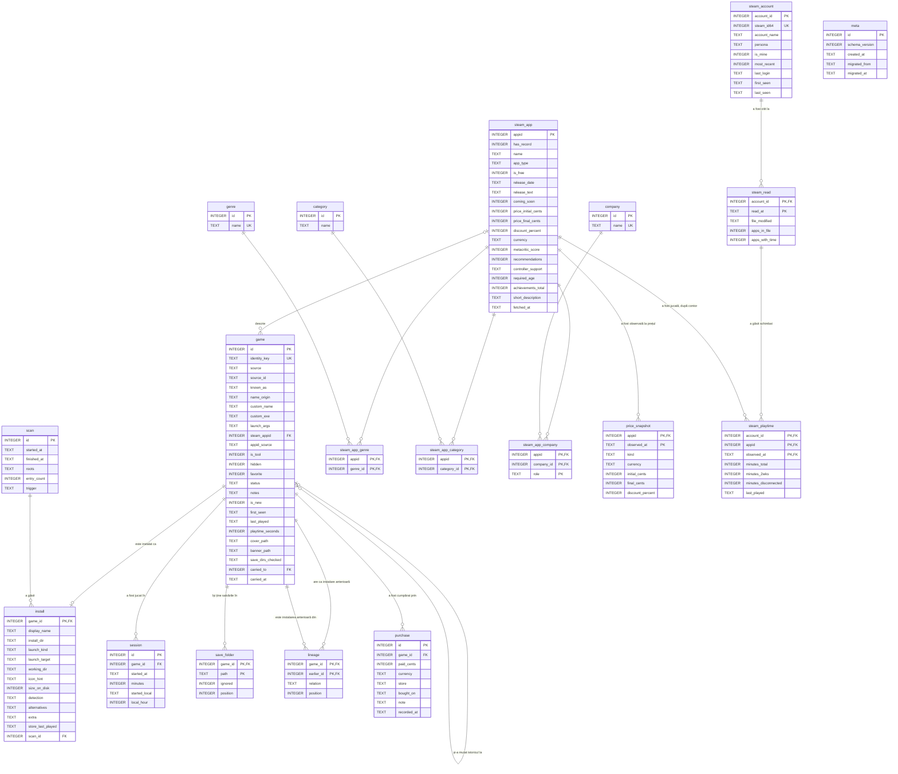

# Baza de date a lansatorului

**Stare: încheiat. Toți cei 8 pași (fazele 64–71) sunt făcuți.** Din faza 73 schema are versiunea 2
(prețurile; secțiunea 18), iar faza 74 îi adaugă fereastra și faptele de pe pagină. Din faza 75 are
versiunea 3: timpul de joc pe care Steam îl ține singur, citit din fișierele lui (secțiunile 4 și 18). Faza 76
îl arată pe pagina jocului și pe dală, iar versiunea 4 rescrie vederea care îl adună, ca să răspundă de o sută de ori
mai repede. **Azi schema are versiunea 8** (faza 101, secțiunea 5): alertele de preț ale listei de dorințe, iar
pentru fazele 102 și 103, gata făcute, nota unei sesiuni și datele semnelor Playing / Finished / Dropped.
Lansatorul își ține biblioteca
în `data/library.db` din seara de **10 octombrie 2026, ora 23:05**, când l-ai pornit și migrarea a
mutat datele tale reale în bază: 66 de înregistrări, 113 sesiuni, 34 de instalări, nimic refuzat.
`overrides.json` și `catalog.json` stau neatinse în `data/migrated/`. Cum vezi baza și ce verifici
de mână sunt la sfârșitul secțiunii 14. Restructurarea pe straturi și granița datelor sunt descrise
în `docs/ARHITECTURA.md`, iar secțiunea 10 de acolo trimite aici.

Cifrele din planul inițial (secțiunile 1–13) au fost măsurate pe **10 octombrie 2026**, pe datele
reale, doar citite: o repetiție a migrării a încărcat copia lor într-o bază de date ținută în
memorie, în afara proiectului. Ce s-a întâmplat la fiecare pas, cu cifrele lui, e în secțiunea 14.
Mediul de lucru este Python 3.14.5 din venv, cu **SQLite 3.50.4**.

## Cuprins

1. [Pe scurt](#1-pe-scurt)
2. [De ce o bază de date încorporată și de ce SQLite](#2-de-ce-o-bază-de-date-încorporată-și-de-ce-sqlite)
3. [Diagrama entitate–relație](#3-diagrama-entitaterelație)
4. [Tabelele, una câte una](#4-tabelele-una-câte-una)
5. [Schema completă (DDL)](#5-schema-completă-ddl)
6. [Normalizarea și cele două abateri deliberate](#6-normalizarea-și-cele-două-abateri-deliberate)
7. [Ce rămâne în afara bazei de date](#7-ce-rămâne-în-afara-bazei-de-date)
8. [Loc lăsat pentru fazele următoare](#8-loc-lăsat-pentru-fazele-următoare)
9. [Migrarea și verificarea ei](#9-migrarea-și-verificarea-ei)
10. [Depozitul și fațada](#10-depozitul-și-fațada)
11. [Harta: unde citește și scrie codul fiecare câmp](#11-harta-unde-citește-și-scrie-codul-fiecare-câmp)
12. [Regula firelor de execuție](#12-regula-firelor-de-execuție)
13. [Copii de siguranță, cutia de nisip, fișierele păstrate](#13-copii-de-siguranță-cutia-de-nisip-fișierele-păstrate)
14. [Pașii](#14-pașii)
15. [Riscurile](#15-riscurile)
16. [Observate pe drum, nereparate](#16-observate-pe-drum-nereparate)
17. [Istoria git: `overrides.json` și `config.json`](#17-istoria-git-overridesjson-și-configjson)
18. [Evoluția schemei: versiunile 2, 3 și 4](#18-evoluția-schemei-versiunile-2-3-și-4)
19. [Glosar](#19-glosar)

---

## 1. Pe scurt

- **Până în faza 69** datele stăteau în trei fișiere JSON din `data/`:
  - `catalog.json` — ce a găsit ultima scanare; se reface singur;
  - `overrides.json` — tot ce ai făcut tu: timp de joc, sesiuni, coperți alese, nume, semne;
  - `config.json` — setările.
- **Acum** biblioteca e un singur fișier, `data/library.db`. Are 14 tabele și 2 vederi. Tot SQL-ul e
  scris de mână, e vizibil și stă numai în `data_access/` (`library_db.py` și `schema.sql`).
- **Rămân fișiere** `config.json` (conține cheia SteamGridDB), `cache/`, `backups/` și
  `save_backups/`.
- **Restul programului nu a aflat de schimbare.** Cele 28 de apeluri `overrides.get(cheie)` și
  `overrides.update(cheie, ...)` au rămas cum erau. Cele opt locuri care umblau direct în dicționar
  au primit operații cu nume (faza 64).
- **Repetiția pe datele reale a reușit.**
  - Au intrat 66 de jocuri, 113 sesiuni (5.378 de minute), 323.125 de secunde de joc, 15 foldere de
    salvări și o legătură de descendență.
  - Nu s-a încălcat nicio cheie străină și nicio valoare nu a fost refuzată de tipul sau de regula
    coloanei ei.
  - Citite înapoi prin forma de dicționar pe care o folosește programul, **toate cele 66 de
    înregistrări și toate cele 34 de intrări din catalog au ieșit identice, câmp cu câmp**.
- **Au fost 8 pași, fiecare o fază cu tag-ul ei.** Ordinea a diferit puțin de cea din brief
  (secțiunea 14): tot ce citea fișierele a trecut prin depozit *înainte* ca datele să se mute.
- **După fiecare scanare**, tabelele Steam din bază urmează ce ține cache-ul (faza 70), iar magazinul
  e întrebat pentru România, ca prețurile să vină în euro.
- **Din faza 75**, fiecare scanare a ferestrei citește și timpul de joc pe care Steam îl ține pentru
  fiecare cont care a intrat pe acest PC, din fișierele lui, și îl păstrează ca serie: un rând nou
  doar când un contor s-a schimbat. Care conturi sunt ale tale spui tu, în Settings.
- **Din faza 76**, pagina unui joc spune „On Steam” (orele din contorul Steam, pe conturile tale), iar
  dala unui joc Steam arată aceste ore în locul numelui magazinului.

---

## 2. De ce o bază de date încorporată și de ce SQLite

O **bază de date încorporată** (*embedded database*) rulează în procesul programului. Nu este un
server separat. Coordonatorul a confirmat că lucrarea nu are nevoie de un server, pentru că se judecă
după ce se poate analiza. Alegerea vine din felul în care e folosit lansatorul:

- **Un utilizator, un proces, un singur scriitor.** Un server (PostgreSQL, MySQL) ar aduce o
  instalare, un serviciu Windows, o parolă și un port deschis. Nu ar aduce nimic pentru o bibliotecă
  de câteva zeci de jocuri pe un singur calculator.
- **Nicio dependență nouă.** SQLite face parte din Python, prin modulul `sqlite3` din biblioteca
  standard (*standard library*). Prietenii cărora le dai lansatorul nu au nimic de instalat, iar
  programul instalat aduce același motor.
- **Un singur fișier.** Se poate copia, se poate pune într-o copie de siguranță și se deschide cu
  instrumente gratuite (secțiunea 14, faza 71).
- **SQL complet pentru analiză:**
  - `JOIN`, `GROUP BY`;
  - expresii de tabel comune (*CTE*, `WITH`);
  - funcții fereastră (*window functions*) pentru clasamente și serii în timp;
  - funcții JSON.
- **Tranzacții** (*transactions*) cu proprietățile ACID: o scriere se face toată sau deloc, chiar dacă
  se oprește curentul. Azi, scrierea atomică a fișierului (fișier temporar, apoi înlocuire) dă
  aceeași garanție pentru tot fișierul. Tranzacția o dă pentru fiecare operație, inclusiv pentru una
  care atinge două jocuri deodată, cum e mutarea istoricului (faza 36).
- **Integritate verificată de motor.** O cheie străină (*foreign key*) declarată și o regulă `CHECK`
  refuză o valoare greșită în momentul scrierii. JSON-ul primește orice.

**Versiunea.** Venv-ul vine cu SQLite **3.50.4**. Schema folosește:

| Ce | Din versiunea |
|---|---|
| `INSERT ... ON CONFLICT DO UPDATE` (*UPSERT*) | 3.24 |
| funcții fereastră | 3.25 |
| coloane generate (*generated columns*) | 3.31 |
| `RETURNING` | 3.35 |
| tabele `STRICT`, unde tipul declarat al coloanei chiar este impus | 3.37 |
| funcțiile JSON încorporate implicit | 3.38 |

Brieful cerea minimum 3.35. Tabelele `STRICT` ridică cerința la **3.37**. Versiunea din venv o
depășește cu mult, iar programul instalat are aceeași versiune, pentru că PyInstaller împachetează
`sqlite3.dll`-ul aceluiași Python.

**Ce nu face SQLite bine** este scrierea din multe procese sau mașini în același timp. Aici nu e
cazul: există un singur scriitor, firul interfeței (secțiunea 12).

**De ce nu JSON mai departe.** În JSON nu se poate pune nicio întrebare fără cod Python scris pentru
ea, iar un câmp scris greșit nu este refuzat de nimic.

**De ce nu varianta „cheie–valoare"** (un rând per joc, cu valorile într-o coloană JSON;
`ARHITECTURA.md` §10). Ar fi fost mai ieftină, dar SQL-ul nu ar fi putut analiza nimic din ea. Toată
valoarea capitolului stă în tabele separate pentru jocuri, sesiuni, genuri, companii și prețuri.

---

## 3. Diagrama entitate–relație

Diagrama entitate–relație (*entity–relationship diagram*, ERD) arată tabelele și legăturile dintre
ele. Semnele de pe linii spun câte rânduri se pot lega de câte:

- `||` înseamnă exact unul;
- `o|` înseamnă zero sau unul;
- `o{` înseamnă zero sau mai multe.

Exemplu: un joc are zero sau mai multe sesiuni, iar o sesiune aparține exact unui joc.



`price_snapshot` și `purchase` sunt din versiunea 2 a schemei (faza 73, secțiunea 18);
`steam_account`, `steam_read` și `steam_playtime`, din versiunea 3 (faza 75). Legătura dintre
`steam_read` și `steam_playtime` este o cheie străină compusă: perechea (cont, moment) a unui contor
trebuie să fie o citire care chiar a avut loc.

`meta` stă singură, fără legături: descrie fișierul însuși, nu datele din el.

---

## 4. Tabelele, una câte una

Cuvinte pe care le folosesc mai jos:

- **cheie primară** (*primary key*, PK): identifică un rând;
- **cheie surogat** (*surrogate key*): un număr dat de baza de date, fără sens în lumea reală;
- **cheie naturală** (*natural key*): o valoare care identifică lucrul și în afara bazei, cum e
  `identity_key` sau numărul aplicației Steam (appid);
- **cheie străină** (*foreign key*, FK): o coloană care trebuie să numească un rând existent din altă
  tabelă;
- **tabelă de legătură** (*junction table*): ține doar perechile unei relații „mulți la mulți".

### `game` — un rând pentru fiecare joc pe care lansatorul l-a cunoscut vreodată

Ține ce ai făcut tu cu un joc, adică tot ce e azi în `overrides.json`:

- numele, executabilul și argumentele alese de tine;
- steaua, ascunderea, semnul Playing / Finished / Dropped, nota;
- coperta și bannerul alese;
- timpul total și ultima pornire;
- data primei apariții și eticheta NEW;
- unde și când i-au fost căutate salvările;
- unde i s-a mutat istoricul.

**De ce e tabela ei.** Un joc trăiește mai mult decât instalarea lui. Dezinstalat, își păstrează
istoricul, iar reinstalat în același folder și-l regăsește (faza 9). De aceea rândul din `game` nu
dispare când jocul nu mai e pe disc.

**Cheile.** Cheia surogat este `id`. Cheia naturală, `identity_key`, rămâne `UNIQUE` și este cea pe
care o folosește programul:

- pentru jocurile pornite prin executabil, folderul de instalare normalizat;
- pentru cele pornite prin URI, `sursă:id` (de exemplu `steam:730`).

**Coloanele care spun de unde vine o valoare.**

- `name_origin` spune de unde vine numele din `known_as`: `scan` (scris de program), `folder`
  (refăcut de migrare din numele folderului), `steam` (refăcut din înregistrarea Steam) sau `none`.
- `appid_source` spune de unde vine legătura Steam:
  - `manifest` — din manifestul lui Steam;
  - `search` — căutarea după nume făcută de scanare;
  - `chosen` — aleasă de tine;
  - `recovered` — refăcută de migrare pentru un joc dezinstalat.

Regula „un appid ghicit nu ascunde niciodată un joc" (raportată din folosire, după faza 9) se poate
scrie de acum în SQL: `appid_source IN ('search', 'recovered')` nu ascunde.

**Valorile goale au sens.** `NULL` la `is_tool` înseamnă „nicio părere". `0` înseamnă că ai spus
„este joc", iar asta trebuie să rămână `0`, nu `NULL` (faza 6). `NULL` la `playtime_seconds` înseamnă
„nu a fost cronometrat niciodată", ceea ce e altceva decât 0.

**Datele semnului (versiunea 8, faza 101).** `status_changed_at` este momentul în care semnul Playing /
Finished / Dropped a fost pus sau scos ultima oară, iar `nudged_at` momentul în care lansatorul ți-a amintit
ultima oară de el. Le folosește faza 103. `status_changed_at` se scrie de la faza 101 încolo, ca datele să se
adune de acum; **`nudged_at` se scrie din faza 103**: răspunsul „Still playing” din rândul Left behind al lui For you
(`ui_actions.still_playing`) scrie momentul și nimic altceva, ca jocul să fie lăsat în pace `rules.LEFT_BEHIND_DAYS`
(30 de zile). Raportul 11 le citește pe amândouă. Pentru fiecare joc de dinainte de versiunea 8 amândouă sunt
`NULL`: când a fost pus un semn mai vechi nu se știe, așa că nu se ghicește. Ora e cea locală, cu fusul orar
alături, ca la `session.started_at`.

### `install` — ce a găsit ultima scanare, un rând pentru fiecare joc instalat

Ține ce ține azi `catalog.json`:

- folderul, ce se pornește și de unde;
- iconița, mărimea pe disc, cum a fost recunoscut jocul;
- variantele respinse și „punga" proprie a sursei (`extra`);
- data ultimei porniri raportată de magazin (`store_last_played`).

**De ce e separată de `game`.** Datele de aici se rescriu la fiecare scanare, cele din `game`
niciodată. Este regula „o singură direcție a scrierilor", care azi desparte cele două fișiere (faza
1) și de acum devine o regulă între tabele:

- scanarea rescrie `install` și `scan`, într-o singură tranzacție;
- scanarea nu atinge `game`, `session`, `save_folder` și `lineage`;
- singura excepție este îmbinarea (`merge`), care pune data primei apariții, eticheta NEW și numele
  pe rândul din `game`. Exact asta face azi `catalog_io.merge`.

**Cheile.** Cheia primară este chiar `game_id`, deci un joc are cel mult o instalare. Un joc fără rând
aici nu este instalat.

### `scan` — un rând pentru fiecare scanare

Ține când a pornit și când s-a terminat scanarea, ce foldere a parcurs, câte jocuri a găsit și cine
a cerut-o:

| Valoare | Cine a cerut scanarea |
|---|---|
| `first_run` | prima pornire, fără catalog |
| `startup` | trecerea liniștită de la pornire (faza 14) |
| `manual` | butonul Rescan |
| `watch` | supravegherea folderelor (faza 26) |
| `uninstall` | ștergerea unui joc (faza 25) |
| `migration` | rândul adus de migrare |

**De ce e tabela ei.** „Mărimi de la ultima scanare" (pagina Storage) se citește azi din data
modificării fișierului `catalog.json` (`storage.py:222`). De acum devine
`SELECT MAX(finished_at) FROM scan`, adică o valoare, nu un efect secundar al sistemului de fișiere.
În plus, tabela devine un jurnal care se poate analiza.

**De ce `install` are `scan_id` în loc de „scanat la".** Momentul depinde de scanare, nu de
instalare, așa că stă o singură dată, în `scan` (a treia formă normală, secțiunea 6).

### `session` — un rând pentru fiecare ședință de joc: pornită de lansator, sau văzută de el

Ține începutul sesiunii, cu secunda și fusul orar exact ca azi
(`2026-08-14T05:53:32+03:00`), și durata în minute.

**De ce e tabela ei.** Azi sesiunile sunt o listă în interiorul înregistrării jocului, deci o valoare
care nu e atomică (prima formă normală, secțiunea 6). Ca tabelă, „când joc", „cât durează o
sesiune" și „cât am jucat în fiecare lună" devin `GROUP BY`.

**Cheile.** Perechea `UNIQUE (game_id, started_at)` este exact cheia după care programul rescrie
sesiunea în desfășurare (`sessions.at_second`, faza 20).

**Minutele.** Rămân minute, pentru că schimbarea unității nu e treaba acestei faze. E notată ca
rafinare ulterioară.

**Ora locală.** Cele două coloane generate, `started_local` și `local_hour`, iau ora locală direct
din text. Motivul este în secțiunea 9: funcțiile de dată ale lui SQLite trec întâi în UTC.

**De unde vine (versiunea 7, faza 93).** Coloana `origin` spune cum a fost măsurată sesiunea:
`'launched'` — lansatorul a pornit jocul și l-a cronometrat în Job Object-ul lui, la secundă (faza
16); `'observed'` — lansatorul a văzut procesele jocului în lista proceselor, la câteva secunde o
dată, oricine l-ar fi pornit (Steam, Epic, Xbox, scurtătura jocului): o **sesiune observată**
(*observed session*), cu fiecare capăt nesigur cu o privire, adică până la 5 secunde (rezoluția
măsurării, *measurement resolution*). Orice rând dinainte de versiunea 7 este `'launched'`.

**Regula: nicio oră numărată de două ori** (*double counting*). `v_hours` adună, pentru o aplicație
Steam, minutele lansatorului (`game.playtime_seconds`) și contorul Steam (`v_steam_time_mine`). Până
în faza 93 asta era sigur doar pentru că jocurile Steam nu aveau deloc minute ale lansatorului. Așa
că: o sesiune observată a unui joc a cărui sursă e Steam se scrie pentru forma ei (când, cât, ora din
zi) și **nu adaugă nimic** la `playtime_seconds` — orele lui rămân contorul Steam, pe care Steam îl
ține oricine ar porni jocul. O sesiune observată a unui joc fără contor (foldere, GOG, Epic, Xbox,
Ubisoft) își adaugă minutele la `playtime_seconds`, pentru că nimic altceva nu le numără. Regula e un
singur loc în cod, `observe.adds_hours` (`rules.HOURS_KEPT_BY_STORE`). `last_played` se mută pentru
amândouă: o sesiune observată e o observație locală și are întâietate, ca o pornire de aici.

**Cazul pe care regula îl lasă — și de ce nu e o numărare dublă.** Un joc pe care îl ai în două
magazine, legat de același appid (o copie Steam și una din folder, potrivită după nume) și jucat pe
copia din folder: minutele acelei copii intră în `minutes_launcher`, contorul Steam în
`minutes_steam`, și `v_hours` le adună. Nu e aceeași oră de două ori: contorul Steam nu conține
niciodată timpul jucat pe cealaltă copie, așa că sunt două copii și două jocuri (regula din faza 83).
Ar fi numărare dublă doar dacă Steam ar număra el însuși timpul celeilalte copii — ceea ce nu face.

### `save_folder` — unde își ține un joc salvările

Ține calea, dacă e ignorată și poziția ei în listă. Înlocuiește listele `save_dirs` și
`save_dirs_ignored`.

**De ce e tabela ei.** Prima formă normală: un joc poate avea mai multe foldere.

**De ce există `position`.** Ordinea listei trebuie să se păstreze, pentru că
`MainWindow.record_saves` compară lista veche cu cea nouă ca liste (`ui_window.py:1391`). Altfel
ar scrie de fiecare dată ceva neschimbat.

### `lineage` — instalările anterioare ale unui joc

Ține două feluri de legături, în coloana `relation`:

- `carried_from` — o instalare a cărei istorie a fost mutată pe jocul acesta;
- `not_same` — o instalare despre care ai spus că e alt joc.

Înlocuiește listele `earlier_keys` și `not_same_as` (faza 36).

**Cheile.** Ambele capete sunt chei străine spre `game`, ceea ce face din `lineage` o relație
reflexivă (*self-referencing*): un joc legat de alt joc.

**De ce `carried_to` rămâne coloană pe `game` și nu se deduce din `lineage`.** Brieful a cerut
această decizie, iar codul o impune. Lista `earlier_keys` a jocului nou moștenește și lista celui
vechi (`lineage.py:274–278`). Dacă un joc a fost mutat de două ori, A → B → C:

- C are în listă atât pe B, cât și pe A;
- A are însă `carried_to = B`, nu C.

Așadar `carried_to` numește succesorul direct, iar `lineage` numește toți predecesorii. Sunt două
fapte diferite, iar a-l deduce pe unul din celălalt ar schimba ce citește programul.

`carried_at` stă lângă `carried_to`: momentul mutării depinde de instalarea veche.

### `steam_app` și sateliții ei — ce spune magazinul Steam despre o aplicație

**`steam_app`** are un rând pentru fiecare appid. Ține:

- numele, tipul (joc, demo, unealtă);
- dacă e gratuit;
- data lansării, ca dată ISO unde textul lui Steam („9 Dec, 2020") se poate citi, plus textul brut în
  `release_text`. Data nu se ghicește niciodată;
- prețul de listă inițial și final, în cenți, reducerea și moneda;
- Metacritic, numărul de recomandări;
- suportul pentru controler, vârsta minimă, numărul de realizări;
- descrierea scurtă și momentul în care a fost luată înregistrarea.

**De ce e separată de `game`.** Toate acestea depind de appid, nu de jocul tău. Două instalări ale
aceluiași joc au același appid, iar prețul nu trebuie scris de două ori (a treia formă normală).

**De unde vin datele.** Tabela este o **proiecție a unui cache**, nu o sursă: se umple din
`cache/steam_details/<appid>.json`. **Un preț de aici este prețul de listă din ziua în care a fost
luată înregistrarea, în moneda în care a răspuns magazinul, nu ce a plătit cineva.**

**Când se reface (faza 70).** Migrarea o face o dată. De atunci, după fiecare scanare, pe firul
ferestrei și după ce scanarea și-a scris rezultatele, `logic/steam_projection.refresh` aduce
tabela la ce e pe disc. Se recitește numai ce s-a schimbat: o înregistrare pentru care baza nu are
rând, sau al cărei moment al preluării nu e cel din rândul ei. O scanare liniștită nu citește
nimic. O înregistrare care nu încape (de exemplu un gen fără id) e lăsată cum era, numită în jurnal,
iar celelalte intră totuși.

**`fetched_at` este momentul preluării înregistrării.** Din faza 70, cache-ul îl scrie lângă
înregistrare (`details_at`). Pentru una preluată înainte, este momentul în care i s-a scris
fișierul, adică preluarea, pentru că nimic altceva nu scrie fișierul acela. Nu este `fetched_at`-ul
din `steam_web.json`, pe care îl mută orice imagine pusă în cache: la Slow Roads acela spune
6 octombrie, iar înregistrarea e din 30 septembrie. Migrarea folosește același moment.

**Rândurile fără înregistrare.** `has_record = 0` marchează un appid cunoscut pentru care nu există
încă înregistrare în cache. Rândul trebuie să existe totuși, ca să poată fi numit de cheia străină
`game.steam_appid`.

**Sateliții** sunt tabele de legătură, pentru că o aplicație are mai multe genuri, categorii și
companii, iar fiecare dintre acestea are mai multe aplicații. Fiecare relație „mulți la mulți"
devine o tabelă cu cheia formată din ambele capete:

- **`genre`** și **`steam_app_genre`**: genurile, cu id-urile lui Steam.
- **`category`** și **`steam_app_category`**: categoriile (Single-player, Full controller support…).
  **`category.name` nu e `UNIQUE`**, pentru că Steam refolosește un nume sub două id-uri: „Steam
  Workshop" 30 și 51, „DualShock Controller Support" 55 și 56, „DualSense Controller Support" 57 și
  58. Prototipul a găsit asta când constrângerea a rupt o cheie străină. Orice interogare care
  grupează pe numele categoriei numără `COUNT(DISTINCT appid)`, altfel „DualSense" ar fi dat 113% din
  jocuri.
- **`company`** și **`steam_app_company`**: dezvoltatorii și editorii. Steam nu dă companiilor un
  id, așa că `company.id` este cheie surogat, iar `name` e `UNIQUE`. Rolul (`developer` sau
  `publisher`) face parte din cheie, pentru că o companie poate fi ambele la același joc.

### `price_snapshot` — ce a răspuns magazinul, de fiecare dată când a fost întrebat (versiunea 2)

**Ce ține.** Un rând pentru fiecare dată când magazinul Steam a fost întrebat de prețul unei
aplicații: momentul întrebării (`observed_at`), ce a răspuns (`kind`: `priced`, `free` sau
`unavailable`) și, pentru un preț, moneda și cele trei cifre, în cenți. Este o **serie de timp
(*time series*) doar adăugată (*append-only*)**: un rând nu se rescrie și nu se șterge niciodată;
programul nu are nicio instrucțiune `UPDATE` sau `DELETE` pentru tabela aceasta, iar un test
caută una în tot codul.

**De ce tabela ei.** `steam_app` spune cum arăta o aplicație când i s-a luat ultima înregistrare: un
singur preț, înlocuit la fiecare reluare. Seria răspunde la altă întrebare, *cum s-a mișcat prețul
în timp*, și are nevoie de un rând pentru fiecare observație. Cheia primară este cheia naturală
plus momentul, `(appid, observed_at)`, convenția din secțiunea 8 pentru tabelele de instantanee.

**Absența este o observație.** „Gratuit" și „nu se vinde aici" sunt și ele rânduri, nu goluri:
„când a încetat să se vândă" este o întrebare la care seria trebuie să poată răspunde. Pe de altă
parte, **o cerere care a eșuat nu este o observație** (fără răspuns, un răspuns care nu se citește)
și nu scrie nimic. Un test dovedește diferența.

**Reguli impuse de bază:** un rând `priced` are toate cele patru coloane de preț, celelalte niciuna;
`observed_at` este un moment ISO 8601 **în UTC** (`+00:00`), așa că ordinea textului este ordinea
în timp; reducerea e între 0 și 100; aplicația trebuie să existe în `steam_app`.

**De unde vin rândurile.** Din două locuri, prin aceeași funcție (`steam_web.price_observation`),
ca să nu se poată despărți niciodată:

- **cache-ul**: fiecare înregistrare Steam salvată este o observație, datată cu momentul în care a
  fost luată (`details_at`, sau ora fișierului pentru cele mai vechi). Așa a pornit seria, cu 48 de
  rânduri. Inserarea nu face nimic pentru un rând care există deja (`ON CONFLICT DO NOTHING`, o
  *inserare idempotentă*): proiecția poate rula de oricâte ori;
- **observația săptămânală**: o aplicație e „datorată" când n-are nicio observație sau cea mai nouă
  e mai veche de 7 zile (`rules.PRICE_REFRESH_DAYS`), instalată sau nu. Lista se calculează pe firul
  ferestrei, înainte de scanare, și e dată scanării; firul scanării întreabă magazinul și scrie
  răspunsul într-un fișier din `cache/` (`price_observations.json`); după scanare, firul ferestrei
  pune rândurile în bază, iar ce a intrat iese din fișier. Doar scanările ferestrei fac asta, iar cu
  `allow_network` oprit nu pleacă nicio cerere.

**Cererea, încercată o dată pe 11 octombrie 2026.** `appdetails` acceptă mai multe aplicații într-un
singur apel **numai** cu `filters=price_overview`:
`https://store.steampowered.com/api/appdetails?appids=730,550,1&filters=price_overview&cc=RO&l=english`.
Un singur răspuns (HTTP 200, 222 de octeți), un dicționar după appid, cu trei forme:

| appid | Ce e | Răspunsul | Rândul |
|---|---|---|---|
| 730 | Counter-Strike 2, gratuit | `{"success": true, "data": []}`: o listă goală, nu un dicționar | `free` |
| 550 | Left 4 Dead 2 | `{"success": true, "data": {"price_overview": {"currency": "EUR", "initial": 969, "final": 969, "discount_percent": 0, ...}}}` | `priced`, 969 |
| 1 | nu există | `{"success": false}` | `unavailable` |

Trei lucruri aflate din el:

- o aplicație ciudată nu strică restul răspunsului: fiecare se citește separat, iar una care nu se
  citește e sărită și notată în jurnal;
- **cu filtrul, a doua formă nu deosebește un joc gratuit de unul care nu se vinde deloc** (o
  versiune de probă, de exemplu). Decide înregistrarea completă din cache (`is_free`);
- reîmprospătarea celor 48 de aplicații este **o singură cerere** pe săptămână
  (`rules.PRICE_BATCH_SIZE` 50, cel mult `rules.PRICE_REQUESTS_PER_SCAN` 2 cereri pe scanare, la o
  secundă distanță). Răspunsul e păstrat ca exemplu pentru teste, în `tests/fixtures/`.

Prețul vine în moneda în care răspunde magazinul și **nu se convertește niciodată**; unul care nu e
în EUR se notează în jurnal. Cererea a plecat de fapt de două ori: prima dată scriptul meu a pierdut
răspunsul înainte să-l salveze.

### `purchase` — ce ai plătit (versiunea 2)

**Ce ține.** Ce ai plătit pe un joc, scris de tine: suma în cenți, moneda (EUR implicit), magazinul,
data (sau necunoscută) și o notiță. Zero sau mai multe rânduri pentru un joc: un joc cumpărat de două
ori, sau un DLC mai târziu, sunt două rânduri. Se completează din faza 74, din meniul „...” al
oricărui joc: **„What I paid...”** arată cumpărările lui, adaugă una (suma, moneda — EUR ales, RON
alături —, magazinul, cu sugestii, data de azi sau „necunoscută”, o notiță) și scoate una, după o
întrebare al cărei buton implicit este Cancel. Merge și cu controlerul, ca Settings. Nimic altceva
din înregistrarea jocului nu se atinge.

**Călătoresc în pachetul de export**, ca sesiunile, într-un fișier al lor (`purchases.json`, scris
doar când există cumpărări): sunt ale tale și nicio altă mașină nu le poate ști. La import se
**unesc** cu ce e aici, după (data, suma, magazinul) — de două ori același pachet nu adaugă nimic —
și nimic nu se șterge. Un pachet mai vechi, fără ele, se importă ca înainte. Seria de prețuri nu
călătorește: e aceeași observație pe orice mașină.

**De ce tabela ei.** Este singurul fapt economic pe care niciun API nu-l poate da. Un preț de listă
nu e ce ai plătit (o reducere, o cheie, un abonament), iar un joc poate avea mai multe cumpărări,
deci nu încape într-o coloană din `game`.

**Necunoscut nu înseamnă zero.** `paid_cents = 0` este o cumpărare adevărată (un cadou, un pachet,
un abonament). Un joc **fără niciun rând** e necunoscut, nu gratuit: lipsa rândului este o santinelă
pentru „nu știu" (*a sentinel for "unknown"*), aceeași regulă pe care lansatorul o aplică deja
timpului de joc al unui joc Steam. Nicio medie nu numără un joc fără rând ca 0 €.

### `steam_account` — conturile Steam care au intrat pe acest PC (versiunea 3)

**Ce ține.** Un rând pentru fiecare cont care are un folder `Steam\userdata\<id>` cu un
`localconfig.vdf` care se citește: id-ul contului, SteamID64-ul lui, numele de cont și numele afișat
(*persona*), când s-a conectat ultima dată, când l-a văzut lansatorul prima și ultima oară și, mai
ales, **dacă e al tău**.

**Trei nume pentru același cont (rezolvarea entităților, *entity resolution*).** Folderul din
`userdata` poartă id-ul contului; `config\loginusers.vdf` îl numește prin SteamID64. Sunt același
lucru: SteamID64-ul unui cont individual este id-ul lui plus 76561197960265728 (cei 32 de biți de
jos). Baza impune legătura: `CHECK (steam_id64 = account_id + 76561197960265728)`. Un cont pe care
`loginusers.vdf` nu-l mai listează (pe mașina ta, 242635243) se citește la fel, doar fără nume.

**„Al meu” are trei valori, nu două.** `is_mine` este `1` (al meu), `0` (nu e al meu) sau `NULL`
(nehotărât) — aceeași formă ca `game.is_tool`. Un cont nou intră nehotărât: lansatorul nu presupune
niciodată că un cont e al tău doar pentru că a intrat pe PC-ul tău. Valoarea se schimbă **numai din
Settings**, iar citirile de după nu o ating niciodată; numele se aduc la zi (un nume lipsă îl
păstrează pe cel cunoscut).

### `steam_read` — jurnalul citirilor (versiunea 3)

**Ce ține.** Un rând pentru fiecare cont la fiecare citire: momentul citirii (`read_at`, UTC), când a
scris Steam fișierul ultima dată (`file_modified`), câte aplicații erau în fișier și câte aveau timp.
Un fișier care nu se citește (Steam îl rescrie cât rulează, iar o citire prinsă la jumătate îl găsește
tăiat) nu dă niciun rând: nu e o citire.

**De ce tabela ei: jurnalul e marginea diferenței.** Un contor care nu s-a schimbat nu scrie nimic
(mai jos), așa că fără jurnal n-ai ști dacă un joc nu a fost jucat sau doar nu a fost citit.
Citirile spun „m-am uitat la momentul acesta”: un contor care s-a mișcat între două citiri a fost
jucat **între acele două momente**, iar unul care a rămas pe loc între ele nu a fost jucat atunci.

### `steam_playtime` — contorul Steam, ca serie (versiunea 3)

**Ce ține.** Pentru fiecare cont și aplicație: `Playtime` (minutele de-o-viață pe acel cont),
`Playtime2wks`, `PlaytimeDisconnected` și `LastPlayed`, la momentul citirii.

**Un contor cumulativ (*cumulative counter*).** `Playtime` nu e o sesiune, ci un total care doar
crește. Ce s-a jucat între două citiri este **diferența** dintre ele (*differencing*): 135.352 de
minute azi și 135.412 săptămâna viitoare înseamnă o oră între cele două citiri, nu 135.412 minute.
De aceea seria se scrie **doar la schimbare** (*record on change*): un rând prima dată când apare o
pereche cont–aplicație și apoi numai când una dintre cele patru valori diferă de cel mai nou rând al
ei. Pe mașina ta, prima citire a scris 390 de rânduri; a doua, imediat după, niciunul.

**Doar adăugată, ca prețurile.** Nu există `UPDATE` și nici `DELETE` pentru `steam_read` sau
`steam_playtime` nicăieri în program, iar un test caută în tot codul. Un contor care a scăzut (un
cont resetat, o aplicație returnată) se păstrează exact cum a fost citit și se notează în jurnal ca
ciudat; nu se „repară”.

**Reguli impuse de bază:** minutele nu sunt negative; aplicația există în `steam_app` (o aplicație
fără înregistrare primește un rând cu `has_record = 0`, ca la prețuri); perechea (cont, moment)
este o citire din `steam_read` (cheia străină compusă). `minutes_total` poate fi `NULL`: trei aplicații
de pe mașina ta au doar `LastPlayed`, fără `Playtime`, iar „nu știu” nu e 0.

**De unde vin rândurile.** Scanarea ferestrei citește fișierele, pe firul ei; rezultatul merge într-un
fișier din `cache/` (`steam_time.json`); după scanare, firul ferestrei îl scrie în bază, într-o singură
tranzacție pentru fiecare citire, și golește fișierul (secțiunea 12). Fișierele sunt locale, așa că se
citesc și cu `allow_network` oprit.

**Ce s-a găsit pe 11 octombrie 2026** (citit, numai citire, din fișierele tale):

| Contul | Nume | Aplicații în fișier / cu timp | De notat |
|---|---|---|---|
| 794996709 | GreenY | 41 / 30 | contul activ; 2 aplicații doar cu `LastPlayed`; o scurtătură non-Steam (id negativ, 85 de minute), sărită |
| 242635243 | — | 209 / 205 | nu e în `loginusers.vdf`; Counter-Strike 2, 135.352 de minute |
| 313478584 | GreenYRO | 141 / 136 | o aplicație doar cu `LastPlayed` |
| 1146938852 | greeny | 22 / 16 | fișierul spune **`Apps`**, cu majusculă |

**Capcana literelor mari și mici.** Trei fișiere spun `apps`, unul `Apps`. O citire care ține cont de
literă găsea contul 1146938852 gol; de aceea fiecare cheie se caută fără să conteze litera, iar
testul dovedește că o citire cu literă exactă nu găsește nimic acolo.

**Înregistrările Steam ale istoriei.** Pentru aplicațiile de pe conturile marcate ale tale care nu au
încă o înregistrare, scanarea o cere de la magazin (endpointul 1), **cel mult 20 pe scanare**, cele
mai jucate întâi, și numai cu rețeaua pornită. Proiecția de după scanare le pune în `steam_app`, cu
nume și genuri, iar fiecare primește prima observație de preț și intră în reîmprospătarea
săptămânală (de aceea `rules.PRICE_REQUESTS_PER_SCAN` a crescut de la 2 la 8). O aplicație care nu
se mai vinde nu blochează lista: răspunsul ei se ține minte, iar scanarea trece la următoarea.

### `wishlist_read` și `wishlist` — lista de dorințe Steam (versiunea 6)

**Ce țin.** `wishlist_read` este **jurnalul citirilor**, ca `steam_read` pentru timpul de joc: un rând
pentru fiecare cont și fiecare răspuns al serviciului de liste de dorințe al Steam (adresa a opta,
`IWishlistService/GetWishlist`), cu momentul (UTC), starea și câte jocuri a dat. `wishlist` are un
rând pentru fiecare joc de pe lista fiecărui cont: prioritatea dată de Steam, când l-ai adăugat (cum
spune Steam), **prima** și **ultima** citire care l-a avut, și **`removed_at`**, citirea care nu l-a
mai avut. Cheia este perechea (cont, aplicație).

**O listă privată răspunde ca una goală.** Pe 15 octombrie, cele patru conturi marcate ale tale:
unul are o listă publică, cu 16 jocuri; celelalte trei au răspuns `{"response":{}}` — iar unul
dintre ele, contul cu care ești intrat în Steam, arată „Wishlist 6” în magazin. Deci un răspuns
fără jocuri nu poate spune dacă lista e goală sau privată. De aceea are starea **`nothing`**
(„nimic de citit”) și **nu scoate niciun joc de pe listă**: altfel, o listă trecută pe privat ar
arăta ca și cum ai fi renunțat la tot. O cerere fără niciun răspuns (rețea căzută, o eroare HTTP)
nu e o citire și nu se scrie deloc; se cere din nou la scanarea următoare.

**Istoria e ea însăși o dată.** Un joc care dispare de pe listă nu se șterge: primește
`removed_at`, momentul citirii care nu l-a mai avut. Ce ai vrut și ai încetat să vrei e o
informație, nu o eroare. Un joc care revine își pierde `removed_at`, iar `last_seen` merge mai
departe. **Nu există `DELETE` pentru `wishlist` nicăieri în program**; un test caută în cod.

**Reguli impuse de bază:** contul există în `steam_account`; aplicația există în `steam_app` (un joc
de care biblioteca nu știa primește un rând cu `has_record = 0`, o **santinelă** — *sentinel* — pentru
„încă nu știu”, ca la timpul Steam și la prețuri); fiecare dintre cele trei momente (`first_seen`,
`last_seen`, `removed_at`) este o citire a aceluiași cont din `wishlist_read` (trei chei străine
compuse); `first_seen ≤ last_seen < removed_at`; starea `items` înseamnă cel puțin un joc, `nothing`
niciunul.

**De unde vin rândurile.** Doar conturile marcate „Mine”, **o dată pe zi**
(`rules.WISHLIST_READ_HOURS`, 20 de ore, ca o pornire puțin mai devreme a doua zi să conteze tot ca
ziua următoare), și numai cu rețeaua pornită. Fereastra hotărăște, pe firul ei, ce conturi sunt
datorate; scanarea face câte o cerere pe cont, la o secundă una de alta, și scrie răspunsurile în
`cache/wishlist.json`; după scanare, firul ferestrei le scrie în bază, câte o tranzacție pe răspuns,
și golește fișierul. Un răspuns mai vechi decât cel mai nou deja scris pentru contul lui nu se mai
aplică.

**Înregistrările și prețurile jocurilor de pe listă.** Un joc dorit care nu are înregistrare Steam o
primește la scanare, **după** cele jucate și în limita aceleiași cote (`rules.STEAM_HISTORY_RECORDS_PER_SCAN`,
20 pe scanare): nume, genuri, preț. De atunci prețul lui se cere **zilnic**, nu săptămânal
(`rules.WISHLIST_PRICE_HOURS`, la cererea ta din 15 octombrie): o reducere Steam ține una-două
săptămâni, iar o privire pe săptămână o poate rata. Pentru cele 16 jocuri de azi înseamnă o cerere
pe zi (un lot de 50). Lotul săptămânal rămâne de 7 cereri: 307 aplicații cu înregistrare plus 13,
adică 320, iar a opta cerere începe abia la 351.

### `price_target` și `price_alert` — alertele de preț ale listei de dorințe (versiunea 8)

**Ce țin.** `price_target` are cel mult **o țintă pentru fiecare joc dorit**: suma (în cenți) la care sau sub
care vrei să afli, moneda în care era prețul jocului când ai pus-o și momentul. O țintă nouă o înlocuiește pe
cea veche, iar „Remove alert” șterge rândul: e o setare, nu o serie. `price_alert` este **jurnalul alertelor**,
doar adăugat (*append-only*): un rând pentru fiecare alertă trimisă, cu prețul care a declanșat-o — un rând
din `price_snapshot`, prin cheia străină compusă (aplicația, momentul observației) —, felul ei, prețul așa
cum ți l-a spus mesajul și momentul trimiterii.

**Cele două feluri.** `lowest`: prețul nou este strict mai mic decât toate prețurile de dinainte ale jocului,
în aceeași monedă, iar seria are cel puțin trei prețuri (`rules.ALERT_MIN_OBSERVATIONS`) — o serie de unul
sau două nu spune încă ce e un preț bun. `target`: prețul nou este la ținta ta sau sub ea, în aceeași monedă,
iar prețul de dinainte era peste țintă, sau mai mare decât cel nou (o nouă scădere).

**O singură dată pe scădere.** Cheia jurnalului este (aplicația, observația, felul): același preț văzut și
mâine nu e un rând nou, deci nu e o alertă nouă; o nouă scădere este. Rândul se scrie **înainte** ca mesajul
să apară, iar dacă scrierea nu reușește, mesajul nu apare deloc: o alertă nu se poate repeta din cauza unei
erori (o notificare idempotentă, *idempotent notification*).

**Reguli impuse de bază:** ținta e mai mare decât 0 și are o monedă de trei litere mari; alerta numește un
preț care chiar există în serie; felul e unul dintre cele două; trimiterea nu e înaintea observației. Toate
momentele sunt UTC, ca seria de prețuri.

### `rating` — nota unei sesiuni (versiunea 8, pentru faza 102)

Creată în faza 101 și **scrisă din faza 102**: cardul „How was it?” de după o sesiune și stelele de pe pagina
jocului o scriu prin `LibraryStore.rate_session` (o singură scriere, pe cheia sesiunii: o notă dată din nou
înlocuiește stelele și momentul), iar importul arhivei din Settings prin `add_ratings` (o reuniune: o sesiune
notată aici își păstrează nota). Raportul 10 o citește. Un rând înseamnă nota (1–5 stele) dată
unei sesiuni și momentul în care ai dat-o. Sesiunea e numită prin jocul ei și momentul în care a început —
perechea pe care `session` o are unică și care rămâne aceeași când sesiunile se rescriu (`id`-ul ei nu
rămâne). **Cheia străină se verifică la sfârșitul tranzacției, nu la fiecare instrucțiune** (*deferred
foreign key*): depozitul scrie sesiunile unui joc ștergându-le și punându-le la loc în aceeași tranzacție,
iar o verificare făcută la ștergere ar refuza orice salvare a unui joc notat. O sesiune care la sfârșit nu
mai există — ștearsă după `rules.SESSION_KEEP_DAYS` (400 de zile) — își ia nota cu ea în aceeași scriere:
`write_record` șterge notele sesiunilor pe care nu le-a pus la loc, iar `carry` (istoria trecută la o
instalare nouă, faza 36) scrie întâi înregistrarea nouă, mută notele sesiunilor venite cu ea, apoi o scrie pe
cea veche — totul într-o tranzacție.

### `meta` — un singur rând despre fișierul însuși

Ține versiunea schemei, când a fost creat fișierul și din ce și când a fost migrat. Regula
`CHECK (id = 1)` împiedică existența unui al doilea rând. `PRAGMA user_version` repetă versiunea,
pentru instrumentele care o citesc de acolo.

**De ce există.** Un program care deschide fișierul trebuie să afle dacă îl înțelege. Fără
versiune, o schimbare de schemă viitoare ar fi o ghicitoare.

### Vederile (*views*)

- **`v_library`** — un rând pentru fiecare joc, instalat sau nu, cu instalarea și înregistrarea Steam
  alături. Este tabelul de pornire pentru analize. Prețul din ea e cel din înregistrarea Steam (vezi
  mai jos `v_price_latest`).
- **`v_playtime_check`** — jocurile la care totalul de-o-viață diferă de suma sesiunilor, cu
  diferența. Pe 10 octombrie sunt 13 jocuri, toate cu totalul *peste* sesiuni, cu 445 de secunde în
  total (secțiunea 6).
- **`v_price_latest`** (versiunea 2) — cea mai nouă observație a fiecărei aplicații, cu felul ei.
  **Din versiunea 2 este singurul răspuns la „cât costă acum".** Coloanele de preț din `steam_app`
  rămân, ca proiecție a înregistrării din cache, dar nimic nou nu le mai citește; scoaterea lor e
  candidată pentru o actualizare ulterioară (secțiunea 18).
- **`v_price_range`** (versiunea 2) — pentru fiecare aplicație: câte observații, prima și ultima,
  prețul cel mai mic văzut și când (prima dată), cel mai mare și când. Cu funcții fereastră
  (*window functions*, `ROW_NUMBER() OVER (PARTITION BY ...)`).
- **`v_game_money`** (versiunea 2) — pentru fiecare joc: ultimul preț de listă (prin
  `steam_appid`), cât ai plătit în total și în câte rânduri, timpul de joc al lansatorului și cât te-a
  costat o oră, acolo unde există și suma, și orele. Un total se face doar într-o singură monedă:
  sume în monede diferite nu se adună și nu se convertesc.
- **`v_steam_time_latest`** (versiunea 3) — cel mai nou rând al fiecărei perechi cont–aplicație, cu
  numele contului și marcajul lui (o funcție fereastră, ca la prețuri).
- **`v_steam_time_mine`** (versiunea 3, rescrisă în versiunea 4) — pentru fiecare aplicație, **numai
  pe conturile marcate ale tale**: minutele adunate, pe câte conturi o ai și când ai jucat-o ultima
  dată. „Ultima dată” se alege după moment (`julianday`), nu după text: `LastPlayed` e în ora locală,
  cu decalajul ei, iar textul a două decalaje diferite nu se ordonează corect (secțiunea 9). Un cont
  „nu e al meu” sau nehotărât nu intră în nicio sumă.

  **De ce a fost rescrisă.** În versiunea 3, „ultima dată” era găsită cu o subinterogare corelată
  (*correlated subquery*): pentru fiecare dintre cele 335 de aplicații, baza citea din nou toate
  rândurile cele mai noi. Pe datele tale, 93 ms — iar fereastra o întreabă la fiecare reîncărcare,
  pe firul interfeței (o dată pe minut cât rulează un joc, la fiecare stea pusă). Versiunea 4 ordonează
  rândurile o singură dată, cu o funcție fereastră (`ROW_NUMBER() OVER (PARTITION BY appid ORDER BY
  julianday(last_played) DESC)`), și îl ia pe primul: 0,8 ms, cu exact același răspuns, aplicație cu
  aplicație, dovedit pe datele tale sub patru seturi de marcaje (secțiunea 18).
- **`v_hours`** (versiunea 5) — orele din ambele surse, câte o aplicație o singură dată; explicată la
  „Versiunea 5” și în `docs/ANALIZA.md`.
- **`v_wishlist_now`** (versiunea 6) — câte un rând pentru fiecare joc de pe listele conturilor
  marcate ale tale: un joc aflat pe două liste e un singur rând, cu ambele conturi numite. Alături:
  cel mai nou preț (felul, prețul de acum, cel de listă, reducerea, când), cel mai mic preț văzut și
  când, cel mai mare, câte prețuri are seria, **`is_lowest_now`** și orele deja jucate pe el
  (`minutes_played`: un alt cont al tău îl poate avea deja). `lists` numără listele care îl au acum;
  la zero, `removed_at` spune când l-a lăsat ultima.

  **„La cel mai mic preț văzut” cere trei lucruri:** prețul de azi e cel mai mic din serie, seria are
  cel puțin două prețuri și **a văzut și unul mai mare**. Fără a treia condiție, un joc niciodată redus
  ar fi „la minimul lui” la fiecare a doua observație: prețurile se notează la fiecare întrebare, chiar
  dacă nu s-au schimbat.

  **Citește doar aplicațiile de pe listă.** Prin `v_price_latest`, `v_price_range` și `v_hours`, care
  citesc toate aplicațiile, vederea lua 4,0 ms pentru 16 jocuri pe biblioteca ta; cu fiecare parte
  restrânsă la `appid IN (SELECT appid FROM items)`, 0,5 ms, cu exact aceleași rânduri (verificat rând
  cu rând). Orele sunt aceeași sumă pe care o face `v_hours`: timpul lansatorului al jocurilor legate,
  plus cele mai noi contoare Steam de pe conturile marcate.

**Pe ecran (faza 76).** Fereastra întreabă depozitul o singură dată, pentru toată biblioteca
(`LibraryStore.steam_times()`: pentru fiecare joc, prin `game.steam_appid`, ce spune
`v_steam_time_mine`), și ține răspunsul; o dală se desenează de zeci de ori pe secundă și nu
întreabă niciodată baza. Răspunsul se citește din nou la fiecare reîncărcare, după ce o scanare a
adus o citire și după ce marcajele se schimbă în Settings — iar dalele și pagina deschisă se
actualizează fără ca grila să fie refăcută.

- **Pe pagina jocului**, în Details, imediat după Source: **„On Steam”** — „113 hours on 2 accounts,
  last played 1 Sep”; pe un singur cont, „33h 31m, last played 1 Oct” (WARDOGS). Doar când un cont marcat al
  tău are jocul. Steam numără minute întregi, deci 0 cu o „ultima dată” înseamnă sub un minut („under a
  minute”), iar 0 fără ea, „never played”. Un cont care ține doar „ultima dată” o dă numai pe ea.
  Trece prin `game.steam_appid`, deci apare și la un joc din foldere legat de Steam după nume: copia
  ta de Silent Hill 2 arată cele 18 ore jucate pe Steam.
- **Pe dală**, rândul mic de sub nume, **doar pentru un joc pornit prin Steam**: orele de pe
  conturile tale, „3964 hours on Steam”, în locul cuvântului „Steam”, când sunt măcar un minut; altfel
  rămâne numele magazinului. Un joc pornit de lansator își păstrează timpul lui.
- **Nimic altceva nu le citește** (un test caută în tot codul): nici Stats, nici „Play something”,
  nici cardul Continue playing sau Jump back in, nici `last_played`. Acelea sunt candidate pentru faza
  de analiză (secțiunea 8).

Interogările de analiză propriu-zise țin de o fază ulterioară. Aici se construiesc doar tabelele pe
care vor rula. Câteva, gata de folosit și verificate pe o copie a bazei tale, sunt la sfârșitul
secțiunii 14 („Cum vezi baza").

---

## 5. Schema completă (DDL)

DDL (*data definition language*) este partea din SQL care creează tabele. Schema stă în
`data_access/schema.sql` și e rulată la crearea fișierului. Versiunea 1 de mai jos a fost încărcată cu
datele reale pe 10 octombrie; versiunea 2, adăugată în faza 73, urmează după ea.

```sql
-- Game Launcher: the library database, schema version 1.
-- SQLite 3.37 or newer (STRICT tables); the venv ships 3.50.4.
-- Every connection runs PRAGMA foreign_keys = ON first: SQLite leaves it off by default,
-- and a declared constraint that is never enforced would be a lie.

CREATE TABLE meta (
    id              INTEGER PRIMARY KEY CHECK (id = 1),
    schema_version  INTEGER NOT NULL,
    created_at      TEXT    NOT NULL,
    migrated_from   TEXT,                -- 'overrides.json + catalog.json', or NULL
    migrated_at     TEXT
) STRICT;

-- A projection of the cached Steam records (cache/steam_details/<appid>.json). A price here
-- is the list price on the day the record was fetched, in its own currency, never converted.
CREATE TABLE steam_app (
    appid                INTEGER PRIMARY KEY,
    has_record           INTEGER NOT NULL CHECK (has_record IN (0, 1)),  -- 0: appid known, no record cached
    name                 TEXT,
    app_type             TEXT,
    is_free              INTEGER CHECK (is_free IN (0, 1)),
    release_date         TEXT,           -- ISO date where release_text parses; never guessed
    release_text         TEXT,           -- exactly as Steam wrote it, e.g. '9 Dec, 2020'
    coming_soon          INTEGER CHECK (coming_soon IN (0, 1)),
    price_initial_cents  INTEGER CHECK (price_initial_cents >= 0),
    price_final_cents    INTEGER CHECK (price_final_cents >= 0),
    discount_percent     INTEGER CHECK (discount_percent BETWEEN 0 AND 100),
    currency             TEXT,           -- ISO 4217, as Steam answered
    metacritic_score     INTEGER CHECK (metacritic_score BETWEEN 0 AND 100),
    recommendations      INTEGER CHECK (recommendations >= 0),
    controller_support   TEXT,           -- 'full', 'partial' or NULL, as Steam says
    required_age         INTEGER CHECK (required_age >= 0),
    achievements_total   INTEGER CHECK (achievements_total >= 0),
    short_description    TEXT,
    fetched_at           TEXT,
    CHECK ((price_final_cents IS NULL) = (currency IS NULL)),
    CHECK (has_record = 1 OR (release_text IS NULL AND price_final_cents IS NULL))
) STRICT;

CREATE TABLE genre (
    id    INTEGER PRIMARY KEY,           -- Steam's own id
    name  TEXT NOT NULL UNIQUE
) STRICT;

CREATE TABLE steam_app_genre (
    appid     INTEGER NOT NULL REFERENCES steam_app (appid) ON DELETE CASCADE,
    genre_id  INTEGER NOT NULL REFERENCES genre (id),
    PRIMARY KEY (appid, genre_id)
) STRICT;

-- Not UNIQUE on name: Steam reuses a name under two ids. Group by name with COUNT(DISTINCT appid).
CREATE TABLE category (
    id    INTEGER PRIMARY KEY,           -- Steam's own id
    name  TEXT NOT NULL
) STRICT;

CREATE TABLE steam_app_category (
    appid        INTEGER NOT NULL REFERENCES steam_app (appid) ON DELETE CASCADE,
    category_id  INTEGER NOT NULL REFERENCES category (id),
    PRIMARY KEY (appid, category_id)
) STRICT;

CREATE TABLE company (
    id    INTEGER PRIMARY KEY,           -- surrogate: Steam gives companies no id
    name  TEXT NOT NULL UNIQUE
) STRICT;

CREATE TABLE steam_app_company (
    appid       INTEGER NOT NULL REFERENCES steam_app (appid) ON DELETE CASCADE,
    company_id  INTEGER NOT NULL REFERENCES company (id),
    role        TEXT    NOT NULL CHECK (role IN ('developer', 'publisher')),
    PRIMARY KEY (appid, company_id, role)
) STRICT;

-- One row per game the launcher has ever known, installed or not. The scan never writes
-- here, except through the merge (first_seen, is_new, known_as), as catalog_io.merge does today.
CREATE TABLE game (
    id                 INTEGER PRIMARY KEY,
    identity_key       TEXT    NOT NULL UNIQUE,
    source             TEXT    CHECK (source IN ('folders', 'steam', 'gog', 'epic', 'ubisoft', 'xbox')),
                                                     -- NULL: an uninstalled folder key, store not recorded
    source_id          TEXT,
    known_as           TEXT,                         -- the detected name, kept current by the merge
    name_origin        TEXT    NOT NULL CHECK (name_origin IN ('scan', 'folder', 'steam', 'none')),
    custom_name        TEXT,
    custom_exe         TEXT,
    launch_args        TEXT,
    steam_appid        INTEGER REFERENCES steam_app (appid),
    appid_source       TEXT    CHECK (appid_source IN ('manifest', 'search', 'chosen', 'recovered')),
    is_tool            INTEGER CHECK (is_tool IN (0, 1)),   -- NULL no opinion; 0 game; 1 tool
    hidden             INTEGER NOT NULL DEFAULT 0 CHECK (hidden IN (0, 1)),
    favorite           INTEGER NOT NULL DEFAULT 0 CHECK (favorite IN (0, 1)),
    status             TEXT    CHECK (status IN ('playing', 'finished', 'dropped')),
    notes              TEXT,
    is_new             INTEGER NOT NULL DEFAULT 0 CHECK (is_new IN (0, 1)),
    first_seen         TEXT,                         -- NULL only until the merge stamps a game just found
    last_played        TEXT,
    playtime_seconds   INTEGER CHECK (playtime_seconds >= 0),  -- lifetime total; NULL never timed
    cover_path         TEXT,
    banner_path        TEXT,
    save_dirs_checked  TEXT,                         -- when the saves were last looked for (a time)
    carried_to         INTEGER REFERENCES game (id), -- the direct successor its history went to
    carried_at         TEXT,
    CHECK ((steam_appid IS NULL) = (appid_source IS NULL)),
    CHECK ((carried_to IS NULL) = (carried_at IS NULL)),
    CHECK (carried_to IS NULL OR carried_to <> id)
) STRICT;

-- One row per scan: a log, and the answer to "sizes as of when".
CREATE TABLE scan (
    id           INTEGER PRIMARY KEY,
    started_at   TEXT,                   -- NULL only for the one the migration brings in
    finished_at  TEXT    NOT NULL,
    roots        TEXT    NOT NULL DEFAULT '[]' CHECK (json_valid(roots)),
    entry_count  INTEGER NOT NULL CHECK (entry_count >= 0),
    trigger      TEXT    NOT NULL CHECK (trigger IN
                     ('first_run', 'startup', 'manual', 'watch', 'uninstall', 'migration'))
) STRICT;

-- What the last scan found: one row per installed game, rewritten by every scan in one
-- transaction. A game with no row here is not installed.
CREATE TABLE install (
    game_id            INTEGER PRIMARY KEY REFERENCES game (id) ON DELETE CASCADE,
    position           INTEGER NOT NULL UNIQUE,      -- the order the scan found them in
    display_name       TEXT    NOT NULL,             -- as this scan detected it
    install_dir        TEXT    NOT NULL,
    launch_kind        TEXT    NOT NULL CHECK (launch_kind IN ('exe', 'uri')),
    launch_target      TEXT    NOT NULL,
    working_dir        TEXT    NOT NULL,
    icon_hint          TEXT    NOT NULL,
    size_on_disk       INTEGER CHECK (size_on_disk >= 0),
    detection          TEXT    NOT NULL,
    alternatives       TEXT    NOT NULL DEFAULT '[]' CHECK (json_valid(alternatives)),  -- diagnostic
    extra              TEXT    NOT NULL DEFAULT '{}' CHECK (json_valid(extra)),         -- the provider's own bag
    store_last_played  TEXT,                         -- the store's own date, copied out of extra
    scan_id            INTEGER NOT NULL REFERENCES scan (id)
) STRICT;

-- One row per exe launch. Local wall time with its offset, second precision, as written
-- today. The generated columns read the local time off the text, because SQLite's own
-- date functions convert to UTC first.
CREATE TABLE session (
    id             INTEGER PRIMARY KEY,
    game_id        INTEGER NOT NULL REFERENCES game (id) ON DELETE CASCADE,
    started_at     TEXT    NOT NULL CHECK (started_at GLOB
        '[0-9][0-9][0-9][0-9]-[0-9][0-9]-[0-9][0-9]T[0-9][0-9]:[0-9][0-9]:[0-9][0-9][+-][0-9][0-9]:[0-9][0-9]'),
    minutes        INTEGER NOT NULL CHECK (minutes >= 0),
    started_local  TEXT    GENERATED ALWAYS AS (substr(started_at, 1, 19)) VIRTUAL,
    local_hour     INTEGER GENERATED ALWAYS AS (CAST(substr(started_at, 12, 2) AS INTEGER)) VIRTUAL,
    UNIQUE (game_id, started_at)
) STRICT;

-- Where a game keeps its saves; replaces save_dirs and save_dirs_ignored. position keeps
-- each list's order, which the code compares.
CREATE TABLE save_folder (
    game_id   INTEGER NOT NULL REFERENCES game (id) ON DELETE CASCADE,
    path      TEXT    NOT NULL,
    ignored   INTEGER NOT NULL DEFAULT 0 CHECK (ignored IN (0, 1)),
    position  INTEGER NOT NULL,
    PRIMARY KEY (game_id, path)
) STRICT;

-- A game's earlier installs (carried over) and the ones the user said are another game;
-- replaces earlier_keys and not_same_as. position keeps each list's order.
CREATE TABLE lineage (
    game_id     INTEGER NOT NULL REFERENCES game (id) ON DELETE CASCADE,
    earlier_id  INTEGER NOT NULL REFERENCES game (id) ON DELETE CASCADE,
    relation    TEXT    NOT NULL CHECK (relation IN ('carried_from', 'not_same')),
    position    INTEGER NOT NULL,
    PRIMARY KEY (game_id, earlier_id),
    CHECK (game_id <> earlier_id)
) STRICT;

CREATE INDEX session_by_start   ON session (started_at);
CREATE INDEX game_by_appid      ON game (steam_appid);
CREATE INDEX lineage_by_earlier ON lineage (earlier_id);

-- Every game, installed or not, with what the analysis needs beside it.
CREATE VIEW v_library AS
SELECT g.id,
       g.identity_key,
       g.source,
       COALESCE(g.custom_name, g.known_as, i.display_name, s.name, g.identity_key) AS name,
       g.name_origin,
       i.game_id IS NOT NULL                                       AS installed,
       i.launch_kind,
       i.size_on_disk,
       i.store_last_played,
       g.steam_appid,
       g.appid_source,
       g.is_tool, g.hidden, g.favorite, g.status,
       g.first_seen, g.last_played, g.playtime_seconds,
       s.app_type, s.price_final_cents, s.currency, s.release_date,
       s.metacritic_score, s.controller_support
FROM game g
LEFT JOIN install   i ON i.game_id = g.id
LEFT JOIN steam_app s ON s.appid = g.steam_appid;

-- The lifetime total beside the windowed history, for every game where they differ.
CREATE VIEW v_playtime_check AS
SELECT g.identity_key,
       COALESCE(g.custom_name, g.known_as, g.identity_key)                AS name,
       COALESCE(g.playtime_seconds, 0)                                    AS total_seconds,
       COALESCE(SUM(se.minutes), 0) * 60                                  AS session_seconds,
       COALESCE(g.playtime_seconds, 0) - COALESCE(SUM(se.minutes), 0) * 60 AS difference_seconds,
       COUNT(se.id)                                                       AS sessions
FROM game g
LEFT JOIN session se ON se.game_id = g.id
GROUP BY g.id
HAVING total_seconds <> session_seconds;
```

### Versiunea 2 (faza 73)

Adăugată de `data_access/upgrades/002_prices.sql` peste o bază de versiunea 1 și aflată, cuvânt cu
cuvânt, la sfârșitul lui `schema.sql` pentru o bază nouă (secțiunea 18):

```sql
-- Game Launcher: schema version 1 -> 2 (Phase 73), prices.
-- docs/BAZA_DE_DATE.md, section 18, explains the upgrade; section 4 the two tables.
--
-- Additive only -- expand before contract: two tables, an index and three views are added;
-- nothing is dropped, renamed or rewritten. data_access/library_db.upgrade runs this file in
-- one transaction with the version bump, so the file is either upgraded whole or left as it
-- was. schema.sql holds the same statements, word for word, for a database created fresh.

-- What the store answered, each time it was asked: a time series, only ever added to.
-- 'free' and 'unavailable' are observations too -- "when did this stop being sold" is a
-- question the series must answer. A request that failed is not an observation, and is
-- not here. observed_at is the moment of the fetch, always UTC, so text order is time order.
CREATE TABLE price_snapshot (
    appid             INTEGER NOT NULL REFERENCES steam_app (appid),
    observed_at       TEXT    NOT NULL CHECK (observed_at GLOB
        '[0-9][0-9][0-9][0-9]-[0-9][0-9]-[0-9][0-9]T[0-9][0-9]:[0-9][0-9]:[0-9][0-9]+00:00'),
    kind              TEXT    NOT NULL CHECK (kind IN ('priced', 'free', 'unavailable')),
    currency          TEXT,           -- ISO 4217, as the store answered; never converted
    initial_cents     INTEGER CHECK (initial_cents >= 0),
    final_cents       INTEGER CHECK (final_cents >= 0),
    discount_percent  INTEGER CHECK (discount_percent BETWEEN 0 AND 100),
    PRIMARY KEY (appid, observed_at),
    CHECK (CASE kind
               WHEN 'priced' THEN currency IS NOT NULL AND initial_cents IS NOT NULL
                              AND final_cents IS NOT NULL AND discount_percent IS NOT NULL
               ELSE currency IS NULL AND initial_cents IS NULL
                AND final_cents IS NULL AND discount_percent IS NULL
           END)
) STRICT;

-- What the user paid, typed by hand: zero or more rows per game (a game bought twice, a DLC
-- later). 0 is a real purchase (a gift, a bundle, a subscription); a game with no row is
-- unknown, not free.
CREATE TABLE purchase (
    id           INTEGER PRIMARY KEY,
    game_id      INTEGER NOT NULL REFERENCES game (id) ON DELETE CASCADE,
    paid_cents   INTEGER NOT NULL CHECK (paid_cents >= 0),
    currency     TEXT    NOT NULL DEFAULT 'EUR' CHECK (length(currency) = 3 AND currency = upper(currency)),
    store        TEXT    NOT NULL CHECK (length(trim(store)) > 0),
    bought_on    TEXT    CHECK (bought_on IS NULL OR date(bought_on) IS bought_on),  -- an ISO date, or unknown
    note         TEXT,
    recorded_at  TEXT    NOT NULL
) STRICT;

CREATE INDEX purchase_by_game ON purchase (game_id);

-- The newest observation of every app: "what does it cost now". The one answer to that
-- question from version 2 on; steam_app's price columns are the cached record's.
CREATE VIEW v_price_latest AS
SELECT appid, observed_at, kind, currency, initial_cents, final_cents, discount_percent
FROM (SELECT p.*, ROW_NUMBER() OVER (PARTITION BY appid ORDER BY observed_at DESC) AS newest
      FROM price_snapshot p)
WHERE newest = 1;

-- Per app: how often it was seen, first and last, and the lowest and highest price seen
-- (each the first time it was seen at that price).
CREATE VIEW v_price_range AS
SELECT seen.appid,
       seen.observations,
       seen.first_observed,
       seen.last_observed,
       low.final_cents   AS lowest_cents,
       low.currency      AS lowest_currency,
       low.observed_at   AS lowest_on,
       high.final_cents  AS highest_cents,
       high.currency     AS highest_currency,
       high.observed_at  AS highest_on
FROM (SELECT appid, COUNT(*) AS observations,
             MIN(observed_at) AS first_observed, MAX(observed_at) AS last_observed
      FROM price_snapshot GROUP BY appid) seen
LEFT JOIN (SELECT appid, final_cents, currency, observed_at,
                  ROW_NUMBER() OVER (PARTITION BY appid ORDER BY final_cents, observed_at) AS rank
           FROM price_snapshot WHERE kind = 'priced') low
       ON low.appid = seen.appid AND low.rank = 1
LEFT JOIN (SELECT appid, final_cents, currency, observed_at,
                  ROW_NUMBER() OVER (PARTITION BY appid ORDER BY final_cents DESC, observed_at) AS rank
           FROM price_snapshot WHERE kind = 'priced') high
       ON high.appid = seen.appid AND high.rank = 1;

-- Per game: the latest list price, what was paid (a total only within one currency -- never
-- converted), the launcher's playtime, and what an hour cost where both are known.
CREATE VIEW v_game_money AS
SELECT g.id AS game_id,
       g.identity_key,
       COALESCE(g.custom_name, g.known_as, i.display_name, s.name, g.identity_key) AS name,
       g.steam_appid,
       pl.kind          AS list_kind,
       pl.final_cents   AS list_cents,
       pl.currency      AS list_currency,
       pl.observed_at   AS list_observed_at,
       pu.purchases,
       pu.paid_cents,
       pu.paid_currency,
       g.playtime_seconds,
       CASE WHEN pu.paid_cents IS NOT NULL AND g.playtime_seconds > 0
            THEN ROUND(pu.paid_cents * 3600.0 / g.playtime_seconds) END AS cents_per_hour
FROM game g
LEFT JOIN install        i  ON i.game_id = g.id
LEFT JOIN steam_app      s  ON s.appid = g.steam_appid
LEFT JOIN v_price_latest pl ON pl.appid = g.steam_appid
LEFT JOIN (SELECT game_id,
                  COUNT(*) AS purchases,
                  CASE WHEN COUNT(DISTINCT currency) = 1 THEN SUM(paid_cents) END AS paid_cents,
                  CASE WHEN COUNT(DISTINCT currency) = 1 THEN MIN(currency) END   AS paid_currency
           FROM purchase GROUP BY game_id) pu
       ON pu.game_id = g.id;
```

### Versiunea 3 (faza 75)

Adăugată de `data_access/upgrades/003_steam_time.sql` peste o bază de versiunea 2 și aflată,
cuvânt cu cuvânt, la sfârșitul lui `schema.sql` pentru o bază nouă:

```sql
-- Game Launcher: schema version 2 -> 3 (Phase 75), Steam's own playtime.
-- docs/BAZA_DE_DATE.md, section 18, explains the upgrades; section 4 the three tables.
--
-- Additive only -- expand before contract: three tables, an index and two views are added;
-- nothing is dropped, renamed or rewritten. Run by data_access/library_db.upgrade in one
-- transaction with the version bump. schema.sql holds the same statements, word for word.

-- The Steam accounts that have used this machine: one row per userdata\<account id> folder.
-- The id is the low 32 bits of the SteamID64 (entity resolution: the folder name, the
-- SteamID64 in loginusers.vdf and the account are one). is_mine is three-valued, as
-- game.is_tool is: NULL not decided, 1 mine, 0 not mine -- set only from Settings, never
-- assumed. Names come from loginusers.vdf when it lists the account, otherwise NULL.
CREATE TABLE steam_account (
    account_id    INTEGER PRIMARY KEY CHECK (account_id > 0),
    steam_id64    INTEGER NOT NULL UNIQUE CHECK (steam_id64 = account_id + 76561197960265728),
    account_name  TEXT,
    persona       TEXT,
    is_mine       INTEGER CHECK (is_mine IN (0, 1)),       -- NULL: not decided
    most_recent   INTEGER CHECK (most_recent IN (0, 1)),   -- loginusers.vdf's MostRecent, when it says
    last_login    TEXT,                                    -- loginusers.vdf's Timestamp, an instant
    first_seen    TEXT    NOT NULL,
    last_seen     TEXT    NOT NULL
) STRICT;

-- One row per account per reading: when the launcher looked, and what the file looked like.
-- It is what bounds a difference: a counter that moved between two readings was played
-- between those two moments. A file that did not parse gives no row. Only ever added to.
CREATE TABLE steam_read (
    account_id      INTEGER NOT NULL REFERENCES steam_account (account_id),
    read_at         TEXT    NOT NULL CHECK (read_at GLOB
        '[0-9][0-9][0-9][0-9]-[0-9][0-9]-[0-9][0-9]T[0-9][0-9]:[0-9][0-9]:[0-9][0-9]+00:00'),
    file_modified   TEXT    NOT NULL CHECK (file_modified GLOB
        '[0-9][0-9][0-9][0-9]-[0-9][0-9]-[0-9][0-9]T[0-9][0-9]:[0-9][0-9]:[0-9][0-9]+00:00'),
    apps_in_file    INTEGER NOT NULL CHECK (apps_in_file >= 0),
    apps_with_time  INTEGER NOT NULL CHECK (apps_with_time BETWEEN 0 AND apps_in_file),
    PRIMARY KEY (account_id, read_at)
) STRICT;

-- Steam's lifetime playtime counter per account and app, as a series: a row the first time a
-- pair is seen and whenever one of its four values changes; an unchanged pair writes nothing
-- (its read row says it was looked at). Only ever added to: a counter that went down is kept
-- as it was read. observed_at is its reading's read_at, which the foreign key holds to.
CREATE TABLE steam_playtime (
    account_id            INTEGER NOT NULL,
    appid                 INTEGER NOT NULL REFERENCES steam_app (appid),
    observed_at           TEXT    NOT NULL,
    minutes_total         INTEGER CHECK (minutes_total >= 0),         -- NULL: LastPlayed but no Playtime
    minutes_2wks          INTEGER CHECK (minutes_2wks >= 0),
    minutes_disconnected  INTEGER CHECK (minutes_disconnected >= 0),
    last_played           TEXT,                                       -- local time with its offset
    PRIMARY KEY (account_id, appid, observed_at),
    FOREIGN KEY (account_id, observed_at) REFERENCES steam_read (account_id, read_at)
) STRICT;

CREATE INDEX steam_playtime_by_app ON steam_playtime (appid);

-- The newest observation of every account and app, with whose account it is.
CREATE VIEW v_steam_time_latest AS
SELECT t.account_id, a.persona, a.is_mine, t.appid, t.observed_at,
       t.minutes_total, t.minutes_2wks, t.minutes_disconnected, t.last_played
FROM (SELECT p.*, ROW_NUMBER() OVER (PARTITION BY account_id, appid ORDER BY observed_at DESC) AS newest
      FROM steam_playtime p) t
JOIN steam_account a ON a.account_id = t.account_id
WHERE t.newest = 1;

-- Per app, over the accounts marked mine only: the minutes summed, the newest last played (by
-- the moment, across offsets), and how many of the accounts hold it.
CREATE VIEW v_steam_time_mine AS
SELECT l.appid,
       SUM(l.minutes_total) AS minutes,
       COUNT(*)             AS accounts,
       (SELECT n.last_played FROM v_steam_time_latest n
        WHERE n.appid = l.appid AND n.is_mine = 1 AND n.last_played IS NOT NULL
        ORDER BY julianday(n.last_played) DESC LIMIT 1) AS last_played
FROM v_steam_time_latest l
WHERE l.is_mine = 1
GROUP BY l.appid;
```

### Versiunea 4 (faza 76)

`data_access/upgrades/004_steam_time_mine.sql` înlocuiește o singură vedere; în `schema.sql`, pentru o
bază nouă, vederea are direct forma aceasta:

```sql
-- Game Launcher: schema version 3 -> 4 (Phase 76), v_steam_time_mine in one pass.
-- docs/BAZA_DE_DATE.md, section 18, explains the upgrades; section 4 the view.
--
-- A view holds no data, so replacing one loses nothing: every row of every table is as it
-- was. Version 3's view found each app's newest last played with a correlated subquery that
-- read v_steam_time_latest again for every app -- 93 ms for the 335 apps on the user's
-- accounts, on the GUI thread at every reload. This one ranks the rows once with a window
-- function and takes the first: 0.8 ms, and the same answer for every app (proven on the
-- real data under three different sets of marks). schema.sql holds the same view.

DROP VIEW v_steam_time_mine;

-- Per app, over the accounts marked mine only: the minutes summed, the newest last played (by
-- the moment, across offsets), and how many of the accounts hold it.
CREATE VIEW v_steam_time_mine AS
SELECT r.appid,
       SUM(r.minutes_total) AS minutes,
       COUNT(*)             AS accounts,
       MAX(CASE WHEN r.latest_play = 1 THEN r.last_played END) AS last_played
FROM (SELECT l.appid, l.minutes_total, l.last_played,
             ROW_NUMBER() OVER (PARTITION BY l.appid
                                ORDER BY julianday(l.last_played) DESC NULLS LAST) AS latest_play
      FROM v_steam_time_latest l
      WHERE l.is_mine = 1) r
GROUP BY r.appid;
```

### Versiunea 5 (faza 83)

`data_access/upgrades/005_hours.sql` adaugă o singură vedere, **`v_hours`**: orele din ambele surse
(cronometrul launcher-ului și contoarele Steam ale conturilor marcate „Mine”), câte un rând pentru
fiecare aplicație Steam și câte unul pentru fiecare joc fără aplicație, fără ca vreo aplicație să fie
numărată de două ori. Ca versiunea 4, nu schimbă nicio tabelă și nu mută niciun rând. O bază nouă o
primește direct din `schema.sql`. Cele două surse se întâlnesc într-un singur `FULL JOIN`, așa că
contoarele Steam se citesc o singură dată: 1,9 ms pe biblioteca mea, față de 2,8 ms pentru o variantă
care le citea de două ori. Rapoartele citesc vederea de vreo douăzeci de ori pe pagină. Textul
vederii, explicat rând cu rând, e în `docs/ANALIZA.md`, la „Două surse de ore”.

### Versiunea 6 (faza 86)

`data_access/upgrades/006_wishlist.sql` adaugă două tabele, **`wishlist_read`** și **`wishlist`**, și o
vedere, **`v_wishlist_now`** (secțiunea 4). Nu schimbă nimic din ce exista: o actualizare care doar
adaugă (*expand before contract*), ca versiunile 2, 3 și 5. O bază nouă le primește direct din
`schema.sql`; un test dovedește că o bază nouă și una adusă de la versiunea 5 (sau de la 1, prin
toate scripturile) au aceeași schemă. Pe o copie a bazei tale, actualizarea a durat 4,6 ms, iar
rândurile tale au rămas neatinse.

Lista de dorințe este a doua formă de preferință din bază: **preferința declarată** (*stated
preference*, ce ai spus că vrei), lângă **preferința dezvăluită** (*revealed preference*, orele, ce
ai ales de fapt să joci). Cum se pun alături este în `docs/ANALIZA.md`.

### Versiunea 7 (faza 93)

`data_access/upgrades/007_observed.sql` adaugă o coloană, **`session.origin`**
(`TEXT NOT NULL DEFAULT 'launched' CHECK (origin IN ('launched', 'observed'))`), și nimic altceva: o
actualizare care doar adaugă (*expand before contract*). Tabela rămâne STRICT, iar fiecare rând deja
acolo citește `'launched'` — toate fuseseră cronometrate de lansator. SQLite pune coloana adăugată după
ultima coloană, înaintea regulii `UNIQUE`; `schema.sql` o are în același loc, fără niciun comentariu
în interiorul tabelei (SQLite păstrează textul tabelei așa cum e scris), ca o bază nouă și una adusă
la zi să se citească la fel. O copie a bazei tale păstrată ca anulare a datelor, cum e eticheta
pentru cod: `data/library.before-phase-93.db`, doar pentru citire.

### Versiunea 8 (faza 101)

`data_access/upgrades/008_alerts_ratings_marks.sql` este **o singură actualizare pentru trei faze**, ca biblioteca
unui prieten să treacă o singură dată: trei tabele — **`price_target`**, **`price_alert`** (faza 101) și
**`rating`** (faza 102) — și două coloane pe `game`, **`status_changed_at`** și **`nudged_at`** (faza 103).
Doar adaugă (*expand before contract*), ca versiunile 2, 3, 5, 6 și 7; tabelele sunt STRICT, toate trei goale
la început, iar cele două coloane sunt `NULL` pentru fiecare joc deja acolo. SQLite pune coloanele adăugate
după ultima coloană, înaintea regulilor `CHECK` ale tabelei; `schema.sql` le are în același loc, fără
comentarii în interiorul tabelei. Pe o copie a bazei tale (versiunea 7, 72 de jocuri, 128 de sesiuni),
actualizarea a durat 2,3 ms: toate cele 20 de tabele de dinainte au păstrat fiecare rând, iar baza adusă la zi
se citește la fel ca una nouă. Plasa a patra (`tests/check_migration.py`) dovedește asta la fiecare rulare
completă, pe o copie a bazei tale. Anularea datelor: `data/library.before-phase-101.db`, doar pentru citire.

Tabelele și coloanele pe care le folosesc fazele următoare sunt spuse ca atare: `rating` o scrie faza 102,
`nudged_at` faza 103; în faza 101 nimic nu le citește și nimic din interfață nu le pregătește.

### Unde diferă de schema din brief, și de ce

Fiecare diferență vine din date sau din cod, nu din preferință:

1. **`install.scanned_at` a devenit `install.scan_id`**, cheie străină spre `scan`. Momentul ține de
   scanare, deci stă o dată (a treia formă normală).
2. **`scan.trigger` are valorile din cod**: `first_run`, `startup`, `manual`, `watch`, `uninstall`
   și `migration`. Cele cinci locuri care pornesc o scanare sunt:
   - `ui_window.py:224` (fără catalog);
   - butonul Rescan (`ui_window.py:233`);
   - `ui_window.py:1088` (pornirea);
   - `ui_window.py:1081` (supravegherea folderelor);
   - `ui_removal.py:159` (după o ștergere).

   **`cli` lipsește**, pentru că `scanner.py` nu scrie nici azi catalogul, ci tipărește JSON sau
   scrie fișierul dat cu `--out`. O valoare care nu poate apărea ar fi o regulă moartă.
3. **`game.source` acceptă `NULL`.** 21 de chei de foldere ale unor jocuri dezinstalate nu spun nicăieri
   pe disc din ce magazin veneau (un joc GOG are tot o cheie de folder). „Nenotat" e mai cinstit
   decât o ghicire.
4. **`game.name_origin` și cele patru valori din `appid_source`** (`chosen` și `recovered` pe lângă
   cele două din brief). Brieful cerea să se noteze de unde vine fiecare nume și fiecare legătură.
   Singurul appid ales de mână din date (`"2215200"`, scris ca text) devine `chosen`.
5. **`game.playtime_seconds` acceptă `NULL`.** 30 de înregistrări nu au deloc câmpul, iar „nu a fost
   cronometrat niciodată" nu e același lucru cu 0.
6. **`install.display_name`.** Catalogul trebuie să se poată citi înapoi întreg, iar numele găsit de
   o scanare nu e același fapt cu `game.known_as`: acela supraviețuiește dezinstalării.
7. **`session.started_local` și `session.local_hour`**, coloane generate (secțiunea 9, fusul orar).
8. **`save_folder.position` și `lineage.position`.** Ordinea listelor se păstrează, pentru că
   `record_saves` compară liste.
9. **`steam_app.has_record`.** Cheia străină `game.steam_appid` trebuie să numească un rând chiar și
   înainte ca înregistrarea să fie în cache.
10. **`save_dirs_checked` ține un moment, nu un da/nu.** Brieful a cerut verificarea. Toate cele 15
    valori din date sunt momente ISO (`2026-09-25T04:25:23+03:00`), scrise de
    `ui_window.py:1390`, iar codul le citește doar ca „s-a căutat" (`gamedetails.py:110`,
    `ui_window.py:1359`).

**Găsite în faza 67, când schema a fost scrisă în cod** (`data_access/schema.sql`):

11. **`game.first_seen` acceptă `NULL`. Codul a dovedit greșită decizia din brief („first_seen NOT
    NULL").** Ordinea din program este: scanarea scrie ce a găsit, apoi îmbinarea pune data primei
    apariții. Între cele două, un joc tocmai găsit are deja un rând în `install`, iar rândul acela
    cere un rând în `game` (cheia străină). Fără `NULL` aici, ar trebui inventată o dată, iar atunci
    îmbinarea nu ar mai vedea jocul ca nou: n-ar mai primi eticheta NEW și nici mesajul „New game: X".
    `NULL` înseamnă deci „nicio înregistrare încă" și durează doar până la îmbinare, la pornire sau
    după o scanare. În datele de azi nu există niciun astfel de rând.
12. **`install.position`.** Ordinea în care scanarea a găsit jocurile se păstrează, pentru că
    fereastra compară lista nouă cu cea veche ca să decidă dacă reface grila
    (`ui_window._same_entries`). O ordine schimbată ar fi refăcut grila după fiecare scanare.
13. **`v_library` ia numele și din `install.display_name`**, pentru un joc instalat care nu are încă
    `known_as`.

---

## 6. Normalizarea și cele două abateri deliberate

**Normalizarea** (*normalisation*) înseamnă să așezi datele astfel încât fiecare fapt să stea într-un
singur loc. Așa nu se pot contrazice două copii ale lui. Formele normale cerute de obicei sunt trei:

- **Prima formă normală** (1NF): fiecare celulă ține o singură valoare, nu o listă.
  - Azi `sessions`, `save_dirs`, `earlier_keys` și `not_same_as` sunt liste într-o înregistrare, iar
    genurile și companiile sunt liste într-o înregistrare Steam.
  - Fiecare a devenit o tabelă: `session`, `save_folder`, `lineage`, `steam_app_genre`,
    `steam_app_category`, `steam_app_company`.
- **A doua formă normală** (2NF): într-o tabelă cu cheie compusă, nicio coloană nu depinde de doar o
  parte a cheii.
  - Tabelele de legătură țin numai cheile și, la companii, rolul, care face parte din cheie.
  - Numele genului depinde doar de `genre_id`, deci stă în `genre`, nu în `steam_app_genre`.
- **A treia formă normală** (3NF): nicio coloană nu depinde de cheie prin altă coloană (o
  dependență tranzitivă, *transitive dependency*).
  - Prețul depinde de appid, nu de joc, deci stă în `steam_app`.
  - Momentul scanării depinde de scanare, deci stă în `scan`.

**Unde schema se abate, cu bună știință.** Brieful cerea să le numesc. Sunt două:

1. **Totalul de-o-viață lângă sesiuni.** `game.playtime_seconds` și `SUM(session.minutes)` par să
   spună același lucru, și o normalizare strictă ar păstra doar sesiunile. Nu spun același lucru:
   - totalul pornește din faza 16, sesiunile abia din faza 20 (14 august 2026);
   - sesiunile se șterg după 400 de zile (`SESSION_KEEP_DAYS`), totalul niciodată;
   - o sesiune se păstrează în minute întregi, rotunjite în jos, iar una sub un minut nu se păstrează
     deloc.

   Așadar unul e un **total pe toată viața**, celălalt un **istoric pe o fereastră de timp**. Le
   păstrez pe amândouă, iar vederea `v_playtime_check` arată unde diferă. Pe 10 octombrie, după
   corectura din faza 61:
   - 13 jocuri diferă, toate cu totalul peste sesiuni, cu 445 de secunde (7 minute) în total;
   - cea mai mare diferență e Chained Together, +84 s în 2 sesiuni;
   - cinci jocuri au timp, dar nicio sesiune (Cinderia 80 s, Arctic Awakening 18 s, Eden 12 s,
     Silent Hill 2 și SILENT HILL f câte 6 s). Sunt porniri sub un minut, care nu se păstrează.

   Lucrarea poate arăta cifra, în loc s-o ascundă.

2. **Coloanele JSON din `install`.** `alternatives` (executabilele respinse) și `extra` („punga"
   proprie a fiecărei surse) rămân text JSON, verificat cu `json_valid`. Este o coloană
   **semi-structurată** (*semi-structured column*), deliberată:
   - în catalog, `extra` are **36 de chei diferite**, care diferă de la o sursă la alta: candidații
     de nume, executabilele sărite, statistici ale parcurgerii, câmpurile din manifeste;
   - nimic nu le interoghează, sunt diagnostice;
   - 36 de coloane goale în majoritatea rândurilor ar fi normalizarea greșită;
   - `json_extract(extra, '$.cheie')` le poate atinge dacă o interogare va avea vreodată nevoie.

   **Două valori sunt copiate din pungă în coloane**, pentru că analiza le cere:
   - `install.store_last_played` (din `extra.last_played_unix` al manifestului Steam). Fără ea,
     „instalate și nepornite niciodată" ar lista jocuri jucate prin Steam (prototipul a găsit
     Counter-Strike 2 și Overwatch);
   - `game.steam_appid` (din `extra.appid`). Brieful cere ca legătura Steam să persiste singură, ca
     un joc dezinstalat să n-o mai piardă.

   Punga rămâne neatinsă, ca să se poată citi catalogul înapoi întreg. Copiile sunt scrise doar de
   îmbinare, din aceeași pungă, niciodată de mână. Este o redundanță declarată, nu una scăpată din
   vedere.

**Alte trei decizii mai mici**, numite ca să nu pară scăpări:

- `install.display_name` și `game.known_as` sunt egale cât timp jocul e instalat. Sunt totuși două
  fapte: numele găsit de *această* scanare și numele *ținut minte* după dezinstalare.
- `carried_to` nu se deduce din `lineage` (secțiunea 4).
- `category.name` nu e unic (secțiunea 4).

---

## 7. Ce rămâne în afara bazei de date

Baza de date ține datele pe care aplicația **le deține sau le analizează**. Restul rămâne fișier,
fiecare dintr-un motiv:

| Ce | De ce rămâne fișier |
|---|---|
| `config.json` | Setări, specifice mașinii, editabile de mână. **Conține cheia SteamGridDB, care nu intră niciodată în baza de date.** Așa, o bază dată cuiva pentru analiză nu poate duce cheia cu ea. |
| `cache/` | Răspunsuri web care se pot cere din nou și imagini. Înregistrarea Steam completă, cu descrieri și capturi de ecran, rămâne în `cache/steam_details/`, citită doar când se deschide pagina unui joc. Din ea intră în bază numai proiecția analizabilă (`steam_app` și sateliții). |
| `backups/` | Arhive: instantaneele datelor tale. Una dintre ele va fi o copie a bazei (secțiunea 13). |
| `save_backups/` | Arhive zip cu salvările jocurilor (faza 29). |
| `launcher.log` | Jurnalul programului, rotit. |

**Căile pe disc** sunt specifice mașinii (de exemplu `c:\games\...`, `C:\Users\andre\...`). Stau în
coloane proprii: `identity_key`, `custom_exe`, `cover_path`, `banner_path`, `save_folder.path` și
coloanele de cale din `install`. Un export „pentru analiză" de mai târziu le poate goli ușor. Brieful
cere să nu proiectez nimic altceva pentru el acum.

---

## 8. Loc lăsat pentru fazele următoare

Planificate după faza 63. Primele două există din faza 73 (versiunea 2), următoarele din faza 75
(versiunea 3, secțiunea 4), iar ultima, `wishlist`, din faza 86 (versiunea 6). **Locurile lăsate atunci sunt
toate ocupate.** Versiunea 8 (faza 101) lasă două locuri noi, făcute dinainte ca prietenii să-și actualizeze
biblioteca o singură dată: **`rating`**, pentru nota sesiunilor (faza 102), și **`game.nudged_at`**, pentru
amintirile fazei 103 (iar `game.status_changed_at`, de care are nevoie tot faza 103, se scrie de pe acum).

- **`price_snapshot`** — **construită în faza 73**: un rând la fiecare observație, doar adăugat
  (*append-only*), ca reducerile să devină o serie în timp; pornită cu 48 de rânduri din cache și
  reîmprospătată săptămânal;
- **`purchase`** — **construită în faza 73**, completată din faza 74: ce ai plătit, unde și când,
  scris de mână;
- **`steam_account`**, **`steam_read`** și **`steam_playtime`** — **construite în faza 75**: timpul
  de joc din `Steam\userdata\<accountid>\config\localconfig.vdf` (`Playtime` în minute, total pe
  cont; `Playtime2wks`; `PlaytimeDisconnected`; `LastPlayed`), cu jurnalul citirilor alături. Pe
  11 octombrie, patru conturi: cel activ, 794996709, are 30 de aplicații cu timp, iar 242635243 are
  205, cu Counter-Strike 2 la 135.352 de minute.

  **Date personale.** Id-urile conturilor, SteamID64-urile și numele afișate identifică oameni.
  Exportul „pentru analiză” **le pseudonimizează** (făcut în faza 80, `logic/analysis.py`,
  `docs/DISTRIBUTIE.md` secțiunea 10): doar conturile marcate „Mine”, fiecare devenind „A”, „B”, ... în
  ordinea minutelor, iar numerele și numele nu pleacă deloc; datele lui sunt citite cu
  `LibraryStore.analysis_source`, coloană cu coloană, ca nimic personal să nu fie măcar citit. Pachetul de export de azi (secțiunea 4, `purchase`) nu le conține: nu
  călătoresc, ca seria de prețuri, pentru că sunt citite din nou pe orice mașină;
- **`wishlist`** și **`wishlist_read`** — **construite în faza 86**: lista de dorințe Steam a
  conturilor marcate „Mine”, citită o dată pe zi, cu istoria ei (un joc scos primește `removed_at`,
  nu se șterge), și vederea `v_wishlist_now` (secțiunea 4).

**Faza de analiză a venit în faza 83, ca șapte rapoarte: `docs/ANALIZA.md`.** Fiecare raport
înseamnă:

- o întrebare;
- interogările SQL care îi răspund (`data_access/reports.py`, citite numai, peste vederea `v_hours` a
  versiunii 5);
- răspunsul pe datele mele;
- ce nu pot vedea cifrele.

Rapoartele sunt în tabul Reports al launcher-ului și pot fi scoase cu `reports.py --markdown`.

**Candidate pentru faza de analiză, lăsate deliberat afară în faza 76** (brieful le numește): timpul
Steam pe pagina Stats; în ponderile din „Play something”; pe cardul Continue playing și în Jump back
in; ca „ultima dată” a jocului (`last_played`); și sesiunile deduse din diferențele contorului între
două citiri. Cronometrarea unui joc Steam urmărindu-i procesele e altă idee și rămâne în afară.

„Locul" lăsat înseamnă trei lucruri concrete:

- `steam_app` are cheia appid;
- `game.steam_appid` persistă singur;
- există o convenție pentru tabelele de instantanee: **cheia naturală plus `observed_at` formează
  cheia primară** (de exemplu `PRIMARY KEY (appid, observed_at)` sau
  `PRIMARY KEY (account_id, appid, observed_at)`). Instantaneele nu se rescriu, ci se adaugă.

---

## 9. Migrarea și verificarea ei

### Când și în ce ordine (pasul 69 — construit așa, dovedit de suita 69)

1. Rulează **la pornire, când `library.db` nu există și `overrides.json` există.** O a doua pornire
   găsește baza și nu face nimic.
2. Întâi **`backups.snapshot("before-database")`**: o copie a fișierelor JSON, cu care Settings le
   poate pune înapoi.
3. Baza se construiește într-un **fișier temporar** în `data/`, într-o singură tranzacție.
4. **Se verifică față de JSON** (mai jos), înainte de orice altceva.
5. Numai după o verificare reușită fișierul temporar se **redenumește** în `library.db`. Pe același
   disc, redenumirea e atomică.
6. `overrides.json` și `catalog.json` se **mută** în `data/migrated/<data>/`. Nu se șterg niciodată.
7. **O verificare eșuată lasă totul cum era.** Lansatorul pornește din JSON ca înainte, iar motivul
   (înregistrarea și regula încălcată) scrie în `launcher.log`. Fișierul refuzat rămâne lângă,
   ca `library.db.refused`, ca să poată fi cercetat. La pornirea următoare se încearcă din nou.

**Cum e scris în cod** (`logic/migration.py`):

- `open_library()` alege ce deschide:
  - baza, dacă există;
  - altfel, dacă există `overrides.json`, rulează `migrate()`;
  - altfel (prima pornire a unei copii noi) o bază goală.
- Un `overrides.json` apărut lângă o bază existentă nu e citit, iar jurnalul o spune. Asta s-ar
  întâmpla dacă lansatorul vechi ar fi rămas deschis în timpul comutării și ar mai fi salvat.
- Fișierul temporar e `library.db.building`. Un instantaneu „before-database" se ia întâi; când e
  identic cu cel de la pornirea ferestrei (care tocmai s-a luat), nu se repetă, iar jurnalul
  numește instantaneul care protejează mutarea.

**Restaurarea unui instantaneu de dinainte de comutare** (mutată aici din faza 68):

- un asemenea instantaneu ține doar `overrides.json`. Pus înapoi ca fișier, n-ar schimba nimic din ce
  vede programul;
- de aceea `backups.restore` pune baza de acum deoparte, în
  `data/migrated/<instantaneu>-replaced/library.db`, după ce instantaneul abia luat i-a păstrat o
  copie;
- întâi scrie ce a găsit ultima scanare înapoi în `catalog.json`, ca biblioteca refăcută să știe
  ce e instalat fără să aștepte o scanare;
- fereastra redeschide apoi biblioteca, iar migrarea, cu verificarea ei, o reface din fișierele puse
  înapoi.

Lansatorul acesta este cel pe care îl folosești în fiecare seară (scurtăturile duc aici din faza
51). De aceea migrarea se încearcă **întâi pe copii ale lui `data/`** în cutia de nisip. Pe folderul
real o pornești **tu**, deschizând lansatorul.

### Ce reface migrarea din ce a pierdut catalogul

**Numele.**

- 31 de înregistrări mai vechi de faza 36 nu au niciun nume stocat, pentru că `known_as` nu exista
  atunci.
- Pe 10 octombrie, din 66 de nume:
  - 35 vin de la program (`scan`);
  - 20 din numele folderului, prin `naming.clean_folder_name` (`folder`);
  - 5 din înregistrarea Steam (`steam`).
- **6 nu se pot reface din nimic de pe disc:** `epic:fortnite` și cinci jocuri Xbox, ale căror chei
  nu conțin un nume citibil. Rămân `none` și sunt listate.

**Legăturile Steam.**

- Appid-ul unui joc din foldere stă în catalog, așa că un joc dezinstalat nu mai are legătură.
- Migrarea o caută în `cache/steam_search.json`, cu același prag de 0,85 ca scanarea. Așa au revenit
  **17 legături**, toate la potrivire 1,0: Cyberpunk 2077, SnowRunner, BeamNG.drive, S.T.A.L.K.E.R.
  2 și altele.
- Orele cu gen cunoscut urcă astfel la **74,8 din 89,8**.
- **Rămân fără legătură 6 jocuri cu timp de joc**, listate, nu ghicite:

  | Joc | Ore |
  |---|---|
  | RV There Yet | 6,9 |
  | The Witcher 3 | 6,2 |
  | Gospodar's Tales | 1,5 |
  | o instalare S.T.A.L.K.E.R. 2 Ultimate | 0,2 |
  | BloodBorne (instalat după prototip) | 0,0 |
  | Eden (o unealtă, nu un joc) | 0,0 |

- De acum înainte `game.steam_appid` persistă singur, deci pierderea nu se mai repetă.

**Valorile refăcute nu se scriu înapoi în înregistrarea programului.** Fațada (secțiunea 10) dă
înapoi `known_as` doar când `name_origin = 'scan'` și `appid` doar când `appid_source = 'chosen'`.
Programul vede exact ce vedea înainte. Analiza vede și ce s-a refăcut, cu proveniența alături.

### Verificarea (al patrulea plas de siguranță)

Verificarea este testul propriu al migrării:

- același număr de jocuri și același set de chei;
- același total `playtime_seconds`;
- același număr de sesiuni și aceeași sumă a minutelor;
- aceleași foldere de salvări și aceeași descendență;
- **fiecare câmp al fiecărei înregistrări egal**, citit înapoi prin fațadă.

Testul *dus-întors* (*round trip*) migrează, apoi `export_records()`, apoi compară cu dicționarul
original câmp cu câmp. Același lucru se face pentru catalog.

**Rezultatul repetiției din 10 octombrie** (pe copia datelor, doar citire; `data/` a rămas neschimbat,
verificat):

| Ce | În JSON | În bază |
|---|---|---|
| jocuri | 66 | 66 |
| set de chei | — | același |
| secunde de joc | 323.125 | 323.125 |
| sesiuni | 113 | 113 |
| minute în sesiuni | 5.378 | 5.378 |
| foldere de salvări | 15 | 15 |
| legături de descendență / `carried_to` | 1 / 1 | 1 / 1 |
| instalări | 34 | 34 |
| `steam_app` | — | 47 (toate cu înregistrare), 12 genuri, 57 de categorii, 77 de companii |
| chei străine încălcate | — | 0 |
| valori refuzate de tip sau `CHECK` | — | **0** |
| înregistrări egale câmp cu câmp, dus-întors | — | **66 din 66** |
| intrări de catalog egale câmp cu câmp | — | **34 din 34** |

**Valori care nu încap: niciuna.** Ca schema să încapă datele fără să le forțeze, ea a trebuit
schimbată în patru locuri, fiecare explicat în secțiunea 5:

- `source` acceptă `NULL`;
- `known_as` acceptă `NULL` și a primit `name_origin`;
- appid-ul scris ca text a primit `chosen`;
- `playtime_seconds` acceptă `NULL`.

Lista de înregistrări refuzate (*misfits*) rămâne în migrare. Dacă vreo valoare nu încape în
coloana ei, migrarea o **listează și se oprește**, nu o forțează.

### Fusul orar, dovedit pe date

Sesiunile se păstrează ca **ora locală cu decalajul ei** (*offset*): `+03:00` vara, `+02:00` iarna.
Funcțiile de dată ale lui SQLite **trec întâi în UTC**, așa că `strftime('%H', started_at)` dă ora
UTC.

- **Toate cele 113 sesiuni** cad la altă oră pe calea aceea.
- O sesiune reală de vară, `2026-08-14T05:53:32+03:00`:
  - `strftime` dă ora 02;
  - `local_hour` dă 5, ceea ce e corect.
- O sesiune de iarnă construită pentru probă, `2026-11-03T21:15:00+02:00`:
  - `strftime` dă 19;
  - `local_hour` dă 21.

  Greșeala ar fi fost deci și **inegală**: 3 ore vara, 2 iarna.

**Soluția aleasă** sunt coloanele generate `started_local` și `local_hour`, care iau ora din textul
stocat cu `substr`. Le-am preferat calculului în Python, pentru că atunci orice interogare SQL ar fi
avut nevoie de Python. Le-am preferat și unui `substr` scris în fiecare interogare, pentru că acela
s-ar uita. Fiind `VIRTUAL`, nu ocupă loc pe disc.

Prima sesiune reală de iarnă poate apărea după **25 octombrie** (schimbarea orei). Proba pe ea se
face atunci, iar pasul care o face o notează aici.

**Timpul Steam (versiunea 3) urmează aceeași regulă, cu o deosebire scrisă.** Momentele lansatorului
(`steam_read.read_at`, `file_modified`, deci și `steam_playtime.observed_at`) sunt **în UTC**: ordinea
textului e ordinea în timp, iar baza o impune. `LastPlayed`, în fișier un număr de secunde Unix, se
scrie ca **oră locală cu decalajul ei**, ca `install.store_last_played`, pentru că e o oră din viața
ta, nu a lansatorului. Două valori cu decalaje diferite (vara și iarna) nu se compară ca text, așa că
vederea `v_steam_time_mine` alege „ultima dată” după `julianday`, care trece prin UTC; un test pune
o valoare `+03:00` lângă una `+00:00` cu o oră mai târziu și cere a doua. `last_login` din
`loginusers.vdf` este un moment, deci UTC.

### Prețurile în altă monedă

Din cele 40 de prețuri din cache, 38 sunt în EUR și 2 în **PLN**:

- S.T.A.L.K.E.R. 2, 22.999 de groși (229,99 zł), luat pe 15 septembrie;
- Slow Roads, 2.384 (23,84 zł), luat pe 30 septembrie.

**Cauza:** `rules.STEAM_APPDETAILS_URL` nu trimite parametrul `cc=`, iar magazinul răspunde după
locul din care pare să vină cererea. În schimb, `STEAM_SEARCH_URL` trimite `cc=RO`.

**Ce se face:**

- **moneda se păstrează și nu se convertește niciodată**;
- raportul migrării listează rândurile care nu sunt în EUR;
- `&cc=RO` pe adresa appdetails și o nouă preluare a celor două înregistrări sunt o reparație de un
  rând, în pasul proiecției Steam (faza 70).

**Făcut în faza 70, cu „da"-ul tău separat:**

- `rules.STEAM_STORE_COUNTRY = "RO"` intră în ambele adrese: appdetails o primește acum, iar
  căutarea o avea dintotdeauna. `rules.STEAM_STORE_CURRENCY = "EUR"` e moneda în care răspunde
  magazinul pentru țara aceasta.
- O înregistrare din cache al cărei preț nu e în EUR și care nu a fost luată pentru RO este cerută
  din nou **o singură dată**, la următoarea scanare cu rețeaua pornită (`steam_web._mend_currency`).
  Se cere chiar dacă jocul nu mai e instalat, pentru că baza îi păstrează înregistrarea:
  S.T.A.L.K.E.R. 2 nu e instalat, deci o scanare obișnuită n-ar fi ajuns niciodată la ea.
- Înregistrarea e marcată (`details_cc`) orice ar răspunde magazinul. Dacă nu o mai vinde în
  România, înregistrarea veche rămâne neatinsă. O cerere fără răspuns se reia la scanarea
  următoare. Prețurile în EUR și jocurile gratuite nu sunt cerute niciodată pentru asta.
- Pe mașina ta asta a însemnat **două cereri, o singură dată**. Au plecat pe 10 octombrie la 23:51,
  din plasa scanerului din `run_all`, care rulează o scanare reală, cu rețeaua pornită, pe cache-ul
  tău. Magazinul a răspuns în euro: S.T.A.L.K.E.R. 2, 59,99 €; Slow Roads, 7,69 €. Asta confirmă
  și `STEAM_STORE_CURRENCY`. Scanerul nu scrie baza, așa că proiecția de după prima scanare a
  lansatorului duce prețurile în `steam_app`.

Momentul preluării se notează acum în cache (`details_at`, secțiunea 4, `steam_app`).

---

## 10. Depozitul și fațada

**Depozitul** (*repository pattern*) este modelul în care tot accesul la date trece printr-un singur
obiect. Restul programului îi cere „înregistrarea jocului X" și nu știe dacă dedesubt e un fișier, o
bază de date sau altceva. La noi, depozitul este clasa `Overrides` din `data_access/catalog_io.py`.
Dedesubt se schimbă JSON-ul cu SQLite. Deasupra rămân **aceleași două operații**:

- `get(cheie)` → un dicționar cu câmpurile jocului, de exemplu
  `{"playtime_seconds": 1377, "favorite": True, "sessions": [...]}`;
- `update(cheie, **valori)` → scrie câmpurile date; `None` șterge un câmp.

Forma de dicționar păstrată deasupra tabelelor este o **fațadă** (*facade*): o interfață simplă,
veche, în fața unui mecanism nou. A fost păstrată ca faza să fie **o schimbare de stocare, nu o
rescriere**. Programul nu află, iar un risc mare se împarte în pași mici.

**Ce face fațada pe dedesubt:**

- **Un cache în memorie, scris imediat și în bază** (*write-through cache*). Codul de azi se bazează
  pe faptul că `get()` dă **același obiect dicționar** de fiecare dată: vederile `GameView` țin
  dicționarul și îl citesc „viu" după un `update()`. Fațada păstrează asta. Încarcă toate rândurile
  la pornire (66 de jocuri, sub o secundă), dă dicționarele din cache, iar `update()` scrie în bază
  **și** în dicționar.
- **Fiecare `update()` este o tranzacție.** Rândul din `game` și, dacă e cazul, rândurile lui din
  `session`, `save_folder` și `lineage` se scriu împreună sau deloc. O listă dată (`sessions=[...]`)
  înlocuiește lista jocului: se șterg și se inserează rândurile lui, în aceeași tranzacție.
- **Traducerea dintre câmp și coloană** e scrisă o singură dată:
  - `True` ↔ 1;
  - un câmp lipsă ↔ `NULL` sau 0, după coloană;
  - appid-ul ales ↔ text;
  - `save_dirs` și `save_dirs_ignored` ↔ `save_folder.ignored`;
  - `earlier_keys` și `not_same_as` ↔ `lineage.relation`.
- **Un câmp necunoscut este refuzat cu zgomot**, adică o eroare în jurnal, nu o pierdere tăcută. Azi
  JSON-ul primește orice. Un plas nou citește static fiecare apel `update(...)` din cod și verifică
  că fiecare cuvânt-cheie are o coloană.

**Operațiile cu nume (făcute în faza 64, încă pe JSON).** Cele opt locuri care umblau direct în
`overrides.games` (secțiunea 11) cer acum depozitului ce le trebuie, prin cinci operații. Fiecare
scrie cel mult o dată, iar în baza de date va fi o singură tranzacție. Toate dau înapoi aceleași
dicționare vii pe care le dă `get`.

| Operația, în `data_access/catalog_io.py` | Ce face | Înlocuiește |
|---|---|---|
| `carry(veche, nouă, old_record=..., new_record=...)` | scrie **împreună** cele două jumătăți ale mutării istoricului: înregistrarea nouă așa cum a ieșit și ce rămâne pe cea veche | `lineage.py:210–286` (`.games` de trei ori și `save()`) |
| `uncarried()` | toate înregistrările a căror istorie nu a fost mutată | `lineage.py:105`, `ui_window.py:1335` |
| `values_of(câmp)` | valoarea unui câmp, pentru fiecare înregistrare care îl are | `ui_window.py:397`, `ui_window.py:1095` |
| `update_many({cheie: {câmp: valoare}})` | `update` pentru mai multe jocuri, scris o singură dată | `ui_window.py:397–411` (scrierea și `save()`) |
| `last_scan_time()` (funcție a modulului) | când a fost scris ce a găsit ultima scanare | `storage.py:222` (data fișierului `catalog.json`) |

Al optulea loc, `mark_seen` (`ui_window.py:415`), nu avea nevoie de o operație nouă. Citea
`overrides.games.get(cheie)`; acum citește `overrides.get(cheie)`, care dă același răspuns și
pentru o cheie fără înregistrare.

**Regulile de mutare rămân în `lineage.py`**: ce se adună, ce se unește, ce se ia doar dacă lipsește.
Sunt reguli ale aplicației, nu ale stocării. `carry_over` le aplică pe o **copie** a înregistrării
noi și abia la sfârșit îi dă depozitului ambele jumătăți. Diferența, singura voită:

- înainte, o mutare oprită la jumătate (de o eroare neprevăzută) lăsa în memorie o înregistrare pe
  jumătate schimbată, pe care următoarea scriere, a oricui, ar fi salvat-o;
- acum o mutare oprită la jumătate nu schimbă nimic.

La o mutare reușită rezultatul e același, octet cu octet (secțiunea 14, faza 64).

**Exportul și importul (făcute în faza 65).** `transfer.py` nu mai deschide niciun fișier al
lansatorului:

| Operația | Ce face |
|---|---|
| `export_records()` | o **copie** a tuturor înregistrărilor, pentru pachet; a o schimba nu schimbă nimic în depozit |
| `import_records({cheie: înregistrare})` | fiecare înregistrare din pachet ia locul celei întregi de pe acest PC, scrise **o dată**. Dacă scrierea eșuează, toate se pun înapoi cum erau, ca depozitul și fișierul să nu se contrazică |
| `config_io.load_saved()` | setările așa cum le ține fișierul, fără valorile implicite, pentru pachet și pentru unirea listelor de foldere |

**Settings îi dă exportului și importului depozitul ferestrei** (`SettingsDialog(..., store=)`),
ca să existe un singur loc care ține biblioteca: în baza de date, o singură conexiune. Fără
el (un test, un apel vechi), transferul citește biblioteca așa cum e salvată, ca înainte.

Regulile importului din fazele 15 și 20 rămân neschimbate:

- importul câștigă la preferințe;
- sesiunile se unesc după momentul de început;
- nu se șterge nimic;
- întâi se face un instantaneu.

**Pachetul de export rămâne JSON** (manifest, `config.json`, înregistrările, `art/`), nu o copie a
bazei. Motivele:

- nu trebuie să depindă de versiunea schemei;
- trebuie să poată lăsa afară cheia SteamGridDB.

Un export „pentru analiză", ca bază cu căile golite, ține de o fază ulterioară.

**După comutare, `.games` devine privat** (`_records`). O scriere directă rămasă undeva eșuează
imediat, în loc să nu se salveze în tăcere. `save()` dispare, pentru că fiecare operație își face
singură commit-ul.

**Ce nu face faza aceasta:** nu înlocuiește dicționarele cu obiecte tipizate. Ar fi pasul firesc
următor al depozitului, dar ar fi o rescriere, nu o schimbare de stocare.

---

## 11. Harta: unde citește și scrie codul fiecare câmp

Aceasta este lista din care se construiește fațada: ce folosește codul, nu lista din brief. Am
găsit-o căutând în tot codul aplicației (testele, mai jos) apelurile spre depozit, `.games`,
`.data`, `record`, `sessions.*` și fișierele. Numerele de linie sunt cele de pe 10 octombrie (commit
`019d108`).

**Câmpurile.** Codul folosește 24 de câmpuri:

> `name`, `exe`, `args`, `hidden`, `favorite`, `status`, `notes`, `is_tool`, `appid`,
> `playtime_seconds`, `last_played`, `first_seen`, `new`, `cover`, `banner`, `known_as`, `sessions`,
> `save_dirs`, `save_dirs_ignored`, `save_dirs_checked`, `earlier_keys`, `not_same_as`, `carried_to`,
> `carried_at`

**Prezente în date** (din 66 de înregistrări):

| Câmp | Înregistrări |
|---|---|
| `first_seen` | 66 |
| `playtime_seconds` | 36 |
| `last_played` | 36 |
| `known_as` | 35 |
| `cover` | 32 |
| `sessions` | 31 |
| `save_dirs_checked` | 15 |
| `save_dirs` | 13 |
| `banner` | 12 |
| `is_tool` | 7 |
| `favorite` | 7 |
| `status` | 3 |
| `appid` | 1 |
| `hidden` | 1 |
| `carried_to` | 1 |
| `carried_at` | 1 |
| `earlier_keys` | 1 |

**În cod, dar nu în date:** `name`, `exe`, `args`, `notes`, `new`, `save_dirs_ignored`, `not_same_as`.

`save_dirs_ignored` este **citit, dar nu e scris nicăieri** în aplicație (`ui_window.py:1327`).
Schema îi păstrează locul (`save_folder.ignored`).

### Prin depozit (rămân neschimbate: 28 de apeluri în 8 module)

| Modul:linie | Operație | Câmpuri |
|---|---|---|
| `data_access/catalog_io.py:373` | `get` | `exe` |
| `data_access/catalog_io.py:407, 444` | `get` (îmbinarea, pentru fiecare joc) | tot dicționarul, ținut de `GameView` |
| `logic/lineage.py:141, 156` | `get` | `not_same_as`, `save_dirs` |
| `logic/lineage.py:295, 299` | `get`, `update` | `not_same_as` |
| `logic/stats.py:121` | `get` | `sessions` |
| `logic/storage.py:246` | `get` | `first_seen`, `last_played` (prin `_idle_days`) |
| `presentation/ui_actions.py:173, 176` | `update` | `name` |
| `presentation/ui_actions.py:186` | `update` | `exe` |
| `presentation/ui_actions.py:209` | `update` | `args` |
| `presentation/ui_actions.py:280` | `update` | `favorite` |
| `presentation/ui_actions.py:290` | `update` | `status` |
| `presentation/ui_actions.py:317` | `update` | `notes` |
| `presentation/ui_actions.py:323` | `update` | `hidden` |
| `presentation/ui_cover_actions.py:137, 158` | `update` | `cover` sau `banner` |
| `presentation/ui_cover_actions.py:150` | `update` | `is_tool` |
| `presentation/ui_save_restore.py:48` | `get` | `earlier_keys` |
| `presentation/ui_window.py:419` | `update` | `new` |
| `presentation/ui_window.py:1180, 1187` | `get`, `update` (banking) | `playtime_seconds`, `last_played`, `sessions` |
| `presentation/ui_window.py:1314` | `get` | `save_dirs`, `save_dirs_ignored` |
| `presentation/ui_window.py:1359` | `get` | `save_dirs_checked` |
| `presentation/ui_window.py:1389, 1393` | `get`, `update` | `save_dirs`, `save_dirs_checked` |

### Prin `view.data` (dicționarul viu al unui joc, numai citire)

| Modul:linie | Câmpuri |
|---|---|
| `data_access/catalog_io.py:143–293` (proprietățile `GameView`) | `name`, `exe`, `args`, `hidden`, `favorite`, `status`, `notes`, `is_tool`, `appid`, `playtime_seconds`, `last_played`, `first_seen`, `new`, `cover`, `banner` |
| `logic/gamedetails.py:107, 110, 116, 124` | `save_dirs`, `save_dirs_checked`, `earlier_keys` |
| `logic/saves.py:83` | `sessions` |
| `logic/lineage.py:55–63, 92, 106, 111, 124–125, 175–180` | `playtime_seconds`, `sessions`, `last_played`, `known_as`, `carried_to`, `save_dirs`, `status`, `notes`, `favorite`, plus `_HISTORY` |
| `presentation/ui_actions.py:54, 147, 230` | `save_dirs`, `exe` |
| `presentation/ui_cover_actions.py:143` | `cover` sau `banner` |
| `presentation/ui_detail.py:671` | `sessions` |
| `presentation/ui_hero.py:96` | `banner` |

### Direct în dicționar (cele opt locuri care primesc operații cu nume)

**Gata în faza 64**: toate opt cer acum depozitului (secțiunea 10). Liniile de mai jos sunt cele de
la `before-phase-64`, ca harta să rămână de citit lângă codul vechi.

| Modul:linie | Ce face | Câmpuri |
|---|---|---|
| `logic/lineage.py:105` | citește toate înregistrările | `carried_to` și `_HISTORY` |
| `logic/lineage.py:210` | citește înregistrarea veche | toate |
| `logic/lineage.py:217` | creează sau scrie înregistrarea nouă | `playtime_seconds`, `sessions`, `last_played`, `favorite`, `CARRY_IF_MISSING` (`name`, `cover`, `banner`, `appid`, `args`, `is_tool`, `status`, `notes`), `save_dirs`, `earlier_keys`, `not_same_as` |
| `logic/lineage.py:285–286` | înlocuiește înregistrarea veche, apoi `save()` | `first_seen`, `known_as`, `carried_to`, `carried_at` |
| `presentation/ui_window.py:397–411` | parcurge toate, scrie, apoi `save()` | `save_dirs` |
| `presentation/ui_window.py:415` | citește | `new` |
| `presentation/ui_window.py:1095` | parcurge toate | `first_seen` |
| `presentation/ui_window.py:1335–1338` | parcurge toate | `carried_to` |

În interiorul graniței, deci nu e problemă, dar tot pe hartă:

- `catalog_io.py:342–351`: `relocate_artwork`, `cover` și `banner`;
- `catalog_io.py:425–435`: îmbinarea scrie `first_seen`, `new`, `known_as`.

### Fișierele, nu câmpurile

| Modul:linie | Ce | După faza bazei |
|---|---|---|
| `presentation/ui_window.py:144` | `catalog_io.load_catalog()` | citește din `install` |
| `presentation/ui_window.py:1098` | `catalog_io.save_catalog(entries, roots=...)`, pe firul interfeței | rescrie `install` și adaugă în `scan` |
| `logic/storage.py:222` | data modificării lui `catalog.json` | ✓ faza 64: `catalog_io.last_scan_time()`; în faza 69, `MAX(finished_at)` din `scan` |
| `logic/transfer.py:77–82, 120–163, 214–273` | citește și scrie `overrides.json` și `config.json` ca fișiere | ✓ faza 65: `export_records()`, `import_records()` și `config_io.load_saved()`; `config.json` rămâne fișier |
| `logic/transfer.py:95` (`art_files`) | `cover`, `banner` din toate înregistrările | ✓ faza 65: prin `export_records()` |
| `shared/rules.py:479` (`PROTECTED_FILES`) | numele celor două fișiere protejate. **Le folosesc și `backups` (ce copiază), și `transfer` (numele membrilor din zip)** | două constante separate. Formatul pachetului nu se schimbă. |
| `packaging/installer.py:28` | ce nu se șterge la actualizare | + `library.db`, `library.db-journal` |
| `logic/uninstall.py:27` | aceeași listă, **nefolosită** (secțiunea 16) | — |

`config.json`, care rămâne fișier, este citit și scris prin `config_io` în: `ui_window.py:126, 542,
551, 562, 791, 815, 1035, 1098, 1469`, `transfer.py:344` și `scanner.py:105`. Nu se schimbă.

### În teste

- **33 de fișiere** din `tests/` numesc `overrides.json` (84 de rânduri). Cele mai multe îl numesc
  doar în verificarea finală că fișierele reale au rămas neatinse, care trece prin `test_sandbox`.
- **19 rânduri în 8 fișiere** citesc fișierul ca să verifice ce s-a scris.
- **43 de rânduri în 8 fișiere** folosesc `.games` sau construiesc un `Overrides`. 5 dintre ele scriu
  direct în `.games`: suitele 25, 26 și 36.
- **73 de rânduri** numesc `config.json`. Acelea rămân.

Brieful număra 25 de fișiere și 115 rânduri, pe 8 octombrie, cu altă regulă de numărare. Cifrele de
mai sus sunt cele de la începutul fazei 63 și spun cum au fost numărate.

**Gata în faza 66.** Testele nu mai știu cum e ținută biblioteca. Cinci ajutoare din
`tests/test_sandbox.py` trec prin depozit:

| Ajutorul | La ce folosește |
|---|---|
| `records(store=None)` | ce s-a **salvat**, citit din nou, nu din memoria unui depozit; fără argument, biblioteca deschisă de aplicația testată |
| `put_records({cheie: înregistrare}, store=None)` | plantează înregistrări întregi, prin importul depozitului, scrise o dată; într-un depozit viu (al unei ferestre), care le arată imediat |
| `separate_store(nume, înregistrări=None)` | o bibliotecă separată, lângă copie |
| `records_in(folder)` | ce ține o bibliotecă salvată în alt folder, de exemplu un instantaneu |
| `real_records()`, `real_stamp()` | biblioteca ta reală, doar citită: pentru verificarea fiecărei suite că a rămas neatinsă |

Când biblioteca se mută în baza de date (faza 69), `test_sandbox.py` este singurul fișier din
`tests/` care trebuie schimbat.

Au fost mutate **43 de locuri din 10 fișiere** (suitele 22–27, 29, 36, 37 și 64). Suita 66
caută în toate cele 42 de fișiere din `tests/` și refuză orice citire a fișierului sau orice
`.games`, în afară de patru locuri numite:

| Fișierul | De ce încă | Până la |
|---|---|---|
| `test_sandbox.py` | e locul care știe cum e ținută biblioteca | — |
| `check_paths.py` | proba pazei: o schimbare plantată într-o copie | faza 68 |
| `phase65_tests.py` | fișierele codului vechi, octet cu octet: o probă a pasului ei, pe JSON | faza 69 |
| `phase66_tests.py` | verifică `real_records()` față de fișierul însuși | — |

**Rămase pentru faza 68** (cutia de nisip și copiile de siguranță învață baza): copierea fișierelor
în cutia de nisip și comparația octet cu octet de la sfârșit (`test_sandbox.start/finish`, și
cutiile proprii ale suitelor 26 și 37); verificările că `OVERRIDES_PATH` arată în copie (suitele 26
și 27, `check_paths`). **Pentru faza 69:** `tests/playtime_report.py`, un instrument care citește
un fișier `overrides.json` dat ca argument; și suitele 64–65, care compară cu codul de dinainte,
care știe doar JSON-ul.

---

## 12. Regula firelor de execuție

O conexiune `sqlite3` refuză să fie folosită din alt fir decât cel care a deschis-o
(`check_same_thread`). Așa că întâi am cartografiat cine atinge datele azi:

| Firul | Ce face cu datele azi |
|---|---|
| firul interfeței (`MainWindow`) | **singurul scriitor**: îmbinarea, `update()`-urile, timpul de joc, salvările găsite și catalogul |
| `ScanWorker` (QThread) | rulează descoperirea și **trimite intrările înapoi** printr-un semnal (`scanned`). **Nu scrie catalogul**: îl scrie `_on_scanned`, pe firul interfeței (`ui_window.py:1098`) |
| `SaveWorker` | găsește salvări și face copii zip. **Nu scrie** în `overrides.json`: întoarce rezultate, iar `MainWindow.record_saves` le scrie pe firul interfeței |
| `folder_watch` | măsoară foldere noi și **cere** o scanare |
| capturi de ecran, eroi, știri | scriu doar fișiere în `cache/`, în afara bazei |
| `scanner.py` (linie de comandă) | tipărește JSON sau scrie `--out`. Nu atinge datele programului |

**Codul a dovedit greșită o presupunere din brief:** descoperirea nu scrie catalogul. Varianta
preferată în brief, cu un singur scriitor și scanarea care-și dă intrările înapoi firului
interfeței, **este deja forma de azi**. Nu trebuie construită, doar păstrată.

**Regula:**

- **O singură conexiune, deschisă pe firul interfeței la pornire și deținută de depozit.**
  `check_same_thread` rămâne la valoarea implicită (activ), ca orice greșeală viitoare (un fir
  care atinge baza) să ridice imediat o eroare (`ProgrammingError`), în loc să strice ceva.
- Proiecția Steam se reîmprospătează după fiecare scanare tot pe firul interfeței, din fișierele pe
  care firul scanării le-a lăsat în `cache/`.
- La fel prețurile (faza 73) și timpul Steam (faza 75): firul scanării citește fișierele Steam și
  scrie citirea în `cache/steam_time.json`; firul interfeței o pune în bază după scanare. Suita 75
  dovedește că citirea a rulat pe firul scanării și scrierea pe cel al interfeței.
- **Testul cerut:** o scanare pornită de supravegherea folderelor, cu fereastra deschisă. Testul
  verifică că rândurile din `install` și `scan` au fost scrise de firul interfeței și că nicio
  conexiune nu a fost atinsă din alt fir.

Este și povestea lucrării: arhitectura n-tier are un singur punct prin care trec scrierile.

---

## 13. Copii de siguranță, cutia de nisip, fișierele păstrate

**Jurnalul tranzacțiilor.** Rămâne cel implicit al lui SQLite, jurnalul de revenire (*rollback
journal*, modul `DELETE`):

- fișierul `library.db-journal` există doar cât durează o scriere;
- după o cădere de curent, la următoarea deschidere SQLite îl folosește ca să anuleze scrierea
  neterminată.

Modul WAL ar fi lăsat permanent alte două fișiere lângă bază, cât timp e deschisă. Ar fi complicat
„o copie e un singur fișier", iar câștigul lui, cititori în paralel cu un scriitor, nu folosește
la un singur scriitor.

**Copiile de siguranță** (`data_access/backups.py`) — **făcute în faza 68**:

- **Un instantaneu ține și o copie a bazei, dacă baza există.** Copia se face cu
  `sqlite3.Connection.backup()` (`library_db.copy_database`), **niciodată prin copierea fișierului**
  unei baze care poate fi deschisă. O copie de fișier făcută în timpul unei scrieri poate prinde o
  stare ruptă. Suita 68 o face cu baza ținută deschisă de un `LibraryStore`.
- *Repetiția găsise o capcană:* `backup()` se blochează dacă aceeași conexiune ține deschisă o
  tranzacție de scriere. Copia se face deci dintr-o conexiune proprie, iar depozitul face commit
  după fiecare operație.
- **„Sari peste copie dacă nimic nu s-a schimbat"** (faza 13) nu se mai poate face comparând octeți:
  o schimbare *anulată* lasă alți octeți, deși conținutul e același. De aceea baza se compară cu
  copia ei din ultimul instantaneu prin **amprenta conținutului** (sha256 peste `iterdump()`). Cele
  două fișiere JSON se compară ca înainte, octet cu octet.
- **Dovada din faza 13, repetată:** douăzeci de instantanee cerute și două ferestre construite
  (primul lucru pe care îl face fereastra e un instantaneu), apoi o schimbare făcută și anulată
  (alți octeți, același conținut). Rezultatul: **niciun instantaneu în plus**. O schimbare
  adevărată dă un instantaneu nou, cu baza schimbată în el.
- **Restaurarea** pune baza înapoi tot prin `backup()`, într-un fișier temporar de lângă ea,
  redenumit apoi peste ea într-un singur pas (`library_db.put_back`). Mai întâi se face, ca
  întotdeauna, un instantaneu cu ce e acum. Un jurnal rămas de la o scriere întreruptă e rezolvat
  deschizând o dată baza veche (SQLite anulează scrierea pe jumătate), ca să nu fie aplicat noii
  baze. Windows nu înlocuiește un fișier deschis, așa că depozitul trebuie închis înainte. Din
  faza 69 asta o face fereastra, prin `reload_after_restore`.
- **Mutat în faza 69: restaurarea unui instantaneu de dinainte de comutare.** Un astfel de
  instantaneu ține doar `overrides.json`. După comutare, punerea lui înapoi trebuie să refacă baza
  din el, prin aceeași migrare și aceeași verificare. Refacerea are nevoie de `logic/migration.py`,
  dar `backups.py` stă în `data_access/`, un strat mai jos, și nu are voie să-l cheme. Așa că
  refacerea se leagă acolo unde se leagă și restul comutării, în faza 69. Azi, un instantaneu doar
  cu JSON se restaurează ca înainte, iar baza, dacă există, rămâne neatinsă (suita 68 o arată).

**Cutia de nisip a testelor** (`tests/test_sandbox.py`) — **făcută în faza 68**:

- Dacă există o bază reală, `start()` o copiază în folderul de unică folosință, tot prin `backup()`,
  dintr-o conexiune **numai pentru citire** (`mode=ro`). Prin acea conexiune nu se poate scrie niciun
  octet în biblioteca ta, iar lansatorul tău o poate ține deschisă în timpul ăsta.
- `finish()` compară baza reală înainte și după prin amprenta `iterdump()`, nu prin octeți.
  Întrebarea plasei este „a schimbat un test datele tale", adică conținutul. Amprenta e calculată
  în `test_sandbox` însuși, nu de codul aplicației: paza nu trebuie să depindă de ce păzește.
- **Dovada, ca în faza 38, pasul 2** (`tests/check_paths.py`, secțiunea 3b), pe o copie care joacă
  rolul bibliotecii reale:
  - baza e copiată în cutia de nisip așa cum e;
  - o scriere care lasă alți octeți, dar același conținut, nu dă alarmă;
  - o schimbare plantată în conținut e raportată.
- `start()` refuză în continuare să pornească după ce `catalog_io` sau `config_io` au fost
  importate primele. `library_db` nu trebuie pus pe listă: el nu leagă nicio cale la import, doar
  la apel.

**Fișierele păstrate la actualizare și la dezinstalare** — **făcute în faza 68**:

- `packaging/installer.py` șterge la o actualizare **fiecare fișier din folderul programului care nu
  e pe lista lui** (`USER_DATA`). `library.db` și `library.db-journal` sunt acum pe listă, înainte
  ca o copie instalată să folosească baza. Pe codul vechi, actualizarea le ștergea pe amândouă
  (suita 68, dovedit în ambele sensuri). Folderele (`backups/`, `migrated/`) nu sunt atinse.
- La dezinstalare, dacă alegi să-ți păstrezi datele, se șterge doar programul (`_internal` și
  exe-ul), deci baza rămâne. Lista din `logic/uninstall.py` nu e citită nicăieri; e ținută la zi
  doar ca să nu mintă.
- `rules.PROTECTED_FILES` (ce copiază instantaneele ca fișiere) s-a despărțit de numele membrilor
  din pachetul de export (`TRANSFER_RECORDS_MEMBER`, `TRANSFER_CONFIG_MEMBER`). Pachetul nu-și
  schimbă formatul la comutare; lista de pe disc, da. Baza are numele ei: `rules.LIBRARY_DB_FILE`.
- **`packaging/app.spec` împachetează `data_access/schema.sql` și fonturile** (Inter și Phosphor,
  cu licențele lor). **Instalatorul a fost reconstruit și chiar rulat**, într-un profil fals:
  - 72 MB;
  - schema și cele 11 fișiere de fonturi sunt în programul instalat, octet cu octet;
  - o actualizare a păstrat o bază și un jurnal plantate și a șters un fișier rămas;
  - programul instalat a pornit, iar jurnalul lui spune că a încărcat Inter, Inter Display și
    Phosphor;
  - o dezinstalare a șters doar programul;
  - cele patru scurtături reale au rămas octet cu octet cum erau.

---

## 14. Pașii

Fiecare pas îndeplinește patru condiții:

- e destul de mic ca să se poată anula singur;
- lasă lansatorul funcțional;
- lasă **toate plasele verzi**;
- este o fază cu tag-ul ei, `before-phase-NN`, ca fazele 38–48.

Plasele sunt: importurile, scanerul, suitele și, din pasul 67, dus-întorsul migrării.

**Ordinea diferă de cea din brief într-un punct, și aici e motivul.** Din momentul în care datele
stau în `library.db`, orice cod care încă citește `overrides.json` citește un fișier vechi. Iar o
cutie de nisip care nu știe de bază nu o poate păzi. De aceea transferul, testele, copiile de
siguranță și cutia de nisip trec prin depozit **înainte** de comutare, nu după. Comutarea rămâne
astfel o schimbare doar în interiorul lui `data_access/`.

| Faza | Pasul | Ce se schimbă | Cum se dovedește |
|---|---|---|---|
| **63** | 0 | Planul: documentul acesta. Testele 33, 56 și 58 își aleg subiectul după ce verifică. Plasa scanerului e salvată din nou, cu BloodBorne. | Plasele verzi (secțiunea „Linia de bază" de mai jos) |
| **64** ✓ | 1 | **Operațiile cu nume**, încă pe JSON: cele opt locuri din `lineage` și `ui_window`, plus `storage.py:222`. În afara lui `data_access/` nimic nu mai umblă în `.games` și nu mai cheamă `save()`. | **Făcut.** `tests/phase64_tests.py`, 23 de verificări, rulează codul de la `before-phase-64` (citit din git) lângă cel nou, pe copii identice ale bibliotecii: toate cele 646 de perechi joc–instalare anterioară mutate la fel, octet cu octet. Pe codul vechi: 21 trec, 2 eșuează (căutarea găsește cele zece locuri; mutarea oprită la jumătate lasă urme). Rularea completă: ALL GREEN, 1.254 din 1.254. |
| **65** ✓ | 2 | **Transferul prin depozit**: `export_records()` și `import_records()`. Fișierul de pachet rămâne același. | **Făcut.** `tests/phase65_tests.py`, 21 de verificări, rulează `transfer.py` de la `before-phase-65` lângă cel nou, pe copii identice: exportul are aceiași 46 de membri, octet cu octet (cu cheie și fără, din fișier și din depozitul ferestrei); după un import cu un joc schimbat, unul nou și sesiuni de unit, cele două fișiere și arta despachetată sunt octet cu octet ale codului vechi, cu același raport; un import care nu se poate scrie lasă depozitul ferestrei neatins. Pe codul vechi: 2 trec, 6 eșuează. Rularea completă: ALL GREEN, 1.275 din 1.275. |
| **66** ✓ | 3 | **Testele citesc prin depozit**: un ajutor în `test_sandbox` (`records()`, `put_record()`) în locul rândurilor care citesc `overrides.json` sau scriu în `.games`. Rândurile cu `config.json` rămân. | **Făcut.** Cinci ajutoare (secțiunea 11, „În teste"); 43 de locuri din 10 fișiere mutate; nicio linie din aplicație schimbată. Fiecare suită mutată are aceleași cifre ca înainte. `tests/phase66_tests.py`, 14 verificări: ajutoarele citesc și scriu prin depozit, importul lui `test_sandbox` nu încarcă niciun modul de date, iar căutarea găsește cele 43 de locuri în testele de la `before-phase-66` și niciunul azi, în afara celor patru numite. Rularea completă: ALL GREEN, 1.289 din 1.289. |
| **67** ✓ | 4 | **Schema și depozitul SQLite, lângă JSON, nefolosit încă**: `data_access/schema.sql`, încărcătorul (JSON → tabele) și proiecția Steam. **A patra plasă**, `tests/check_migration.py` (dus-întors pe o copie), intră în `run_all`. `check_layers` refuză `sqlite3` în afara lui `data_access/`. `.gitignore` primește `library.db`. | **Făcut.** A patra plasă, pe copia datelor tale: 66 de înregistrări, 113 sesiuni, 5.378 de minute, 323.125 de secunde, 15 foldere de salvări, 1 legătură, 34 de instalări, nimic refuzat, nicio diferență, iar `LibraryStore` redeschis pe fișier dă aceleași înregistrări și același catalog. Încercată cu două greșeli puse intenționat în cod (o stea nescrisă, un câmp pierdut la citire): le prinde pe amândouă. `tests/phase67_tests.py`, 48 de verificări: schema refuză ce declară; proiecția Steam; `LibraryStore` face exact ce face `Overrides` pe aceeași secvență de operații (editare, sesiune, îmbinare, artă regăsită, mutare de istoric, export, import); catalogul și ordinea lui; un singur fir. Rularea completă: ALL GREEN, 1.337 din 1.337, cu a patra plasă. |
| **68** ✓ | 5 | **Copiile de siguranță, cutia de nisip și listele de păstrare** învață baza: `backup()`, amprenta, restaurarea (și cea a unui instantaneu JSON), `USER_DATA`. | **Făcut** (secțiunea 13). `tests/phase68_tests.py`, 22 de verificări: douăzeci de instantanee și două ferestre, niciunul în plus; o schimbare anulată, niciunul; una adevărată, unul. Pe codul vechi: 8 trec, 9 eșuează, iar actualizarea șterge baza. Paza dovedită ca în faza 38 (`check_paths`, 20/20). Instalatorul reconstruit, cu schema și fonturile, și rulat într-un profil fals: 20/20. Restaurarea unui instantaneu doar cu JSON după comutare trece în faza 69. Rularea completă: ALL GREEN, 1.360 din 1.360. |
| **69** ✓ | 6 | **Migrarea și comutarea.** Depozitul citește și scrie baza, catalogul devine `install` și `scan`, îmbinarea scrie în `game`. Testul cu supravegherea folderelor. Repetată pe copii, apoi **o pornești tu pe datele reale**. | **Făcut în cod și dovedit pe copii.** Fereastra deschide biblioteca prin `migration.open_library()`; scanarea scrie `install` și `scan`, cu cine a cerut-o (`first_run`, `startup`, `manual`, `watch`, `uninstall`). Restaurarea eliberează baza; un instantaneu de dinainte de comutare o reface prin migrare. Toate suitele rulează acum pe o bază migrată din copia lor, cum va rula lansatorul tău. `tests/phase69_tests.py`, 31 de verificări (mai jos). Rularea completă: ALL GREEN, 1.392 din 1.392. **Pasul tău, făcut** pe 10 octombrie la 23:05: migrarea datelor reale, 66 de înregistrări, nimic refuzat (secțiunea 9). |
| **70** ✓ | 7 | **Proiecția Steam după fiecare scanare**, `&cc=RO` și o nouă preluare a celor două înregistrări în PLN, cu momentul preluării în cache. Schimbă o adresă web, deci **întreb separat înainte**. | **Făcut, în două părți.** A doua, după „da"-ul tău: adresa cere România, iar înregistrările în altă monedă se cer din nou o dată (secțiunea 9); suita 70 crește la 31 de verificări (pe codul de dinainte, adresa nu cere țara și secțiunea nu poate rula); rularea completă: ALL GREEN, 1.428 din 1.428. **Prima parte:** proiecția după fiecare scanare și momentul preluării în cache (secțiunea 4, `steam_app`). `tests/phase70_tests.py`, 23 de verificări: după o scanare, `steam_app` și cei trei sateliți sunt exact ce spune cache-ul (48 de aplicații, 113 genuri, 645 de categorii, 113 companii), scrise de firul ferestrei; a doua scanare nu mai scrie nimic; o înregistrare care nu încape e lăsată cum era, iar cealaltă intră; depozitul JSON nu ține proiecție; migrarea scrie aceleași momente. Pe codul vechi: 3 trec, 6 eșuează. Rularea completă: ALL GREEN, 1.420 din 1.420. |
| **71** ✓ | 8 | **Încheierea**: `ARHITECTURA.md`, documentul acesta în forma finală, CLAUDE.md, lista de verificat de mână (fiecare tabelă atinsă, nimic distructiv pe un joc personalizat), cum se deschide baza. | **Făcut.** `ARHITECTURA.md` adus la baza de date: povestea datelor, stratul de acces, cele două drumuri prin cod, harta modulelor regenerată din cod (117 rânduri măsurate din nou, 12 adăugate). Documentul acesta la timpul trecut, cu „Cum vezi baza" (o copie întâi, `python -m sqlite3`, șapte întrebări, DB Browser numai citire) și lista ta, mai jos. Fiecare întrebare și fiecare comandă au fost rulate pe o copie a bazei tale. **Ai parcurs lista pe 11 octombrie: „all good".** Verificat apoi numai citind: toate prețurile în euro, sesiunea ta pe Slow Roads înregistrată (3 minute, timpul crescut cu atât), nimic rămas pe joc din pașii 3–4, nicio copie de siguranță goală. |
| **73** ✓ | — | **Prețurile, pasul 1 din 2: prima actualizare a schemei** (versiunea 2), `price_snapshot` și `purchase`, trei vederi, seria pornită din cache, observația săptămânală. | **Făcut** (secțiunile 4, 18). `tests/phase73_tests.py`, 83 de verificări: actualizarea pe o copie a bazei tale (copia de siguranță întâi, aceeași schemă ca o bază nouă, doar adăugări), una refuzată lasă fișierul neatins și lansatorul pe versiunea 1, constrângerile, nicio rescriere a seriei, cererea din 11 octombrie citită, o cerere eșuată nu scrie nimic, scanarea ferestrei observă și firul ferestrei scrie. Pe codul de dinainte: 10 eșuează. Rularea completă: ALL GREEN, 1.536 din 1.536. **Rulează pe baza ta la următoarea pornire.** |
| **74** ✓ | — | **Prețurile, pasul 2 din 2:** fereastra „What I paid...”, cele patru fapte pe pagina jocului, formatul banilor, cumpărările în export și import. | **Făcut.** `tests/phase74_tests.py`, 56 de verificări (cu rândul din jurnal al fiecărei scanări): formatul banilor; cumpărări adăugate, arătate și scoase prin depozit, cu mouse-ul și cu controlerul, pe un joc fără nimic ales, fără să atingă altceva din înregistrare; cele patru fapte, fiecare exact unde are ce spune, la toate jocurile; cumpărările în pachet, unite la import, niciuna scoasă, un pachet vechi importat. Pe codul de dinainte: 13 eșuează. Rularea completă: ALL GREEN, 1.592 din 1.592. Lista ta, mai jos. |
| **75** ✓ | — | **Timpul Steam, pasul 1 din 2: versiunea 3** — `steam_account`, `steam_read`, `steam_playtime`, două vederi; cititorul fișierelor Steam; citirea pe firul scanării, scrierea pe firul ferestrei; înregistrările pentru conturile tale, cel mult 20 pe scanare; în Settings, „Steam accounts”, cu marcajul în trei, mers și cu controlerul. | **Făcut** (secțiunile 4, 18). `tests/phase75_tests.py`, 102 verificări: actualizarea pe o copie a bazei tale (2 → 3, și 1 → 3 prin ambele scripturi, aceeași schemă ca o bază nouă, șase obiecte adăugate, nimic schimbat); ce refuză cele trei tabele; cititorul pe fișierele tale, numai citire, cu cifrele numărate separat de test (`Apps` cu majusculă, scurtătura non-Steam, contul nelistat); fișiere inventate, tăiate, goale sau fără aplicații; scrierea doar la schimbare, nimic rescris sau șters, un contor scăzut păstrat; cele două vederi; cererile de înregistrări; marcajul din Settings cu mouse-ul și cu controlerul; scanarea ferestrei cu rețeaua oprită. Pe codul de dinainte: 9 secțiuni eșuează. Rularea completă: 1.686 din 1.694; cele 8 erau verificări vechi (Settings cu șase secțiuni, greutățile literelor și suita 74, care număra doar cele 5 cumpărări puse de ea, nu și pe a ta de pe Slow Roads), actualizate și trecute fiecare singură; toate plasele curate. **A rulat pe baza ta pe 11 octombrie, la 19:49**: patru conturi, 390 de contoare; ai marcat toate patru ca ale tale, iar a doua scanare a adus 18 înregistrări. |
| **76** ✓ | — | **Timpul Steam, pasul 2 din 2:** „On Steam” pe pagina jocului, orele pe dala unui joc Steam; **versiunea 4**, vederea `v_steam_time_mine` rescrisă cu o funcție fereastră. | **Făcut** (secțiunile 4, 18). `tests/phase76_tests.py`, 60 de verificări: actualizarea 3 → 4 pe o copie a bazei tale (copia de siguranță întâi, singura schimbare din schemă e vederea, toate rândurile neatinse, același răspuns ca versiunea 3 sub patru seturi de marcaje, 105 ms → 1,2 ms; o bază nouă, una de versiunea 2 și una de versiunea 1 ajung la aceeași schemă; un script 4 stricat lasă baza la versiunea 3, care răspunde în continuare); răspunsul depozitului recalculat din rândurile brute; faptul și rândul de pe dală la fiecare joc, sub fiecare set de marcaje, cu faptele de bani neschimbate; un răspuns nou ajunge la dale și la pagina deschisă după Settings și după o scanare, fără ca grila să fie refăcută; nimic altceva nu citește orele. Pe codul de dinainte: 6 eșuează. Rularea completă: 1.748 din 1.754; cele 6 erau ale suitei 70, care își alegea subiectele dintre înregistrările aduse de scanarea ta după faza 75 (acestea poartă deja momentul preluării și țara) — suita le scoate acum cele două note în copia ei; 31/31 singură, toate plasele curate. **Versiunea 4 a rulat pe baza ta pe 11 octombrie, la 20:12; ai parcurs lista: „all good”.** Verificat apoi numai citind: versiunea 4, integritatea în regulă, toate patru conturile ale tale, 20 de citiri și tot 390 de contoare, 119 aplicații din istoric cu înregistrare după trei scanări, nicio eroare în jurnal. |

### Cum vezi baza

**Regula întâi: te uiți, nu scrii.** Baza e biblioteca ta de zi cu zi. Orice program care o
deschide poate și să o schimbe, așa că pentru orice în afară de o privire scurtă **lucrezi pe o
copie**. Copia se face într-o secundă și nu atinge originalul. Comenzile sunt pentru PowerShell,
din folderul proiectului (`C:\Users\andre\Licenta`).

**1. Fără nimic de instalat: Python.** Python 3.14 are interpretorul de linie de comandă al SQLite
(`python -m sqlite3`, din 3.12). Întâi copia, în folderul temporar al Windows:

```powershell
Copy-Item data\library.db $env:TEMP\library-copy.db
```

Apoi câte o întrebare, scrisă între ghilimele după numele fișierului. De exemplu, cele mai jucate
cinci jocuri, în ore:

```powershell
& .venv\Scripts\python.exe -m sqlite3 $env:TEMP\library-copy.db "SELECT name, ROUND(playtime_seconds / 3600.0, 1) AS ore FROM v_library WHERE playtime_seconds > 0 ORDER BY playtime_seconds DESC LIMIT 5"
```

Fără întrebare, comanda deschide o sesiune în care scrii întrebările una câte una, fiecare
terminată cu `;`, iar `.quit` iese. Câteva întrebări care merg așa cum sunt (verificate pe o copie
a bazei tale, pe 10 octombrie):

| Ce afli | Întrebarea |
|---|---|
| Despre fișier: versiunea schemei, când a fost făcut, din ce a fost migrat | `SELECT * FROM meta` |
| Sesiunile pe luni | `SELECT substr(started_local, 1, 7) AS luna, COUNT(*) AS sesiuni, SUM(minutes) AS minute FROM session GROUP BY luna ORDER BY luna` |
| La ce oră a zilei joci (ora locală, nu UTC; secțiunea 9) | `SELECT local_hour, COUNT(*) FROM session GROUP BY local_hour ORDER BY local_hour` |
| Ultimele scanări și cine le-a cerut | `SELECT id, trigger, started_at, entry_count FROM scan ORDER BY id DESC LIMIT 5` |
| Timpul jucat pe genuri Steam | `SELECT g.name, ROUND(SUM(l.playtime_seconds) / 3600.0, 1) AS ore FROM v_library l JOIN steam_app_genre sg ON sg.appid = l.steam_appid JOIN genre g ON g.id = sg.genre_id GROUP BY g.name ORDER BY ore DESC` |
| Prețurile care nu sunt în euro (după faza 70 nu ar trebui să mai fie niciunul) | `SELECT appid, name, price_final_cents, currency FROM steam_app WHERE currency <> 'EUR'` |
| Jocurile cunoscute, dar care nu mai sunt instalate | `SELECT name, playtime_seconds FROM v_library WHERE NOT installed ORDER BY playtime_seconds DESC` |
| Timpul Steam pe conturile marcate ale tale, în ore (din faza 75) | `SELECT s.name, ROUND(m.minutes / 60.0, 1) AS ore, m.accounts FROM v_steam_time_mine m JOIN steam_app s ON s.appid = m.appid ORDER BY m.minutes DESC LIMIT 10` |

**2. Cu mouse-ul: DB Browser for SQLite.** Program gratuit, de pe `sqlitebrowser.org`; îl instalezi
tu. Deschide **copia**, nu originalul, sau, dacă vrei originalul, folosește din meniul File
„**Open Database Read Only...**". Fila „Browse Data" arată tabelele, „Execute SQL" primește
întrebările de mai sus. Nu apăsa „Write Changes" pe original.

Un singur lucru de știut: cât timp lansatorul e pornit, el poate scrie în bază (o sesiune, o
scanare). Un program care o ține deschisă în același timp poate primi un mesaj că baza e ocupată
(„database is locked"). Pe o copie nu se întâmplă.

### Verificarea finală, făcută de tine

Fiecare punct atinge cel puțin o tabelă, iar împreună le ating pe toate. **Niciun punct nu schimbă
nimic la un joc personalizat de tine.** Jocul folosit este **Slow Roads**: nu are nimic ales de
tine (nici copertă, nume, notiță, semn sau stea). Ce pui pe el la punctele 3 și 4 iei înapoi tot
acolo. Cele două minute de la punctul 5 rămân în istoria ta, ca orice seară de joc.

Întrebările de la fiecare punct se pun pe o copie făcută **după** pasul acela (prima comandă din
„Cum vezi baza"), ca să vezi ce s-a scris.

1. **Pornește lansatorul**, ca de obicei. Biblioteca, coperțile și timpul jucat sunt ca înainte.
   Scanarea de la pornire duce în bază cele două înregistrări în euro, aduse din nou de la Steam
   pe 10 octombrie. *(`game`, `install`, `scan`, `steam_app`)*
   - Întrebare: prețurile care nu sunt în euro (tabelul de mai sus) nu mai dă niciun rând.
2. **Apasă Rescan.** Mesajul din colț spune câte jocuri a găsit. *(`scan`, `install`)*
   - Întrebare: ultimele scanări; cea de sus e `manual`, cu ora de acum.
3. **Pe Slow Roads: steaua, apoi încă o dată.** Apare în filtrul Favorites, apoi dispare.
   *(`game.favorite`)*
4. **Pe Slow Roads: semnul Playing, apoi apasă-l încă o dată; o notiță, apoi șterge-o.** Pagina
   arată semnul și notița, apoi nimic. *(`game.status`, `game.notes`)*
5. **Joacă Slow Roads două minute și închide jocul.** Fereastra revine în față, pagina arată o
   sesiune nouă, iar timpul a crescut cu două minute. *(`session`, `game.playtime_seconds`,
   `game.last_played`; după joc, căutarea salvărilor: `save_folder`)*
   - Întrebare: sesiunile pe luni; luna aceasta are o sesiune în plus.
6. **Stats și Storage.** Cifrele, graficul pe luni și barele pe unități. Storage spune „sizes as of"
   ora scanării de la punctul 2. *(citesc `session`, `install`, `scan`)*
7. **Deschide pagina lui SnowRunner, fără să apeși nimic pe ea.** Cardul „Played before?" arată
   instalarea anterioară. **Nu** apăsa „Carry it over" și nici „Not the same game".
   *(`lineage`, numai citire)*
8. **Settings → Your library data → Export**, într-un folder de pe Desktop. **Nu** importa nimic.
   Fișierul zip ține înregistrările tale, ca înainte. *(toate tabelele utilizatorului, numai citire)*
9. **Settings → lista copiilor de siguranță: doar deschide lista**, nu restaura nimic. Nicio
   intrare nu e goală, iar cea mai nouă ține `library.db`. *(copia bazei, prin `backup()`)*
10. **Închide lansatorul și deschide-l din nou.** Totul e cum l-ai lăsat. *(baza, citită din nou)*
    - Întrebare: `SELECT * FROM meta` arată versiunea 1 și migrarea din 10 octombrie.

Dacă ceva arată ciudat, primul loc de citit este `data\launcher.log`.

### Prețurile pe pagina jocului (faza 74)

În cardul **Details** al paginii unui joc apar patru fapte, fiecare doar când are ce spune:

- **List price** — ultima observație: „9,69 € on Steam, as of 11 Oct” (cu reducerea, când e una),
  „free” sau „not sold here”;
- **Lowest seen** — doar când seria are mai mult de o observație și cel mai mic preț văzut nu e cel
  de acum: „29,99 € on 20 Dec”;
- **Paid** — o cumpărare: „12,50 €, key reseller, 3 May 2026”; mai multe: totalul și câte; în monede
  diferite, nu se adună;
- **Cost per hour** — ce ai plătit împărțit la orele lansatorului, doar unde există amândouă.

Un singur format pentru bani, în tot programul (`humanize.money`): ca magazinul pentru România —
virgulă zecimală, punct între mii, semnul monedei după sumă, legat de ea printr-un spațiu care nu se
rupe („1.299,00 €”, „12,50 lei”).

### Verificarea prețurilor, făcută de tine (faza 74)

Jocul folosit pentru cumpărare este **Slow Roads**, care nu are nimic ales de tine. Ce adaugi la
pasul 3 scoți la pasul 4. Întrebările de la pasul 6 se pun pe o copie (secțiunea „Cum vezi baza”).

1. **Pagina unui joc Steam cu preț** — Left 4 Dead 2: în Details, „List price: 9,69 € on Steam, as of
   11 Oct” (sau ziua ultimei observații).
2. **Pagina unui joc gratuit** — Counter-Strike 2: „List price: free”.
3. **O cumpărare pe Slow Roads**: „...” → **What I paid...** → suma 5,00, magazinul „key reseller”,
   data de azi → **Add** → **Close**. În Details apar „Paid: 5,00 €, key reseller, <ziua de azi>” și
   „Cost per hour”, pentru că Slow Roads are timp jucat prin lansator.
4. **Scoate-o**: „...” → What I paid... → alege rândul → **Remove selected...** → **Remove** → Close.
   „Paid” și „Cost per hour” dispar; jocul e iar „necunoscut”.
5. **Rescan**, apoi în `data\launcher.log` rândul „prices: N app(s) due for a price” (azi probabil 0:
   toate au fost întrebate ieri; peste o săptămână, toate, într-o singură cerere).
6. **Cele trei vederi**, în DB Browser pe o copie, fila Execute SQL:
   - `SELECT * FROM v_price_latest`
   - `SELECT * FROM v_price_range`
   - `SELECT * FROM v_game_money`

### Verificarea timpului Steam, făcută de tine (faza 76)

Nimic de aici nu schimbă vreun joc; marcajele le pui la loc la pasul 6. Întrebările de la pasul 7
se pun pe o copie (secțiunea „Cum vezi baza”).

1. **Pornește lansatorul.** Actualizarea la versiunea 4 rulează întâi; în `data\launcher.log`:
   „the library database is at version 4 now”.
2. **Settings → Steam accounts**: lasă **GreenY** și **Account 242635243** pe *Mine*, pune
   **GreenYRO** și **greeny** pe *Not mine* → **OK**.
3. **Pagina lui Overwatch**, cardul Details: „On Steam: 113 hours on 2 accounts, last played 1 Sep”
   (5.410 de minute pe 242635243 și 1.410 pe GreenY).
4. **Dala lui Counter-Strike 2**: „2255 hours on Steam” — doar cele două conturi marcate (135.352 +
   3 minute). O dală a unui joc din foldere își păstrează timpul lansatorului.
5. **Rescan**, apoi în `data\launcher.log` trei rânduri: „steam time: 4 account(s) read, 390
   value(s)” (toate patru se citesc, marcate sau nu), „steam time: 1 reading(s) landed -- … 0
   observation(s) written” (0 dacă n-ai jucat nimic pe Steam între timp) și „steam history: N
   record(s) asked for, M fetched” (doar pentru conturile marcate ale tale, cel mult 20).
6. **Settings → Steam accounts**: pune-le la loc cum le vrei (toate patru *Mine*) → OK.
   Counter-Strike 2 arată din nou „3964 hours on Steam”.
7. **În DB Browser, pe o copie**, fila Execute SQL:
   - `SELECT * FROM v_steam_time_mine ORDER BY minutes DESC` — 335 de aplicații, CS2 primul;
   - cu nume: `SELECT s.name, ROUND(m.minutes / 60.0, 1) AS ore, m.accounts, m.last_played FROM v_steam_time_mine m JOIN steam_app s ON s.appid = m.appid ORDER BY m.minutes DESC`;
   - jurnalul citirilor: `SELECT * FROM steam_read ORDER BY read_at DESC, account_id`;
   - contoarele lui Counter-Strike 2: `SELECT * FROM steam_playtime WHERE appid = 730 ORDER BY account_id, observed_at`.

### Verificarea listei de dorințe, făcută de tine (faza 87)

**Tabelele și vederea, pe scurt.** `wishlist_read` este jurnalul: un rând de fiecare dată când
launcher-ul a întrebat Steam de lista unui cont — când, și dacă a primit jocuri (`items`) sau nimic
(`nothing`: o listă privată sau goală). `wishlist` are un rând pentru fiecare joc de pe lista fiecărui
cont, cu prima și ultima citire care l-a avut și `removed_at` când nu l-a mai avut; un rând nu se
șterge niciodată. `v_wishlist_now` le pune cap la cap pentru conturile tale: un rând pe joc, cu prețul
de azi, cel mai mic văzut, câte prețuri are seria și dacă azi e minimul.

1. **Repornește launcher-ul** și lasă-l să scaneze o dată (lista se citește o dată pe zi).
2. **Settings → Steam accounts:** sub GreenYRO, „Wishlist: 16 games · read ...”; sub celelalte trei,
   „nothing to read — private on Steam, or empty”.
3. **Tabul Wishlist**, în bara de sus după Reports, sau în bara laterală; cu controlerul: View (Stats),
   apoi dreapta de trei ori: Storage, Reports, Wishlist.
4. **Un rând:** coperta, numele, linia potrivirii („Action, Strategy: 99% of your hours”), când l-ai
   adăugat și pe lista cui; în dreapta prețul de azi — la o reducere, cel vechi tăiat și reducerea —
   și câte prețuri are seria. „Lowest seen” apare lângă nume doar când prețul de azi e cel mai mic
   văzut și seria a văzut și unul mai mare. „Already played” când ai deja ore pe el.
5. **Open in Steam:** dublu clic pe un rând, sau A pe controler — se deschide pagina jocului în
   magazinul din clientul Steam. X (sau clic dreapta) deschide meniul: Open in Steam și **Hide from
   this page** — semnul rămâne pe acest PC, lista din Steam nu se schimbă. Jocul ascuns stă sub
   „Hidden from this page”, de unde îl poți readuce din același meniu.
6. **Chips-urile:** All și On sale; Y pe controler trece de la unul la altul.
7. **Anunțul:** după o scanare care aduce prețurile, dacă un joc dorit e la cel mai mic preț văzut și
   nu ți-a mai fost spus, colțul din dreapta jos spune „1 wishlist game at its lowest price seen” —
   cel mult o dată pe zi, niciodată o fereastră.
8. **În DB Browser, pe o copie**, fila Execute SQL:
   - `SELECT * FROM v_wishlist_now ORDER BY discount_percent DESC` — jocurile dorite, cele reduse
     întâi;
   - `SELECT * FROM wishlist` — câte un rând pe joc și cont, cu `first_seen`, `last_seen` și
     `removed_at`;
   - jurnalul: `SELECT * FROM wishlist_read ORDER BY read_at DESC, account_id`.

### Linia de bază, pasul 0

Toate cele de mai jos din 10 octombrie, din `tests\run_all.py`.

**Prima rulare: 1.226 din 1.230, plasa scanerului cu o diferență.** Codul nu se schimbase din faza
62. Toate cauzele erau în biblioteca și pe ecranul tău:

- **Plasa scanerului** a găsit BloodBorne, instalat după ce fusese salvată rularea de referință.
  Rularea a fost salvată din nou (cea veche e păstrată în `tests/baseline/`): 34 de jocuri, 0
  diferențe.
- **Suita 33** testa pagina „primului joc cu timp de joc", azi BloodBorne. Pagina lui e prea scurtă
  ca să aibă ce derula. Acum alege primul joc cronometrat a cărui pagină se derulează (Control
  Resonant): 60/60.
- **Suita 56** se aștepta să vadă artă la capătul din dreapta al cardului Continue playing, iar
  bannerul lui CULTIC e aproape negru acolo. Acum compară fereastra cu arta proprie a cardului,
  acolo unde arta nu e fundal: 32/32.
- **Suita 58**: inelul de deasupra unei cutii de mărime din Settings era tăiat. Pe ecranul tău de
  acum (1032 de pixeli înălțime), cutia ajunsese la 2 pixeli sub marginea zonei care se derulează.
  E un defect mic și real, pus pe lista din secțiunea 16. Suita pune întâi cutia la mijloc, pentru
  că verifică inelul, nu derularea: 51/51.

**A doua rulare,** după aceste trei schimbări de teste: **ALL GREEN, 1.230 din 1.230.** Suita 49
eșuase trei verificări în prima rulare, cu poarta pad-ului (altă fereastră era în față). Singură, a
trecut 20/20, iar în a doua rulare tot 20/20.

Plasele: importuri 0 probleme, straturi 0 importuri în sus, căi 17/17, scaner 0 diferențe,
folderul original neatins.

---

## 15. Riscurile

1. **Migrarea rulează pe biblioteca de fiecare seară.** O protejează:
   - instantaneul de dinainte;
   - construcția într-un fișier temporar;
   - verificarea înainte de redenumire;
   - JSON-ul mutat, nu șters;
   - pornirea din JSON la o verificare eșuată;
   - repetiția pe copii;
   - faptul că o pornești tu.
2. **Dicționarul viu.** Vederile citesc dicționarul pe care l-au primit de la `get()`. Fațada trebuie
   să dea același obiect pentru același joc (cache-ul cu scriere imediată), altfel o vedere ar arăta
   o valoare veche până la următoarea reîncărcare. Pe de altă parte, o scriere în dicționar fără
   `update()` nu ar mai ajunge în bază. Faza 64 scoate toate scrierile directe. După comutare,
   `.games` devine privat.
3. **Actualizarea programului instalat ar șterge baza** dacă `library.db` nu e pe lista lui
   `installer.py`. ✓ Reparat în faza 68, înaintea comutării, și încercat pe instalatorul
   reconstruit.
4. **Copierea unei baze deschise** poate prinde o stare ruptă, deci se folosește doar `backup()`.
   „Neschimbat" se judecă după conținut, nu după octeți. ✓ Faza 68.
5. **Restaurarea unui instantaneu de dinainte de comutare** trebuie să refacă baza prin migrare.
   ✓ Faza 69: baza de acum e pusă deoparte, iar migrarea o reface din fișierele restaurate.
   Instalările sunt păstrate prin `catalog.json` (secțiunea 9).
6. **Firele.** Un fir care ar atinge conexiunea ridică o eroare (`check_same_thread` rămâne activ).
   ✓ Faza 69: o scanare cerută de supravegherea folderelor, cu fereastra deschisă, își scrie
   rezultatul din firul interfeței. Suita 69 o urmărește chiar în `write_catalog`.
7. **Paza testelor.** Dacă cutia de nisip nu ar redirecționa baza, un test ar putea scrie în
   biblioteca reală. Dovada din faza 38 se repetă pentru bază, cu o schimbare plantată. ✓ Faza 68:
   paza citește baza reală numai pentru citire. Redirecționarea căii bazei în cutia de nisip vine
   odată cu depozitul, în faza 69.
8. **`first_seen`.** ~~`NOT NULL`~~ — rezolvat altfel în faza 67: coloana acceptă `NULL`, care
   înseamnă „nicio înregistrare încă" (secțiunea 5, punctul 11). Un pachet importat dintr-o versiune
   foarte veche, cu o înregistrare fără `first_seen`, intră deci ca atare, exact ca în JSON.
   Îmbinarea îl ștampilează și îl marchează NEW, cum ar fi făcut și înainte. Nu mai e nimic de decis.
9. **O cheie din `earlier_keys` sau `not_same_as` care nu numește nicio înregistrare** (de exemplu
   dintr-un pachet parțial) ar rupe cheia străină. În date nu există. Importul le listează.
10. **O cale aflată și în `save_dirs`, și în `save_dirs_ignored`** ar încălca cheia
    `(game_id, path)`. În date nu există, iar depozitul o refuză cu un mesaj, nu o forțează.
11. **Analiza orelor** trebuie să folosească `local_hour`, nu `strftime`. Proba pe o sesiune reală de
    iarnă se face după 25 octombrie.
12. **Prețurile au monede amestecate** și nu se convertesc. Sunt prețuri de listă, nu prețuri plătite.
13. **Ordinea listelor** (sesiuni, foldere de salvări, instalări anterioare) trebuie să iasă la fel,
    pentru că se compară liste. De aceea există coloanele `position`, iar sesiunile se citesc
    ordonate după **momentul** începutului (`julianday`, care ține cont de decalaj), nu după
    text. Așa, noaptea schimbării orei nu le încurcă.
14. **Commit-urile „Play data" se opresc.** De acum, singura istorie a datelor tale sunt instantaneele
    din `backups/`: ultimele 5 și primul din fiecare dintre ultimele 10 zile. Recomand un export din
    Settings, din când în când, pe alt disc. Asta o faci tu.
15. **Nu porni un tag vechi în folderul acesta.** Regula din faza 48 rămâne: un tag de dinainte pune
    JSON-uri vechi în rădăcină, iar codul vechi nu știe de bază. Codul vechi se vede cu
    `git worktree`.
16. **Programul instalat trebuie să aibă și `schema.sql`.** Baza se creează din fișierul acela, citit
    prin `paths.resource_dir()`. ✓ Faza 68: `packaging/app.spec` îl împachetează, odată cu
    fonturile (`ARHITECTURA.md`, secțiunea 12, punctul 18, închis), iar instalatorul reconstruit a
    fost rulat.
17. **Ordinea câmpurilor dintr-o înregistrare.** Citită din bază, o înregistrare are câmpurile mereu
    în aceeași ordine. În JSON, ordinea era cea în care fuseseră adăugate. Valorile sunt aceleași
    (comparația dicționarelor nu ține cont de ordine). Doar textul din pachetul de export arată
    altfel după comutare.
18. **Un rând de joc nu se șterge niciodată.** Când o înregistrare se golește (cum face `update` în
    JSON), rândul rămâne, cu coloanele utilizatorului goale, pentru că o instalare, istoria altui
    joc sau un nume recuperat îl pot numi. Pentru program e „nicio înregistrare", ca o cheie lipsă
    din `overrides.json`.
19. **O valoare pe care baza o refuză** (un semn în afara celor trei, o oră fără decalaj) nu se mai
    salvează, cum se întâmpla în JSON. Depozitul răspunde `False`, iar datele din memorie se recitesc
    din bază, așa că memoria și discul rămân de acord. Programul nu scrie asemenea valori. Suita 67
    o arată pentru amândouă cazurile.

---

## 16. Observate pe drum, nereparate

Brieful spune: *„Anything else you notice goes on a list for me."* Niciuna nu e reparată în faza
aceasta:

1. **Settings: inelul pad-ului putea fi tăiat la marginea zonei care se derulează.**
   **Reparat după pasul 0, cu acordul tău, într-un commit separat, înainte de faza 64.**
   - `_follow_focus` cerea lui Qt `ensureWidgetVisible(..., 40 px)`.
   - Qt păstrează marginea numai pentru un control care **nu** e deja întreg pe ecran. Unul întreg,
     dar lipit de margine, rămânea acolo, iar inelul de 2 px din afara lui ieșea din vedere.
   - Dovedit pe ecranul de 1032 px: cutia de mărime era la 2 px de marginea de sus, iar pixelul unde
     ar fi trebuit să fie inelul avea culoarea fundalului.
   - Acum marginea se păstrează și pentru un control deja vizibil. O verificare nouă în suita 58 pune
     cutia la 2 px de margine: cu reparația, ajunge la 40 px și inelul se vede întreg; pe codul vechi,
     verificarea eșuează.
2. **Cheia SteamGridDB este în istoria git** (secțiunea 17), în 15 versiuni ale lui `config.json`:
   - 7 dintre ele sunt și pe GitHub, în `GreenYRO/game-launcher`, care e **privat**;
   - prima e din faza 9 (12 august).
3. **Importul înlocuiește înregistrarea întreagă a unui joc pe care îl știu ambele mașini**,
   sesiunile exceptate (`transfer.py:262`). Un câmp pe care îl are doar mașina ta (de exemplu o
   copertă aleasă aici) se pierde la import, dacă jocul există și în pachet. Este comportamentul de
   azi și rămâne neschimbat. Îl semnalez pentru că „nu se șterge nimic" e adevărat la nivel de
   joc, nu de câmp.
4. **`logic/uninstall.py:27` `USER_DATA`** nu e folosit nicăieri. Este o constantă moartă, copie a
   celei din `installer.py`.
5. **`scanner.py` are propriul cititor pentru `config.json`** (deja pe listă din faza 46).
6. **`rules.STEAM_APPDETAILS_URL` fără `cc=`.** **Reparat în faza 70, cu „da"-ul tău separat**
   (secțiunea 9, „Prețurile în altă monedă").
7. **Suitele 28 și 49 depind de fereastra din față.** În prima rulare a pasului 0, suita 49 a
   eșuat trei verificări cu poarta pad-ului, pentru că altă fereastră era în față, și a trecut 20/20
   singură. Este cunoscut din fazele 53–62.
8. **Copiile de siguranță vechi erau golite, dar folderele lor rămâneau** (găsit la verificarea
   comutării). **Reparat după faza 69, cu acordul tău, într-un commit separat, înainte de faza 70.**
   - 113 din cele 163 de foldere ale proiectului au atributul Windows **ReadOnly**: toate cele făcute
     între copierea din 6 octombrie și 10 octombrie, 14:45. Nimic din lansator nu îl pune; cauza nu
     se știe.
   - Windows nu șterge un folder ReadOnly, nici gol. Rotația ștergea fișierele și lăsa folderul: 18
     foldere goale, pe care fereastra de restaurare le arăta „goale". Protecția nu a fost atinsă: 15
     copii întregi, niciuna dintre cele goale printre cele păstrate.
   - Acum rotația scoate atributul și încearcă din nou. Cutia de nisip a testelor avea aceeași
     problemă (235 de copii rămase în folderul temporar) și e reparată la fel. Suita 68 dovedește
     ambele, în ambele sensuri.
9. **Suitele scrise pentru JSON s-au oprit la comutarea ta reală**, pentru că `overrides.json` și
   `catalog.json` sunt acum în `data/migrated/`. **Reparat în același commit:**
   `test_sandbox.start(as_json=True)` scrie baza copiei înapoi în cele două fișiere, cu scriitorii
   aplicației. Rularea completă de după: ALL GREEN, 1.397 din 1.397.

---

## 17. Istoria git: `overrides.json` și `config.json`

**Starea.** Ambele fișiere sunt urmărite de git din faza 1. Din faza 48 stau în `data/`.

- `config.json` apare în 18 commit-uri: 11 în rădăcină și 7 în `data/`.
- **15 dintre versiunile lui conțin cheia SteamGridDB**, iar 7 sunt pe GitHub (privat).
- `overrides.json` conține date personale: timp de joc, ore de joc, căi cu numele tău de utilizator
  Windows.
- Brieful spune că depozitul arătat comisiei va fi un export (`ARHITECTURA.md`, decizia 3). Cheia
  nu trebuie să ajungă în nimic din ce dai cuiva.

**Propunerea mea, și ce s-a făcut din ea:**

1. **Schimbă cheia SteamGridDB** pe steamgriddb.com: generezi una nouă și o pui în Settings. Asta o
   faci tu, și e singurul pas care face copiile vechi inofensive oriunde ar fi ajuns.
   **✓ Făcut de tine pe 10 octombrie**, înainte de faza 65. Cheia nouă n-a intrat niciodată în
   istorie.
2. **De la comutare (faza 69), git nu mai urmărește fișierele.** Se scot din index cu
   `git rm --cached data/config.json data/overrides.json` (rămân pe disc) și intră în `.gitignore`,
   ca `catalog.json`. Commit-urile „Play data" s-au încheiat oricum.
   **✓ Făcut în faza 69, cu „da"-ul tău**, după comutarea reală. `overrides.json` era deja mutat în
   `data/migrated/`.
3. **Pentru comisie, un depozit nou și curat**, făcut din arborele final (`git archive`, fără
   `data/`). Poate avea un singur commit sau pașii fazelor rescriși fără date. **Istoria depozitului
   acestuia nu se rescrie**, din trei motive:
   - rescrierea ar cere un instrument nou (`git filter-repo`);
   - ar schimba toate commit-urile și tag-urile `before-phase-NN` pe care se bazează regula de
     anulare;
   - ar cere o publicare forțată (*force push*) pe GitHub.

   Depozitul acesta rămâne plasa ta de siguranță, privat.

---

## 18. Evoluția schemei: versiunile 2, 3 și 4

O bază de date folosită în fiecare seară nu poate fi refăcută de la zero de fiecare dată când
schema crește. **Evoluția schemei (*schema evolution*)** înseamnă că fișierul își știe versiunea și
că programul are, pentru fiecare versiune nouă, un script numerotat care îl aduce la ea (*versioned
migrations*). Faza 73 este prima dată când se întâmplă.

**Cum funcționează:**

- `library_db.SCHEMA_VERSION` este versiunea pe care o înțelege programul (2 din faza 73, 3 din
  faza 75, 4 din faza 76). Fișierul își ține versiunea în `PRAGMA user_version` și în `meta.schema_version`.
- Scripturile stau în `data_access/upgrades/`, câte unul pentru fiecare versiune:
  `002_prices.sql` aduce o bază de la 1 la 2, `003_steam_time.sql` de la 2 la 3,
  `004_steam_time_mine.sql` de la 3 la 4. O bază mai veche trece prin toate cele care îi lipsesc, în
  aceeași tranzacție.
- **`schema.sql` rămâne schema întreagă de azi**, pentru o bază nouă (și pentru migrarea din JSON,
  care creează direct versiunea curentă). Un test dovedește că o bază nouă de versiunea 2 și una de
  versiunea 1 adusă la 2 au aceeași schemă, comparată ca text SQL din `sqlite_master`, fără
  comentarii și spații, nu cu ochiul.
- **Ușa programului face actualizarea** (`migration.open_library`): o bază sub versiunea 2 primește
  întâi o copie de siguranță (`before-schema-2`), apoi toate scripturile lipsă și ridicarea
  versiunii **într-o singură tranzacție** (în SQLite și `user_version` se anulează la `ROLLBACK`),
  apoi seria de prețuri pornește din cache. Nu în depozit: altfel orice deschidere (un test, un
  export) ar actualiza baza fără copia făcută înainte.
- **Refuzată** (un script lipsă, o instrucțiune respinsă), tranzacția se anulează, fișierul rămâne
  exact cum era, motivul ajunge în `launcher.log`, iar lansatorul pornește pe versiunea 1: ce țin
  tabelele noi pur și simplu nu apare. La următoarea pornire încearcă din nou. Testele dovedesc
  amândouă cazurile, cu amprenta fișierului.

**Întâi extinde, apoi restrânge (*expand before contract*).** Prima actualizare **doar adaugă**: două
tabele, un index, trei vederi. Nu șterge, nu redenumește și nu rescrie nimic dintr-o bază pe care o
folosești în fiecare seară. Testul compară schema înainte și după: șase obiecte adăugate, niciunul
scos sau schimbat. Coloanele de preț din `steam_app` rămân, deși nimic nou nu le mai citește (SQLite
nu poate șterge o coloană numită într-un `CHECK` fără să refacă tabela). Scoaterea lor, dacă se face,
e o actualizare ulterioară, separată.

**Pe datele tale.** Actualizarea a rulat întâi pe copii ale bazei tale (cutia de nisip), cu cele
patru plase de siguranță și `check_migration` verzi la versiunea 2. Pe baza reală rulează la
următoarea pornire a lansatorului, pe care o faci tu, ca la migrare. **Ai pornit-o pe 11 octombrie:
baza ta e la versiunea 2.**

**Versiunea 3 (faza 75), la fel.** Doar adaugă: trei tabele, un index, două vederi (testul compară
schema înainte și după: șase obiecte adăugate, niciunul scos sau schimbat; rândurile tabelelor tale,
aceleași). Copia de siguranță de dinainte se numește `before-schema-3`. Tabelele noi sunt goale până
la prima scanare de după actualizare, care face prima citire. Repetată pe o copie a bazei tale:
patru conturi, patru citiri, 390 de rânduri de contor; a doua citire, imediat după, niciun rând de
contor. Pe baza reală a rulat la pornirea ta din 11 octombrie, 19:49.

**Versiunea 4 (faza 76): o vedere înlocuită.** `004_steam_time_mine.sql` face `DROP VIEW` și
`CREATE VIEW` pentru `v_steam_time_mine` și atât. Nu e o „restrângere” în sensul regulii de mai sus:
o vedere nu ține date, e o interogare salvată, așa că înlocuirea ei nu pierde nimic. Testul o
dovedește pe o copie a bazei tale: singura diferență din schemă e vederea, fiecare rând din fiecare
tabelă e același, iar vederea nouă dă același răspuns ca cea veche, aplicație cu aplicație, sub
patru seturi de marcaje (toate ale mele, jumătate, altă jumătate, niciunul). `schema.sql` are direct
forma nouă, iar o bază nouă, una de versiunea 3, 2 sau 1 adusă la zi ajung la aceeași schemă. Un
script 4 care eșuează la jumătate (după `DROP VIEW`) e anulat întreg: baza rămâne la versiunea 3, cu
vederea ei veche, iar lansatorul răspunde în continuare, doar mai încet. **De notat pentru o
actualizare viitoare:** SQLite acceptă o vedere care numește o tabelă inexistentă și se plânge abia
când e citită — de aceea testul de echivalență, nu doar reușita scriptului, e dovada.

---

## 19. Glosar

| Termen | În engleză | Pe scurt |
|---|---|---|
| bază de date încorporată | embedded database | motorul rulează în program, fără server |
| tabelă, rând, coloană | table, row, column | — |
| cheie primară | primary key | identifică un rând |
| cheie surogat | surrogate key | un număr dat de bază, fără sens în afara ei (`game.id`) |
| cheie naturală | natural key | o valoare cu sens și în afara bazei (`identity_key`, appid) |
| cheie străină | foreign key | o coloană care trebuie să numească un rând existent |
| tabelă de legătură | junction table | perechile unei relații „mulți la mulți" |
| relație reflexivă | self-referencing relationship | o tabelă legată de ea însăși (`lineage`, `carried_to`) |
| constrângere | constraint (`CHECK`, `UNIQUE`, `NOT NULL`) | o regulă pe care motorul o impune la scriere |
| normalizare, forme normale | normalisation, 1NF/2NF/3NF | fiecare fapt într-un singur loc |
| dependență tranzitivă | transitive dependency | o coloană care depinde de cheie prin altă coloană |
| coloană semi-structurată | semi-structured column | text JSON într-o coloană (`install.extra`) |
| coloană generată | generated column | calculată din altele, nu scrisă (`local_hour`) |
| vedere | view | o interogare salvată, citită ca o tabelă |
| tranzacție, ACID | transaction | totul sau nimic, chiar la o cădere |
| jurnal de revenire | rollback journal | fișierul cu care SQLite anulează o scriere neterminată |
| UPSERT | upsert | inserează, sau actualizează dacă există deja |
| depozit | repository pattern | un singur obiect prin care trece tot accesul la date |
| fațadă | facade | o interfață simplă în fața unui mecanism nou |
| cache cu scriere imediată | write-through cache | copia din memorie se scrie imediat și în bază |
| dus-întors | round trip | scrii, citești înapoi, compari |
| proiecție | projection | o parte dintr-o sursă mai mare, aleasă pentru o întrebare |
| DDL | data definition language | partea din SQL care creează tabele |
| evoluția schemei | schema evolution, versioned migrations | fișierul își știe versiunea; scripturi numerotate îl aduc la cea nouă |
| întâi extinde, apoi restrânge | expand before contract | o schimbare de schemă întâi doar adaugă; ce se scoate, mai târziu și separat |
| serie de timp doar adăugată | append-only time series | rânduri care nu se rescriu și nu se șterg, una pentru fiecare observație |
| inserare idempotentă | idempotent insert | aceeași inserare de două ori lasă baza la fel (`ON CONFLICT DO NOTHING`) |
| santinelă pentru „necunoscut" | sentinel for "unknown" | un semn că valoarea lipsește, deosebit de zero (aici: lipsa rândului) |
| funcție fereastră | window function | o calculație pe un grup de rânduri, păstrând rândurile (`ROW_NUMBER() OVER ...`) |
| contor cumulativ | cumulative counter | un total care doar crește (`Playtime`); ce s-a petrecut între două citiri e diferența lor |
| diferențiere | differencing | scăderea a două citiri ale unui contor, ca să afli cât s-a adăugat între ele |
| înregistrare la schimbare | record on change | un rând nou doar când valoarea diferă de ultimul rând al ei |
| rezolvarea entităților | entity resolution | a recunoaște că trei nume (folder, SteamID64, cont) sunt același lucru |
| valoare cu trei stări | three-valued flag | da, nu sau „nehotărât” (`NULL`), nu doar da și nu (`is_mine`, `is_tool`) |
| cheie străină compusă | composite foreign key | o cheie străină din mai multe coloane (`account_id`, `observed_at`) |
| pseudonimizare | pseudonymisation | înlocuirea unui identificator personal cu un cod fără legătură cu el |
| subinterogare corelată | correlated subquery | o interogare în interiorul alteia, rulată din nou pentru fiecare rând al celei din afară |
